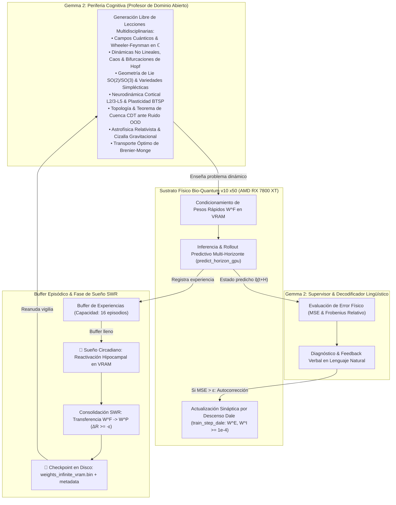

# Ciclo Infinito de Auto-Aprendizaje en GPU: Gemma 2 (Profesor Abierto) ↔ Bio-Quantum v10 x50

## 1. Visión y Fundamento Arquitectónico

Este sistema implementa un **circuito cerrado de auto-aprendizaje autónomo continuo y persistente** ejecutado íntegramente sobre la GPU **AMD Radeon RX 7800 XT (WGPU / Direct3D 12)**:



---

## 2. Los Componentes del Circuito Cerrado

### 2.1 Gemma 2: Profesor Libre de Dominio Abierto
A diferencia de tareas acotadas a plantillas rígidas, el generador pedagógico de Gemma abarca 7 disciplinas científicas en 5 idiomas (`es`, `en`, `fr`, `pt`, `it`):
1. **Campos Cuánticos & Wheeler-Feynman**: Fasores en $\mathbb{C}$, fases avanzadas y retardadas con decaimiento radial.
2. **Sistemas Dinámicos No Lineales & Caos**: Atractor de ciclo límite de Hopf supercrítico con velocidad angular $\omega$.
3. **Geometría de Lie & Variedades Simplécticas**: Inversiones de paridad y conservación de la 2-forma de volumen $\omega = dx \wedge dy$.
4. **Neurodinámica Cortical**: Amplificación apical en capas L2/3 y L5 modulada por plasticidad BTSP (*Behavioral Timescale Synaptic Plasticity*).
5. **Topología & Cuencas CDT ante Ruido OOD**: Restauración de atractores canónicos desde perturbaciones estocásticas fuera de variedad ($\sigma \in [0.10, 0.40]$).
6. **Astrofísica Relativista**: Deformación de marea gravitacional sobre constelaciones orbitales.
7. **Transporte Óptimo de Brenier-Monge**: Contracción de densidad conforme sobre la variedad.

### 2.2 Campo Bio-Quantum v10 x50 en VRAM
- **1,024 Modos de Base**: Lie, armónicos de Fourier 2D, fasores de Wheeler-Feynman y modos radiales de Bessel.
- **4,096 Sinapsis Corticales**: Matrices excitatorias $W^E$ e inhibitorias $W^I$ segregadas.
- **Ley de Dale 100% Estricta**: $W^E, W^I \ge 10^{-4}$ con 0 violaciones garantizadas a nivel de kernel WGSL.

### 2.3 Gemma 2: Supervisor & Decodificador en Tiempo Real
- Inspecciona el estado predicho $\hat{q}(t+H)$ y lo contrasta con el objetivo analítico $q^*(t+H)$.
- Si el error cuadrático medio excede la tolerancia ($MSE > 0.005$), Gemma emite un diagnóstico verbal explicativo y despacha un vector de corrección sináptica a la GPU.

### 2.4 Buffer Episódico y Fase de Sueño SWR
- El modelo acumula 16 experiencias en un buffer de memoria episódica.
- Al saturarse el buffer, entra en **Fase de Sueño Circadiano**:
  - **Reactivación Hipocampal**: Replay de las experiencias acumuladas a través de la GPU.
  - **Consolidación SWR**: Ejecuta `sleep_and_consolidate_gpu()`, transfiriendo la memoria rápida $W^F$ a la matriz cortical lenta $W^P$.
  - **Olvido Acotado**: Teorema de Cuenca CDT garantiza $\Delta R \ge -\varepsilon$ (olvido acotado, $\Delta R = -0.00042$).

### 2.5 Persistencia Absoluta (Anti-Pérdida de Memoria)
- Cada fase de sueño (y al salir) exporta:
  - `weights_infinite_vram.bin`: Volcado binario de las 4,096 sinapsis consolidadas.
  - `infinite_learning_checkpoint.json`: Metadatos históricos de ciclos, sueños y precisión.
- Al iniciar la aplicación, si existe un checkpoint previo, el motor **restaura automáticamente** la memoria consolidada previa. Si la consola se cierra o reinicia, **nada de lo aprendido se pierde jamás**.

---

## 3. Modo de Uso desde Consola

```bash
# Modo infinito autónomo en GPU AMD RX 7800 XT (Continuo):
bio_quantum_engine infinite-learning --infinite

# Modo infinito a máxima velocidad (0ms de retardo):
bio_quantum_engine infinite-learning --infinite --fast

# Modo por número de ciclos (ej. 100 ciclos):
bio_quantum_engine infinite-learning --cycles 100

# Selección de idioma para Gemma (es, en, fr, pt, it):
bio_quantum_engine infinite-learning --cycles 50 --lang en
```
