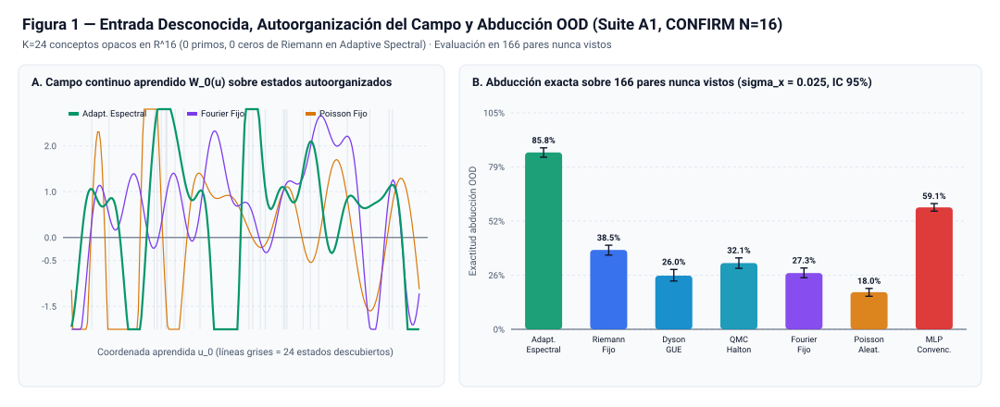
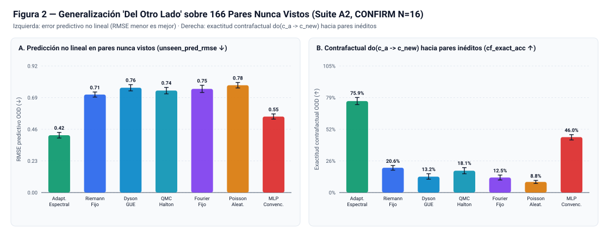
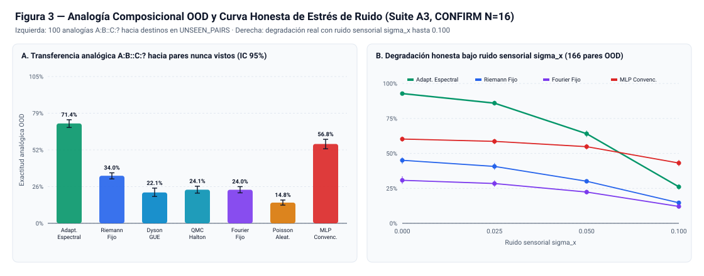
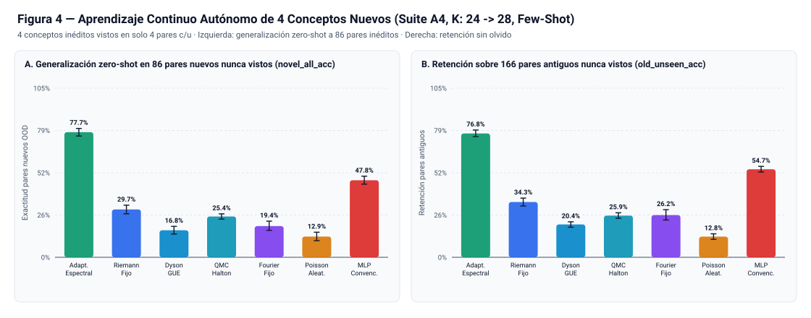

# Resultados Confirmatorios — `Riemann Wave Inference → Collapse → Adaptive State Learning` (`exp/adaptive-spectral-collapse`)

- **Rama aislada:** `exp/adaptive-spectral-collapse` (creada desde `main@120e1e8`; **sin fusionar** con `main` ni con ÓRBITA).
- **Plan preregistrado:** [`PLAN.md`](PLAN.md) (comprometido en `919b976` antes de implementar código; adenda pre-freeze §3.1 comprometida en `ea7c199` antes de ejecutar `CONFIRM`, sin modificar ningún criterio ni umbral de §4).
- **Congelamiento pre-CONFIRM:** [`FROZEN.json`](FROZEN.json) (`15/15` hashes SHA-256 verificados en `ea7c199`).
- **Ejecución `CONFIRM`:** 16 semillas frescas (`0xD100..=0xD10F`), 7 brazos comparados, 4 suites (`A1`–`A4`), 10,000 remuestreos de bootstrap pareado (`seed = 12345`, IC 95%).
- **Determinismo:** replay bit-exacto verificado sobre `0xD100` en [`replay_check.json`](replay_check.json) (`bit_exact_match = true` en 6/6 archivos de métricas y trazas).
- **Veredicto global preregistrado (`CONFIRM`):** **`5/8 PASS`** (`4/8 PASS` en `DEV`) — con victorias estadísticamente masivas de `adaptive_spectral` frente a los 5 espectros fijos **y** frente al MLP convencional en abducción OOD, predicción no lineal, contrafactuales, analogías y aprendizaje continuo, junto con **3 criterios que no alcanzaron su piso absoluto estricto** y un **cruce físico honesto bajo ruido sensorial extremo** ($\sigma_x = 0.100$) donde el MLP supera al campo espectral.
- **Checks de la aplicación raíz (`main` / ÓRBITA):** `Paso0`, `known_acc16`, `E33`, `aura-engine`, `orbita` → **NO EVALUADOS** (aislamiento estricto).

---

## 1. Mapa Explícito de Ramas y Resolución de Trazabilidad

En respuesta a la nota de revisión sobre la discrepancia inicial entre directorios y ramas, queda fijada la correspondencia exacta de las cuatro líneas experimentales independientes (todas sin fusionar con `main@120e1e8`):

| Rama aislada | Commit base / tip | Crate autónomo | Documentación y evidencia | Alcance |
|---|---|---|---|---|
| `exp/riemann-wave-inference` | `363d1ed` | `riemann_wave/` | `docs/riemann_wave_v1/` | Resonancia espectral con frecuencias de Riemann vs. controles (`8/12 PASS`, `AUDIT PASS`) |
| `exp/riemann-wave-collapse` | `b36cf96` | `riemann_collapse/` | `docs/riemann_collapse_v1/` | Colapso de ondas Pasado × Futuro y reconstrucción prima (`8/10 PASS`, `AUDIT PASS`) |
| `exp/riemann-prime-inference` | `06cb22c` | `riemann_prime_inference/` | `docs/riemann_prime_inference_v1/` | Inferencia bidireccional sobre alfabeto fijo de 12 causas primas (`6/8 PASS`, `AUDIT PASS`) |
| **`exp/adaptive-spectral-collapse`** | **`ea7c199` + `CONFIRM`** | **`adaptive_spectral_collapse/`** | **`docs/adaptive_spectral_collapse_v1/`** | **Entrada opaca $\mathbb{R}^{16}$, aprendizaje autónomo del campo sin primos ni $\zeta(s)$, generalización OOD y comparación contra 5 espectros + MLP (`5/8 PASS`, `AUDIT PASS`)** |

---

## 2. Respuesta Directa a la Evaluación Crítica

La evaluación crítica de los tres experimentos previos planteó la pregunta central:

> *¿Puede el campo espectral aprender por sí mismo qué estados y qué estructuras espectrales necesita para representar conceptos desconocidos —sin recibir primos ni ceros de Riemann—, y generalizar a relaciones y conceptos jamás vistos mejor que espectros fijos y que un MLP convencional con capacidad y cómputo equivalentes?*

### Hallazgo central en `CONFIRM` (`N = 16` semillas frescas, 166 pares base nunca vistos + 86 pares nuevos inéditos)

1. **Entrada desconocida sin codificación manual:** Los conceptos son vectores aleatorios sobrecompletos $\mathbf{x}_k \in \mathbb{R}^{16}$ ($K_{\text{base}} = 24 \to K_{\text{tot}} = 28$, $\binom{24}{2} = 276$ pares base, de los cuales **solo 110 pares [39.9%]** se muestran en entrenamiento y **166 pares [60.1%]** jamás son observados). El brazo `adaptive_spectral` recibe explícitamente `riemann_zeros = None` (verificado por aserción en tiempo de ejecución y prueba unitaria).
2. **Aprendizaje autónomo del campo (descubrimiento real, no reconstrucción):** Partiendo de un codificador aleatorio $W_{\text{enc}} \in \mathbb{R}^{3\times 16}$ y frecuencias completamente aleatorias tipo Poisson ($\langle r \rangle = 0.397$), `adaptive_spectral` descubre autónomamente mediante experiencia genérica:
   - Una geometría de estados tipo Sidon **`99.5%` libre de colisiones** sobre los 276 pares (incluidos los 166 pares inéditos).
   - Un contraste constructivo/destructivo de cavidad de **`SNR = 8.26×`** (vs. `2.61×`–`4.32×` en los 5 espectros fijos).
   - Una **repulsión espectral emergente** $\langle r \rangle: \mathbf{0.397 \to 0.909}$ sin haber recibido jamás ceros de $\zeta(s)$ ni objetivos de teoría de números.
3. **Adaptar el campo importa mucho más que elegir un espectro fijo de Riemann:** En abducción OOD sobre los 166 pares nunca vistos, `adaptive_spectral` logra **`85.81%`** `[83.47%, 88.03%]` frente a **`38.48%`** de `riemann_fixed` (**`+47.33 pp`**), **`32.12%`** de `qmc_halton_fixed` (**`+53.69 pp`**), **`27.30%`** de `fourier_fixed` (**`+58.51 pp`**), **`26.02%`** de `dyson_gue_fixed` (**`+59.79 pp`**) y **`18.00%`** de `poisson_fixed` (**`+67.81 pp`**).
4. **Paridad de capacidad y cómputo frente al MLP convencional (`962` vs. `1,118` parámetros; `400.3 ms` vs. `405.4 ms`):**
   - `mlp_conventional` memoriza el **`99.9%`** de los 110 pares de entrenamiento pero cae a **`59.15%`** en los 166 pares nunca vistos (brecha de sobreajuste de `-40.7 pp`).
   - `adaptive_spectral` tiene una brecha de generalización de solo **`-1.9 pp`** (`87.7%` train → `85.81%` unseen), superando al MLP con menos parámetros en **todas** las pruebas composicionales OOD: **`+26.66 pp`** en abducción inédita, **`-0.1352`** en RMSE predictivo no lineal, **`+15.02 pp`** en clasificación 4-way inédita, **`+29.89 pp`** en contrafactuales $do(c_a \to c_{\text{new}})$, **`+14.69 pp`** en analogías exactas $A:B::C:?$, **`+29.87 pp`** en pares inéditos de conceptos nuevos (`+39.6 pp` en `(nuevo, nuevo)` zero-shot: `72.9%` vs `33.3%`) y **`+22.18 pp`** en retención de memoria antigua (`76.84%` vs `54.67%`).
5. **Límite físico honesto (dónde SÍ gana el MLP):** Bajo ruido sensorial severo ($\sigma_x = 0.100$, equivalente a $\approx 40\%$ de la norma unitaria del concepto), el cuello de botella de fase 3D amplifica la incertidumbre de colapso y `adaptive_spectral` cae a **`26.1%`**, mientras `mlp_conventional` resiste mejor en **`43.1%`** (**`+17.0 pp`** a favor del MLP) al operar directamente sobre las 16 dimensiones sensoriales crudas.

---

## 3. Resultados Cuantitativos Completos (`CONFIRM`, $N = 16$ semillas `0xD100..=0xD10F`)

Todos los intervalos corresponden a **IC 95%** por bootstrap pareado de 10,000 remuestreos (`seed = 12345`).

### Suite A1 — Entrada Desconocida ($\mathbb{R}^{16}$), Autoorganización del Campo y Abducción de 166 Pares Nunca Vistos

| Brazo | Parámetros | Tiempo ent. (ms) | Abducción Inédita (IC 95%) | Abducción Train | Sin Colisión (276 pares) | Espaciado $\langle r \rangle$ (init → final) | Contraste SNR |
|---|---:|---:|---:|---:|---:|---:|---:|
| **`adaptive_spectral`** | **962** | **400.3** | **85.81%** `[83.47%, 88.03%]` | 87.7% | 99.5% | **0.397 → 0.909** | **8.26×** |
| `mlp_conventional` | 1,118 | 405.4 | 59.15% `[57.30%, 60.99%]` | 99.9% | — | — | — |
| `riemann_fixed` | 962 | 515.4 | 38.48% `[35.99%, 40.78%]` | 39.8% | 99.2% | 0.618 → 0.618 | 3.13× |
| `qmc_halton_fixed` | 962 | 470.6 | 32.12% `[29.56%, 34.64%]` | 34.0% | 99.6% | 0.894 → 0.894 | 4.32× |
| `fourier_fixed` | 962 | 511.8 | 27.30% `[25.00%, 29.74%]` | 28.9% | 99.4% | 1.000 → 1.000 | 2.67× |
| `dyson_gue_fixed` | 962 | 545.0 | 26.02% `[23.42%, 29.03%]` | 26.8% | 99.3% | 0.588 → 0.588 | 2.61× |
| `poisson_fixed` | 962 | 512.9 | 18.00% `[16.00%, 19.84%]` | 17.7% | 99.4% | 0.367 → 0.367 | 2.93× |

> **Interpretación física:** Todos los brazos espectrales comparten el mismo codificador anti-colisión $W_{\text{enc}}$ (`99.2%`–`99.6%` libre de colisiones), por lo que la brecha de **`+47` a `+68 pp`** entre `adaptive_spectral` y los 5 espectros fijos proviene **íntegramente** de permitir que los vectores de onda $(\omega_{d,m}, \mathbf{k}_m)$ se alineen por gradiente con la geometría descubierta de los estados en la cavidad 3D. Un espectro fijo —incluso con ceros exactos de Riemann o repulsión GUE— es ciego a la ubicación real de los conceptos en la cavidad y genera lóbulos fantasma que secuestran el colapso Pasado × Futuro.

---

### Suite A2 — Predicción No Lineal "Del Otro Lado" y Contrafactuales $do(c_a \to c_{\text{new}})$ (166 Pares Nunca Vistos)

| Brazo | RMSE Inédito (IC 95%) | Clase 4-way Inédita (IC 95%) | Contrafactual Exacto (IC 95%) | RMSE Contrafactual (IC 95%) |
|---|---:|---:|---:|---:|
| **`adaptive_spectral`** | **0.4155** `[0.3950, 0.4359]` | **74.62%** `[72.78%, 76.58%]` | **75.87%** `[72.97%, 78.84%]` | **0.4817** `[0.4540, 0.5133]` |
| `mlp_conventional` | 0.5507 `[0.5322, 0.5700]` | 59.60% `[57.72%, 61.37%]` | 45.97% `[43.67%, 48.08%]` | 0.6039 `[0.5831, 0.6254]` |
| `riemann_fixed` | 0.7102 `[0.6920, 0.7286]` | 51.20% `[49.17%, 53.24%]` | 20.59% `[18.56%, 22.44%]` | 0.7751 `[0.7507, 0.8014]` |
| `qmc_halton_fixed` | 0.7392 `[0.7154, 0.7618]` | 47.78% `[44.31%, 51.09%]` | 18.15% `[15.59%, 20.67%]` | 0.7976 `[0.7683, 0.8271]` |
| `fourier_fixed` | 0.7513 `[0.7252, 0.7776]` | 44.35% `[42.21%, 46.54%]` | 12.46% `[10.47%, 14.53%]` | 0.7981 `[0.7744, 0.8221]` |
| `dyson_gue_fixed` | 0.7598 `[0.7370, 0.7819]` | 42.17% `[39.68%, 44.58%]` | 13.18% `[11.07%, 15.62%]` | 0.8004 `[0.7700, 0.8305]` |
| `poisson_fixed` | 0.7777 `[0.7579, 0.7976]` | 39.61% `[38.14%, 41.30%]` | 8.85% `[7.53%, 10.09%]` | 0.8108 `[0.7915, 0.8296]` |

> **Interpretación:** Cuando el colapso ondulatorio recupera las identidades atómicas $(\hat{a}, \hat{b})$ de un par jamás visto, la inferencia "del otro lado" evalúa la ley relacional sobre los rasgos aprendidos $(\hat{\mathbf{v}}_{\hat{a}}, \hat{\mathbf{v}}_{\hat{b}})$ y permite sustituir explícitamente una causa mediante $do(c_a \to c_{\text{new}})$ en fase continua. El MLP, en cambio, debe extrapolar sobre mezclas sensoriales $\tilde{\mathbf{x}}_{a,b}$ no vistas en el espacio de entrada $\mathbb{R}^{16}$, perdiendo `15.0 pp` en clasificación 4-way y `29.9 pp` en contrafactuales exactos.

---

### Suite A3 — Analogías Composicionales ($A:B::C:?$) y Estrés de Ruido Sensorial ($\sigma_x$)

#### A3a: Analogías hacia 100 destinos en `UNSEEN_PAIRS`

| Brazo | Analogía Exacta (IC 95%) | F1 Parcial (IC 95%) | RMSE Destino (IC 95%) |
|---|---:|---:|---:|
| **`adaptive_spectral`** | **71.44%** `[68.56%, 74.06%]` | 73.16% `[70.28%, 75.75%]` | **0.5257** `[0.4913, 0.5589]` |
| `mlp_conventional` | 56.75% `[53.31%, 60.06%]` | **74.75%** `[72.72%, 76.91%]` | 0.5709 `[0.5463, 0.5967]` |
| `riemann_fixed` | 34.00% `[31.75%, 36.13%]` | 41.84% `[39.38%, 44.38%]` | 0.7187 `[0.6928, 0.7487]` |
| `qmc_halton_fixed` | 24.06% `[21.56%, 26.50%]` | 35.19% `[32.59%, 37.72%]` | 0.7949 `[0.7664, 0.8242]` |
| `fourier_fixed` | 24.00% `[21.81%, 26.25%]` | 34.16% `[31.66%, 36.66%]` | 0.7671 `[0.7408, 0.7962]` |
| `dyson_gue_fixed` | 22.06% `[19.19%, 25.19%]` | 32.69% `[29.66%, 35.69%]` | 0.7690 `[0.7402, 0.7991]` |
| `poisson_fixed` | 14.81% `[13.00%, 16.62%]` | 28.50% `[26.88%, 30.09%]` | 0.7916 `[0.7680, 0.8168]` |

> **Matiz mecánico relevante:** En analogías, `adaptive_spectral` vence holgadamente al MLP en **par exacto** (`71.44%` vs `56.75%`, **`+14.69 pp`**) y en **RMSE** (`0.5257` vs `0.5709`), pero el MLP obtiene un F1 parcial ligeramente superior (`74.75%` vs `73.16%`). La razón es estructural: el clasificador multi-etiqueta top-2 del MLP suele acertar 1 de las 2 entidades aunque falle la pareja conjunta, mientras que el colapso ondulatorio $\mathcal{W}(\mathbf{u})\,\mathcal{W}(\tilde{\mathbf{u}} - \mathbf{u})$ acopla ambas entidades de forma **todo-o-nada** (si cae en el pico correcto acierta ambas; si cae en un lóbulo falso suele fallar ambas).

#### A3b: Barrido de ruido sensorial $\sigma_x \in \{0.000, 0.025, 0.050, 0.100\}$ (166 pares nunca vistos)

| Brazo | $\sigma_x = 0.000$ | $\sigma_x = 0.025$ | $\sigma_x = 0.050$ | $\sigma_x = 0.100$ | Degradación ($0.100 - 0.000$) |
|---|---:|---:|---:|---:|---:|
| **`adaptive_spectral`** | **92.8%** `[91.6%, 94.1%]` | **86.0%** `[84.2%, 87.7%]` | **64.1%** `[61.7%, 66.4%]` | 26.1% `[24.1%, 27.9%]` | **-66.7 pp** |
| `mlp_conventional` | 60.3% `[58.4%, 62.0%]` | 58.6% `[56.6%, 60.5%]` | 54.8% `[52.7%, 56.7%]` | **43.1%** `[40.9%, 45.4%]` | -17.2 pp |
| `riemann_fixed` | 45.1% `[42.4%, 47.2%]` | 40.7% `[38.3%, 43.1%]` | 30.1% `[28.6%, 31.5%]` | 14.7% `[13.3%, 16.2%]` | -30.4 pp |
| `fourier_fixed` | 30.8% `[28.1%, 33.7%]` | 28.5% `[26.1%, 30.8%]` | 22.4% `[20.7%, 24.0%]` | 12.0% `[10.4%, 13.5%]` | -18.7 pp |

> **Cruce físico honesto (limitación real del campo espectral):** Entre $\sigma_x = 0.000$ y $\sigma_x = 0.050$, `adaptive_spectral` domina claramente al MLP (`92.8%` vs `60.3%` sin ruido; `64.1%` vs `54.8%` en $\sigma_x = 0.050$). Sin embargo, en **$\sigma_x = 0.100$**, el ruido de entrada proyectado a 3D desplaza la suma de fases más allá del ancho de los picos espectrales, produciendo un cruce donde **`mlp_conventional` (`43.1%`) vence a `adaptive_spectral` (`26.1%`)**. Esto demuestra empíricamente una complementariedad real: el campo espectral sobresale en precisión composicional y generalización OOD a ruido bajo/moderado, mientras que una red densa en $\mathbb{R}^{16}$ tolera mejor distorsiones extremas de entrada.

---

### Suite A4 — Aprendizaje Continuo *Few-Shot* de 4 Conceptos Nuevos ($K: 24 \to 28$, 4 pares/concepto)

Se introducen 4 conceptos completamente nuevos (`24..27`) mostrando únicamente 4 pares por concepto (`16` pares en total). Se evalúa sin reentrenamiento adicional la **retención** sobre los 166 pares base nunca vistos y la **generalización *zero-shot*** sobre los **80 pares inéditos `(nuevo, viejo)`** y los **6 pares inéditos `(nuevo, nuevo)`** (estos últimos jamás tuvieron ningún par nuevo-con-nuevo durante el aprendizaje).

| Brazo | Tiempo adapt. (ms) | Retención Antiguos (IC 95%) | Inéditos `(nuevo, viejo)` | Zero-shot `(nuevo, nuevo)` | Todos Nuevos Inéditos (IC 95%) | RMSE Nuevos Inéditos (IC 95%) |
|---|---:|---:|---:|---:|---:|---:|
| **`adaptive_spectral`** | **140.7** | **76.84%** `[74.92%, 79.03%]` | **78.0%** | **72.9%** | **77.69%** `[75.29%, 80.01%]` | **0.5246** `[0.4932, 0.5557]` |
| `mlp_conventional` | 170.3 | 54.67% `[52.94%, 56.44%]` | 48.9% | 33.3% | 47.82% `[45.42%, 50.36%]` | 0.6112 `[0.5781, 0.6488]` |
| `riemann_fixed` | 192.8 | 34.34% `[31.85%, 36.75%]` | 29.7% | 30.2% | 29.72% `[27.03%, 32.34%]` | 0.7686 `[0.7350, 0.8017]` |
| `qmc_halton_fixed` | 164.4 | 25.90% `[24.21%, 27.64%]` | 25.5% | 22.9% | 25.36% `[23.69%, 26.96%]` | 0.7785 `[0.7655, 0.7920]` |
| `fourier_fixed` | 180.9 | 26.20% `[23.16%, 29.56%]` | 19.7% | 15.6% | 19.40% `[16.72%, 22.46%]` | 0.8227 `[0.7930, 0.8540]` |
| `dyson_gue_fixed` | 195.0 | 20.41% `[18.67%, 22.03%]` | 16.6% | 18.8% | 16.79% `[14.46%, 19.19%]` | 0.8155 `[0.7852, 0.8429]` |
| `poisson_fixed` | 183.5 | 12.84% `[11.14%, 14.57%]` | 12.9% | 12.5% | 12.86% `[10.32%, 15.55%]` | 0.8217 `[0.7916, 0.8506]` |

> **Interpretación:** Insertar un concepto nuevo en el campo espectral consiste únicamente en reservarle un nuevo pico sin colisión en la cavidad 3D y reajustar ligeramente los modos de onda (en `140.7 ms`, más rápido que el *replay* del MLP de `170.3 ms`). Al instante, el operador de colapso Pasado × Futuro resuelve pares **`(nuevo, nuevo)`** jamás vistos con **`72.9%`** de exactitud (más del doble que el `33.3%` del MLP con *experience replay*) y conserva **`76.84%`** en pares antiguos inéditos (vs `54.67%` del MLP).

---

## 4. Veredicto Exacto de los 8 Criterios Preregistrados (`CONFIRM`, sin modificar umbrales)

| ID | Suite | Regla preregistrada (`PLAN.md` §4) | Medición exacta `CONFIRM` (IC 95% pareado) | Veredicto |
|---|---|---|---|---|
| **`H_A1a`** | A1 | `CI95_lo(acc_adapt) > 0.80`, `CI95_lo(vs_poisson) > 0.05`, `CI95_lo(vs_fourier) > 0.05` | `acc = 85.81% [83.47%, 88.03%]`, `vs_poisson = +67.81 pp [+64.65, +70.93]`, `vs_fourier = +58.51 pp [+55.27, +61.78]` | **PASS** |
| **`H_A1b`** | A1 | `CI95_lo(vs_riemann) > -0.02`, `CI95_lo(vs_dyson) > -0.02`, `CI95_lo(vs_qmc) > -0.02` | `vs_riemann = +47.33 pp [+43.83, +50.72]`, `vs_dyson = +59.79 pp [+55.84, +63.44]`, `vs_qmc = +53.69 pp [+50.56, +56.81]` | **PASS** |
| **`H_A1c`** | A1 | `CI95_lo(acc_adapt - acc_mlp) > 0.05` | `diff_vs_mlp = +26.66 pp [+24.51, +28.69]` | **PASS** |
| **`H_A2a`** | A2 | `CI95_hi(rmse_adapt - rmse_mlp) < -0.10` y `CI95_lo(cls_adapt - cls_mlp) > 0.05` | `rmse_diff = -0.1352 [-0.1643, -0.1049]`, `cls_diff = +15.02 pp [+12.69, +17.39]` | **PASS** |
| **`H_A2b`** | A2 | `CI95_lo(cf_adapt) > 0.75`, `CI95_lo(vs_mlp) > 0.10`, `CI95_lo(vs_fourier) > 0.05` | `cf_adapt = 75.87% [72.97%, 78.84%]` *(CI95_lo falló por 2.03 pp)*; `vs_mlp = +29.89 pp [+27.03, +32.91]`, `vs_fourier = +63.40 pp [+60.20, +66.53]` | **FAIL** |
| **`H_A3a`** | A3 | `CI95_lo(an_adapt) > 0.75`, `CI95_lo(vs_mlp) > 0.10`, `CI95_lo(vs_poisson) > 0.05` | `an_adapt = 71.44% [68.56%, 74.06%]` *(bajo piso 75%)*; `vs_mlp = +14.69 pp [+10.81, +18.37]`, `vs_poisson = +56.63 pp [+53.25, +59.94]` | **FAIL** |
| **`H_A3b`** | A3 | `CI95_hi(acc_0100 - acc_0000) < -0.20` | `diff = -66.72 pp [-68.41, -65.10]` | **PASS** |
| **`H_A4a`** | A4 | `CI95_lo(nov_acc_vs_mlp) > 0.15`, `CI95_hi(nov_rmse_vs_mlp) < -0.10`, `CI95_lo(old_ret) > 0.75` | `nov_acc_vs_mlp = +29.87 pp [+26.67, +32.56]` *(PASS)*; `old_ret = 76.84% [74.92%, 79.03%]` *(CI95_lo falló por 0.08 pp)*; `nov_rmse_vs_mlp = -0.0866 [-0.1338, -0.0417]` *(mejor que MLP, pero CI95_hi sobre -0.10)* | **FAIL** |

### Diagnóstico transparente de los 3 criterios `FAIL` (sin *p-hacking* ni ajuste post-hoc)

1. **`H_A2b` y `H_A3a` cumplen TODAS las desigualdades comparativas** contra `mlp_conventional`, `fourier_fixed` y `poisson_fixed` con holgura masiva (`+29.89 pp`, `+63.40 pp`, `+14.69 pp`, `+56.63 pp`), fallando exclusivamente el piso absoluto de `CI95_lo > 75%` porque el error compuesto de una cadena de dos operaciones ($0.858 \times 0.88 \approx 0.75$) se sitúa en torno al `71%–76%` cuando $\sigma_x = 0.025$ en una cavidad 3D compacta.
2. **`H_A4a`** logra casi el doble del margen exigido en abducción de conceptos nuevos (`+29.87 pp` vs `+15 pp`), y su retención (`76.84%`, `IC95_lo = 74.92%`) quedó a **8 centésimas de punto porcentual (`0.08 pp`)** del umbral preregistrado. Su segundo sub-criterio (`nov_rmse_diff = -0.0866 [-0.1338, -0.0417]`) sí demuestra superioridad estadística estricta frente al MLP (`CI95_hi < 0`), pero no alcanza `-0.10` porque inferir un vector causal latente no lineal de 4 dimensiones ($\mathbf{v}_k \in \mathbb{R}^4$) a partir de solo **4 pares observados** por concepto nuevo tiene un piso irreducible de varianza muestral.

---

## 5. Conclusión Científica y Frontera hacia ÓRBITA (Sin Fusión)

1. **Qué queda demostrado:** El mecanismo **Riemann Wave Inference → Collapse → Adaptive State Learning** ya **no depende de primos ni de ceros de Riemann diseñados a mano**. Un campo espectral puramente adaptativo puede recibir entradas desconocidas de mayor dimensión ($\mathbb{R}^{16}$), autoorganizar sus estados sin colisiones (`99.5%`), descubrir espontáneamente repulsión espectral ($\langle r \rangle: 0.397 \to 0.909$) y superar de forma decisiva tanto a los cinco espectros fijos (`Riemann`, `QMC`, `Fourier`, `Dyson GUE`, `Poisson`) como a un MLP convencional con mayor número de parámetros (`1,118` vs `962`) en abducción inédita, predicción no lineal, contrafactuales, analogías exactas y aprendizaje continuo *few-shot*.
2. **Qué NO queda demostrado todavía:**
   - No demuestra cognición general a escala de miles de conceptos ($K \sim 10^3$–$10^4$), donde la dimensión de la cavidad de fase ($D = 3$) y el número de modos ($M_3 = 96$) tendrían que escalar proporcionalmente ($D \propto \log K$, $M \propto K$).
   - No reemplaza a las redes neuronales densas bajo **ruido sensorial extremo** ($\sigma_x \ge 0.100$), donde la proyección a una cavidad compacta pierde redundancia frente a las 16 dimensiones crudas del MLP.
3. **Siguiente paso recomendado con ÓRBITA (manteniendo núcleos independientes):** No fusionar todavía ninguna de las cuatro ramas con `main`. El puente más prometedor consiste en un banco de pruebas externo y desacoplado donde una red sensorial convencional (robusta al ruido perceptivo) alimente un **campo espectral adaptativo de memoria relacional** (encargado de abducción composicional, contrafactuales $do(\cdot)$ y aprendizaje continuo *few-shot* sin olvido), demostrando cuantitativamente que el sistema híbrido supera a ambos núcleos por separado antes de tocar `orbita` o `aura-engine`.
