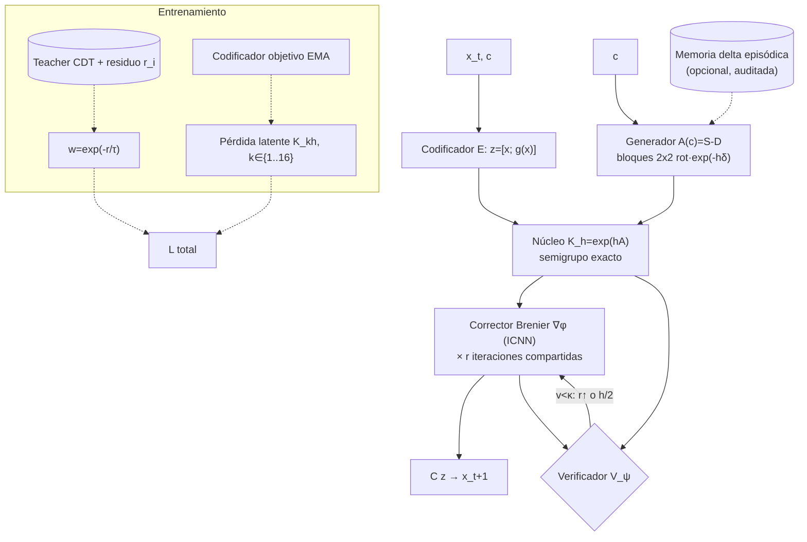

# ÓRBITA — Operador Recurrente con Base Isométrica, Transporte y Autoverificación

**Rama:** `exp/arquitectura-optimizada` · **Fecha:** 2026-10-13 · **Estado:** diseño. No se ha implementado ni ejecutado nada. **Este documento no contiene resultados.** Todas las cifras del proyecto citadas vienen de `docs/resultados_v4.md` (§16, main).
**Fuentes:** literatura verificada (§1; cada enlace arXiv se comprobó el 2026-10-13 leyendo el título en arxiv.org) + `github.com/openai/math` @ `1581d4c` (manuscritos generados por modelo; su `README.md` advierte que los resultados no formalizados pueden tener errores). [ANALOGÍA] marca las conexiones teorema→componente que no son consecuencias formales.

---

## 0. Problema a resolver (de los docs del proyecto)

1. **Horizonte 16:** E3 §16 llega a región 8 (13/16 DEV, 9/16 CONFIRM, en el umbral), con acc h16 ≈ 0.26/0.22. Las perturbaciones no crecen (factor ≈0.99), así que el error es **sesgo lineal** por paso (≈0.9 %).
2. **Superar al MLP:** el control MLP gated de igual capacidad empata (12/16, 10/16). No hay ventaja atribuible a la "dinámica".
3. **Destilación:** la captura del teacher depende de la máscara de confianza; los intentos A/B de destilación directa y la Fase D fallaron.
4. **v5 (en curso, no se toca):** pérdida multi-horizonte k = 1,2,4,8 con 8 evaluaciones de Dφ por ejemplo.

Consecuencia de diseño: lo que hace falta es **una estructura que el MLP no tenga y que reduzca el sesgo compuesto**, no más capacidad. Con $L\approx1$, Gronwall discreto da $e_H\approx H\varepsilon$, de modo que h16 requiere $\varepsilon\lesssim 5\%/16\approx0.3\%$ (aritmética, no medición).

## 1. Estado del arte revisado (fuentes verificadas)

| Familia | Trabajo | Enlace | ¿Se usa? | Por qué |
|---|---|---|---|---|
| SSM selectivo | Gu & Dao 2023, *Mamba* | [2312.00752](https://arxiv.org/abs/2312.00752) | **Sí (idea)** | recurrencia lineal en estado latente con parámetros dependientes de la entrada ⇒ rollout barato y estable |
| SSM/atención | Dao & Gu 2024, *Transformers are SSMs (Mamba-2)* | [2405.21060](https://arxiv.org/abs/2405.21060) | Sí (idea) | dualidad recurrencia ↔ forma matricial: potencias $K^h$ en paralelo |
| Delta rule | Yang et al. 2024, *Parallelizing Linear Transformers with the Delta Rule* | [2406.06484](https://arxiv.org/abs/2406.06484) | **Sí** | actualización de memoria rápida por error ($S\leftarrow S+\beta(v-Sk)k^\top$) |
| Delta + compuerta | Yang, Kautz, Hatamizadeh 2024, *Gated Delta Networks* | [2412.06464](https://arxiv.org/abs/2412.06464) | **Sí** | compuerta de olvido + delta rule: memoria episódica en contexto |
| RNN expresiva | Peng et al. 2025, *RWKV-7 "Goose"* | [2503.14456](https://arxiv.org/abs/2503.14456) | Inspiración | evolución de estado dinámica generalizada del delta rule |
| Memoria en test | Behrouz et al. 2025, *Titans* | [2501.00663](https://arxiv.org/abs/2501.00663) | Opcional (ablación) | memoria que aprende en inferencia; choca con la auditoría de memoria cero ⇒ solo dentro del episodio y auditada |
| MoE | Jiang et al. 2024, *Mixtral*; Dai et al. 2024, *DeepSeekMoE* | [2401.04088](https://arxiv.org/abs/2401.04088), [2401.06066](https://arxiv.org/abs/2401.06066) | No (ablación) | a 2.6k parámetros, el ruteo podría aprender las familias (fuga de estructura) |
| Híbridos | Lieber et al. 2024, *Jamba* | [2403.19887](https://arxiv.org/abs/2403.19887) | Principio | combinar núcleo lineal recurrente y bloque no lineal |
| Operadores neuronales | Li et al. 2020, *FNO* | [2010.08895](https://arxiv.org/abs/2010.08895) | No | requiere una malla espacial; el estado aquí es un vector |
| Koopman | Lusch, Kutz, Brunton 2018 | [1712.09707](https://arxiv.org/abs/1712.09707) | **Sí (núcleo)** | coordenadas latentes donde la dinámica es lineal; pérdidas de reconstrucción/linealidad/predicción multi-paso |
| Hamiltoniano | Greydanus et al. 2019, *HNN*; Jin et al. 2020, *SympNets* | [1906.01563](https://arxiv.org/abs/1906.01563), [2001.03750](https://arxiv.org/abs/2001.03750) | **Sí (estructura)** | generador antisimétrico ⇒ conservación; aquí $K=\exp(h(S-D))$ |
| Flow matching | Lipman et al. 2022; Liu et al. 2022 (*Rectified Flow*) | [2210.02747](https://arxiv.org/abs/2210.02747), [2209.03003](https://arxiv.org/abs/2209.03003) | No (justificado) | modela distribuciones; la tarea es determinista. Solo la idea "trayectorias rectas" inspira el término de semigrupo |
| Equivariancia | Satorras et al. 2021, *EGNN*; Bronstein et al. 2021, *GDL* | [2102.09844](https://arxiv.org/abs/2102.09844), [2104.13478](https://arxiv.org/abs/2104.13478) | Parcial | sesgo isométrico vía grupo ortogonal en el latente, sin fijar familias |
| JEPA / world models | Assran et al. 2023, *I-JEPA*; Assran et al. 2025, *V-JEPA 2*; Hafner et al. 2023, *DreamerV3* | [2301.08243](https://arxiv.org/abs/2301.08243), [2506.09985](https://arxiv.org/abs/2506.09985), [2301.04104](https://arxiv.org/abs/2301.04104) | **Sí (pérdida)** | predicción en el espacio latente contra un codificador objetivo EMA; imaginación multi-paso en latente |
| Profundidad recurrente | Giannou et al. 2023, *Looped Transformers*; Geiping et al. 2025, *Recurrent Depth*; Hao et al. 2024, *Coconut* | [2301.13196](https://arxiv.org/abs/2301.13196), [2502.05171](https://arxiv.org/abs/2502.05171), [2412.06769](https://arxiv.org/abs/2412.06769) | **Sí** | refinar con el mismo bloque $r$ veces: más cómputo sin más parámetros |
| Verificadores | Lightman et al. 2023, *Let's Verify Step by Step* | [2305.20050](https://arxiv.org/abs/2305.20050) | **Sí** | puntuación por paso que decide cuánto refinar |
| Optimizadores/escalado | Yang et al. 2022, *Tensor Programs V (µP)*; Liu et al. 2025, *Muon is Scalable*; Jordan 2024, blog *Muon* | [2203.03466](https://arxiv.org/abs/2203.03466), [2502.16982](https://arxiv.org/abs/2502.16982), [kellerjordan.github.io/posts/muon](https://kellerjordan.github.io/posts/muon/) | **Sí** | Muon para matrices (ortogonalización de la actualización) y µP para E42 (escalado) |
| Base TCV-Net | Amos et al. 2017, *ICNN*; Chen et al. 2018, *Neural ODE*; Czarnecki et al. 2017, *Sobolev Training* | [1609.07152](https://arxiv.org/abs/1609.07152), [1806.07366](https://arxiv.org/abs/1806.07366), [1706.04859](https://arxiv.org/abs/1706.04859) | Sí | corrector de transporte convexo, tiempo continuo, pérdida Jacobiana |

## 2. Qué se fusiona y por qué (decisión razonada)

| Problema | Componente de ÓRBITA | Literatura | openai/math (ID, archivo) |
|---|---|---|---|
| Horizonte 16 | **Núcleo Koopman espectral**: $z_{t+h}=K(c)^{h}z_t$ con $K=\exp(h(S-D))$, $S$ antisimétrica y $D\succeq0$ | Koopman, HNN/SympNets, Mamba-2 | 148 `preprints/The-entropy-rate-dimension-formula-for-self-similar-measures-on-the-line-September-24-2026/main.pdf` (contracción media χ) [ANALOGÍA] |
| Sesgo compuesto | Pérdida multi-horizonte **analítica** ($K^h$ cerrado, sin desenrollar), más término de sesgo medio | Lusch 2018, JEPA | Gronwall [ESTÁNDAR] |
| Superar al MLP | Estructura que el MLP no tiene: grupo ortogonal + semigrupo exacto $K^{a+b}=K^aK^b$ en el latente | GDL, Neural ODE | 374 `Brenier.lean` (corrector como mapa óptimo) [ANALOGÍA] |
| Precisión de un paso | **Corrector de transporte** $\nabla\varphi$ (ICNN) refinado con profundidad recurrente $r$ | ICNN, Recurrent Depth | 374, 139 `LogConcaveQuery.lean` (curvatura acotada) [ANALOGÍA] |
| Destilación | Pesos continuos $w=e^{-r/\tau}$ + Sobolev + objetivo latente EMA | Sobolev Training, JEPA | 374 (sensibilidad $W_2^{1/3}$), 093 (LSI), 140 `NoiselessRegression.lean` (presupuesto de muestras) [ANALOGÍA] |
| Cómputo adaptativo | **Verificador por paso** que decide $r$ y si se subdivide | PRM | `lean/ComparatorChallenges/README.md` (par enunciado/prueba) [INSPIRACIÓN] |
| Contexto episódico (opcional) | Memoria delta con compuerta, solo dentro del episodio | Gated DeltaNet, Titans | 140 (memoria acotada) [ANALOGÍA] |
| Optimización | Muon (matrices) + Adam (vectores/escalares), µP para escalar ancho | Muon, µP | 139 (buen condicionamiento) [ANALOGÍA] |

**Descartado:** atención softmax (sin secuencia larga; empataría con la cabeza §16), FNO (sin malla), flow matching (la tarea es determinista) y MoE (riesgo de que el ruteo memorice familias; queda como ablación A8).

## 3. Arquitectura y ecuaciones

Notación: $x_t\in\mathbb R^d$ estado del generador, $c$ contexto permitido por el protocolo, $m$ dimensión latente ($m\ge d$, par), $h$ paso temporal.

### 3.1 Codificador / decodificador (coordenadas tipo Koopman)
$$z_t=E_\theta(x_t)=\begin{bmatrix}x_t\\ g_\theta(x_t)\end{bmatrix}\in\mathbb R^{m},\qquad \hat x_t=Cz_t=[I_d\;0]\,z_t .$$
Las primeras $d$ coordenadas son el propio estado, así que el decodificador es exacto y lineal: no hay error de autoencoder en $x$, a diferencia de Lusch 2018. $g_\theta$ es un MLP pequeño que añade observables no lineales (p. ej. productos $q\cdot\mathrm{trig}(p)$, que en §16 resolvía la cabeza multiplicativa).

### 3.2 Núcleo espectral (selectivo en el contexto)
$$A(c)=S(c)-D(c),\quad S=B-B^\top,\quad D=\mathrm{diag}\big(\mathrm{softplus}(\delta(c))\big)\,P_\perp^{z},\qquad K_h(c)=\exp\big(h\,A(c)\big).$$
- Sobre el subespacio "tangente" ($D=0$), $K_h$ es ortogonal: conserva la norma, como una rotación/isometría (estructura hamiltoniana lineal; HNN/SympNets).
- En el subespacio "normal", $\|K_h\|\le e^{-h\,\delta_{\min}}<1$: exponente de Lyapunov normal negativo [ANALOGÍA con χ de 148].
- **Semigrupo exacto:** $K_{a}K_{b}=K_{a+b}$, así que $z_{t+H}=K_{Hh}z_t$ se calcula en un solo `matrix_exp`. El MLP no tiene esta propiedad.
- Selectividad (idea de Mamba): $B,\delta$ dependen de $c$, no del estado, para que la parte lineal siga siendo lineal. Por tipo de bloque, la forma de $S$ es *block-diagonal 2×2* (pares de rotaciones con frecuencias $\omega_j(c)$), lo que da $\exp$ cerrado con coste $O(m)$:
$$K_h=\mathrm{blkdiag}_j\Big(e^{-h\delta_j}\begin{bmatrix}\cos h\omega_j&-\sin h\omega_j\\ \sin h\omega_j&\cos h\omega_j\end{bmatrix}\Big)\ \text{en una base } Q(c)\ \text{ortogonal}.$$
$Q(c)$ se parametriza con Cayley de una antisimétrica de rango bajo. `reflect` (det −1) se representa con un bloque de signo **aprendido y continuo** (un $\omega_j=\pi/h$ es una reflexión en ese plano), sin rama por familia.

### 3.3 Corrector no lineal de transporte con profundidad recurrente
$$z^{(0)}=K_h z_t,\qquad z^{(k+1)}=z^{(k)}+\eta\,\big(\nabla_z\varphi_\theta(z^{(k)};c,z_t)-z^{(k)}\big),\quad k=0..r-1,$$
con $\varphi_\theta=\tfrac{1}{2}\|z\|^2+\mathrm{ICNN}_\theta$ y $\alpha I\preceq\nabla^2\varphi\preceq\beta I$ (normalización espectral). Es un mismo bloque iterado $r$ veces, en el espíritu de la profundidad recurrente de Geiping 2025, y cada iteración es un mapa de Brenier [ESTÁNDAR: Brenier 1991] restringido a curvatura acotada [ANALOGÍA 139]. El corrector se entrena para ser pequeño (el término $\lambda_C$ abajo), de modo que el grueso de la dinámica quede en el núcleo lineal.

### 3.4 Verificador por paso (PRM)
$$v_t=V_\psi(z_t,z^{(r)},c)\in[0,1],\qquad \mathcal L_V=\mathrm{BCE}\big(v_t,\ \mathbb 1(\mathrm{rel}_t<\tau)\big),\ \text{con stop-grad hacia }\theta.$$
En inferencia: si $v_t<\kappa$, se aumenta $r$ (hasta $r_{\max}$) o se subdivide $h\to h/2$ (exacto en el núcleo gracias al semigrupo). La puntuación del rollout es $\prod_t v_t$ (Lightman 2023).

### 3.5 Memoria episódica delta (opcional, ablación A6)
$$M_t=\alpha_t M_{t-1}+\beta_t\,(u_t-M_{t-1}k_t)k_t^\top,\qquad \Delta\delta(c)\leftarrow \mathrm{lin}(M_t q),$$
alimentada **solo** con los frames de contexto que el protocolo entrega antes del free-run (Gated DeltaNet). Se reinicia por episodio y nunca lee CDT/tablas. Pasa la auditoría o se descarta.

### 3.6 Pérdidas
Con objetivo latente EMA $\bar E$ (estilo JEPA) y horizontes $\mathcal H=\{1,2,4,8,16\}$:
$$\begin{aligned}
\mathcal L=&\sum_i w_i\Big[\underbrace{\tfrac{\|C\,z^{(r)}_{i}-x_{i,t+1}\|^2}{\|x_{i,t+1}-x_{i,t}\|^2}}_{\text{1 paso}}+\lambda_H\sum_{k\in\mathcal H}\gamma^{k}\underbrace{\|K_{kh}E(x_{i,t})-\bar E(x_{i,t+k})\|^2}_{\text{latente multi-horizonte, analítico}}\Big]\\
&+\lambda_S\,\mathbb E\,w\|J_x\Phi-J_xT\|_F^2+\lambda_B\big\|\mathbb E_{\text{batch}}[C z^{(r)}-x_{t+1}]\big\|^2+\lambda_C\,\mathbb E\|z^{(r)}-K_hz_t\|^2+\lambda_V\mathcal L_V ,
\end{aligned}$$
con $w_i=\exp(-r_i/\tau)$ (residuo del teacher) [ANALOGÍA 374]. El término multi-horizonte cuesta una multiplicación por bloque 2×2 por horizonte, no $k$ evaluaciones de la red como en v5. Esa es la diferencia clave de cómputo. Las coordenadas $x$ del latente no pasan por el EMA (el objetivo sobre ellas es el estado real), así que no hay colapso trivial.

### 3.7 Entrenamiento
- Muon en matrices 2D ($g_\theta$, ICNN, $B$); Adam en vectores/escalares ($\delta,\omega$, sesgos). Recomendación del blog de Jordan y de Liu et al. 2025.
- µP para transferir hiperparámetros entre anchos (E42).
- Currículo: (i) solo núcleo + 1 paso; (ii) + multi-horizonte latente; (iii) + corrector con $r=1\to r_{\max}$; (iv) + verificador.
- Hiperparámetros solo con seeds de tuning `0xC500–0xC503`.

### 3.8 Inferencia (free-run E33)
`z = E(x0); for t: z0 = K_h z; z = corrector^r(z0) (r adaptativo con V); x̂ = C z`. Variante "solo núcleo" ($r=0$) para medir cuánto aporta el corrector.

## 4. Diagrama



## 5. Esqueleto PyTorch (ilustrativo, sin ejecutar)

```python
import torch, torch.nn as nn, torch.nn.functional as F, copy
from torch.nn.utils.parametrizations import spectral_norm

class SpectralCore(nn.Module):
    """K_h(c) = Q(c) blkdiag(e^{-hδ} Rot(hω)) Q(c)^T ; semigrupo exacto."""
    def __init__(s, m, c_dim, rank=4):
        super().__init__(); assert m % 2 == 0
        s.m = m; s.head = nn.Linear(c_dim, m // 2 * 2 + m * rank)   # ω, δ, U (Cayley de rango bajo)
        s.rank = rank
    def params(s, c):
        o = s.head(c); j = s.m // 2
        omega, delta = o[..., :j], F.softplus(o[..., j:2*j])
        U = o[..., 2*j:].view(*c.shape[:-1], s.m, s.rank)
        Sk = U @ U.transpose(-1, -2).roll(1, -1); Sk = Sk - Sk.transpose(-1, -2)
        I = torch.eye(s.m, device=c.device).expand_as(Sk)
        Q = torch.linalg.solve(I - Sk / 2, I + Sk / 2)              # ortogonal
        return omega, delta, Q
    def apply(s, z, c, h, mask_perp):                                # h: [B,1]
        omega, delta, Q = s.params(c)
        y = (Q.transpose(-1, -2) @ z[..., None]).squeeze(-1).view(*z.shape[:-1], -1, 2)
        dmp = torch.exp(-h * delta * mask_perp)                     # D solo en subespacio normal
        cs, sn = torch.cos(h * omega), torch.sin(h * omega)
        y = torch.stack([cs * y[..., 0] - sn * y[..., 1], sn * y[..., 0] + cs * y[..., 1]], -1) * dmp[..., None]
        return (Q @ y.reshape(z.shape)[..., None]).squeeze(-1)

class ICNNCorrector(nn.Module):
    def __init__(s, m, c_dim, hdim=32):
        super().__init__()
        s.a = nn.Linear(m + c_dim, hdim); s.b = nn.Linear(m + c_dim, hdim)
        s.z = spectral_norm(nn.Linear(hdim, hdim, bias=False)); s.o = nn.Linear(hdim, 1, bias=False)
    def grad_phi(s, z, c):
        z = z.requires_grad_(True) if not z.requires_grad else z
        u = torch.cat([z, c], -1); a = F.softplus(s.a(u))
        a = F.softplus(F.linear(a, s.z.weight.clamp_min(0)) + s.b(u))
        pot = 0.5 * (z * z).sum(-1) + F.linear(a, s.o.weight.clamp_min(0)).squeeze(-1)
        return torch.autograd.grad(pot.sum(), z, create_graph=True)[0]

class ORBITA(nn.Module):
    def __init__(s, d, c_dim, m, eta=0.5):
        super().__init__()
        s.d, s.m, s.eta = d, m, eta
        s.g = nn.Sequential(nn.Linear(d, 32), nn.Tanh(), nn.Linear(32, m - d))
        s.core = SpectralCore(m, c_dim); s.corr = ICNNCorrector(m, c_dim)
        s.V = nn.Sequential(nn.Linear(2 * m + c_dim, 32), nn.ReLU(), nn.Linear(32, 1))
    def encode(s, x): return torch.cat([x, s.g(x)], -1)
    def step(s, z, c, h, mask, r):
        z0 = s.core.apply(z, c, h, mask); zk = z0
        for _ in range(r): zk = zk + s.eta * (s.corr.grad_phi(zk, c) - zk)
        v = torch.sigmoid(s.V(torch.cat([z, zk.detach(), c], -1))).squeeze(-1)
        return zk, z0, v

def loss(model, ema_g, b, lam, H=(1, 2, 4, 8, 16), gamma=0.9, r=2):
    x, xs, c, h, w, mask, tau = b            # xs: [B, 17, d] futuro verdadero del episodio (solo TRAIN)
    z = model.encode(x); zr, z0, v = model.step(z, c, h, mask, r)
    y = xs[:, 1]; rel = (zr[..., :model.d] - y).norm(dim=-1) / (y - x).norm(dim=-1).clamp_min(1e-12)
    l1 = (w * rel ** 2).mean()
    lh = 0.
    for k in H:                               # multi-horizonte analítico: 1 aplicación del núcleo por k
        zk = model.core.apply(z, c, k * h, mask)
        with torch.no_grad(): tgt = torch.cat([xs[:, k], ema_g(xs[:, k])], -1)
        lh = lh + gamma ** k * (w * ((zk - tgt) ** 2).sum(-1)).mean()
    lb = ((zr[..., :model.d] - y).mean(0) ** 2).sum()
    lc = ((zr - z0) ** 2).sum(-1).mean()
    lv = F.binary_cross_entropy(v, (rel.detach() < tau).float())
    return l1 + lam["H"] * lh + lam["B"] * lb + lam["C"] * lc + lam["V"] * lv   # + λ_S Sobolev por JVP

# Optimizador: Muon (implementación de referencia de K. Jordan) para p.ndim==2; AdamW para el resto.
# ema_g = copy.deepcopy(model.g) actualizado con τ_ema tras cada paso.
```

## 6. Complejidad y cómputo (fórmulas, sin cifras medidas)

Sean $P$ los parámetros, $d$ la dimensión del estado, $m$ la latente, $r$ las iteraciones del corrector, $|\mathcal H|$ los horizontes y $H$ la longitud del rollout.

| Modelo | Forward por paso | Entrenamiento por ejemplo | Rollout de $H$ pasos |
|---|---|---|---|
| E3 §16 (gated, 2590 params) | $O(P)$ | 1 forward+backward | $H\cdot O(P)$ |
| v5 P2 | $O(P)$ | 8 forward+backward (k=1,2,4,8 desenrollados) | $H\cdot O(P)$ |
| TCV-Net | $O(P)+O(d^3)$ (Cayley) + doble backprop | ≈2–3× E3 (doble backprop) | $H\cdot(O(P)+O(d^3))$ |
| **ÓRBITA** | $O(P_g)+O(m\,\text{rank})+r\cdot O(P_{icnn})$ (doble backprop) | $1$ paso completo $+\ |\mathcal H|\cdot O(m\,\text{rank})$ (núcleo cerrado) | $H\cdot$paso, o $O(m\,\text{rank})$ por salto si $r=0$ |

Reglas para comparar con justicia (obligatorias en §8):
- **Parámetros:** $P_{\text{ÓRBITA}}=2590$ (igual que E3/M3) eligiendo $m$, rank y ancho del ICNN. La tabla del preregistro la fija antes de DEV.
- **Cómputo de entrenamiento:** se mide en FLOPs (contando el doble backprop) y en segundos de pared; se iguala con el MLP gated ajustando sus pasos (brazo `MLP_eqc`), como `P2_gated_eqc` en v5.
- **Cómputo de inferencia:** con verificador, se reporta el número medio de iteraciones $\bar r$ y se compara contra el MLP con el mismo presupuesto (p. ej. un MLP aplicado con sub-pasos o un ensemble).

## 7. Plan de datos
1. **Principal:** el generador sellado del proyecto (`generate_and_seal(seed)`), los splits y el teacher CDT con su residuo $r_i$, sin cambios. Las ventanas de futuro $x_{t+1..t+16}$ salen **solo de episodios TRAIN**. La auditoría de fugas de v5 (frames futuros dentro de la bola TEST) se reutiliza.
2. **Verificador:** etiquetas automáticas $\mathbb 1(\mathrm{rel}<\tau)$ y violaciones de invariantes en TRAIN. Control: verificador con etiquetas barajadas.
3. **Corpus `openai/math` (opcional, línea separada F6):** 8007 `.tex` de `preprints/` y 122 876 `.lean` de `lean/` (conteo del clon) para preentrenar un verificador **simbólico** (enunciado ↔ paso de prueba), a partir de los pares `lean/ComparatorChallenges/*.json|*.lean`. Licencia Apache-2.0 con atribución; excluir los manuscritos retirados según `history.md`; split por familia (IDs de `CONTENTS.md`). No se usa en el gate principal: la transferencia texto/Lean → dinámica vectorial no tiene base empírica.

## 8. Fases de construcción (con gate antes de avanzar)
- **F0 Prototipo (Python/JAX o PyTorch):** tests de propiedades: $\|K^\top K-I\|$ sobre el subespacio tangente $<10^{-6}$, $K_aK_b=K_{a+b}$, Hessiano del ICNN PSD y conteo de parámetros = 2590. Smoke en seed `0x5A00`.
- **F1 Solo núcleo** ($r=0$, sin verificador): 1 paso y E33.
- **F2 + corrector** ($r\in\{1,2\}$ fijado en tuning).
- **F3 + destilación** (pesos continuos, Sobolev, objetivo EMA).
- **F4 + verificador** e inferencia adaptativa.
- **F5 Port a Rust** con paridad numérica (como el pipeline JAX↔Rust existente) y proceso nuevo bit-exacto.
- **F6 (opcional)** verificador simbólico sobre el corpus Lean, con preregistro propio.

## 9. Experimentos preregistrables

**Protocolo común:** tuning `0xC500–0xC503`; DEV `0xA400–0xA40F` y luego CONFIRM `0xB400–0xB40F` con el mismo binario/SHA, sin retune. Auditoría queries=0, leakage=0 y proceso nuevo bit-exacto. **Brazos fijos:** `ORBITA`, `E3_v4` (§16, main), `MLP_gated` (2590 params), `MLP_eqc` (MLP con cómputo de entrenamiento igualado a ÓRBITA) y `ORBITA_shuffled` (futuros barajados entre episodios). IC95 bootstrap pareado por seed (10 000 remuestreos, semilla fija). Los criterios se cierran antes de DEV y los negativos se publican.

| # | Hipótesis / predicción falsable | Métrica | Éxito (DEV **y** CONFIRM) | Fallo |
|---|---|---|---|---|
| X1 | Horizonte: ÓRBITA supera a E3 en h16 | acc h16, región E33 | ORBITA − E3 con IC95 > 0 en h16 o en región | IC incluye 0 o < 0 |
| X2 | Superar al MLP a igual cómputo: la estructura espectral/semigrupo da ventaja | acc h16 vs `MLP_eqc` | IC95 > 0 | IC incluye 0 → no hay ventaja estructural |
| X3 | El núcleo solo ($r=0$) ya es no inferior a E3 en 1 paso | acc 1 paso | IC95 inferior > −0.02 | ≤ −0.02 |
| X4 | Sesgo, no varianza: ÓRBITA reduce el sesgo con signo por paso respecto a E3 | $\|\mathbb E[\hat x_{t+1}-x_{t+1}]\|$ sobre la trayectoria verdadera | IC95 < 0 | ≥ 0 |
| X5 | Destilación: pesos continuos + Sobolev elevan la captura del teacher frente a la máscara dura | acc TEST / acc teacher | IC95 > 0 sin empeorar h16 | ≤ 0 |
| X6 | El multi-horizonte analítico iguala o supera al desenrollado de v5 a menor cómputo | h16 y FLOPs de entrenamiento | no inferior (−0.02) con menos FLOPs | inferior |
| X7 | El verificador mejora h16 frente al mismo cómputo de inferencia uniforme | h16 con $\bar r$ igualado | IC95 > 0 | ≤ 0 |
| X8 | Control negativo: `ORBITA_shuffled` no supera a E3 | h16 | IC incluye 0 o < 0 | si supera → fuga o artefacto, invalida X1 |

**Ablaciones (DEV, y CONFIRM solo si DEV muestra efecto):** A1 sin $D$ (sin contracción normal) · A2 sin restricción ortogonal ($A$ libre) · A3 $r=0$ · A4 sin objetivo EMA (objetivo = encoder en línea) · A5 sin Sobolev · A6 + memoria delta episódica · A7 Adam en lugar de Muon · A8 MoE de 4 núcleos con ruteo por $c$ · A9 multi-horizonte solo hasta $k=8$ (como v5).

**Relación con v5:** v5 no se modifica. X6 se ejecuta después de publicar `docs/comparacion_v4_v5.md`, usando el mismo split y el mismo harness.

## 10. Riesgos y limitaciones
- **Analogías:** 148 (dimensión de medidas autosimilares → contracción normal), 374 (estabilidad de Brenier → pesos de confianza y corrector), 093 (LSI → Sobolev), 139 (muestreo log-cóncavo → curvatura acotada), 140 (regresión gaussiana con memoria acotada → presupuesto de replay/memoria) y Comparator → verificador. **Ninguna es una garantía formal para esta red.** Solo son estándar: Brenier (gradiente de convexo), la exponencial de matrices antisimétricas ortogonal, el semigrupo de $\exp(hA)$, Gronwall y las técnicas citadas en §1.
- **Fuente:** los resultados de `openai/math` fueron generados por un modelo; algunos no están formalizados, `history.md` registra retiradas, y los archivos de `ComparatorChallenges` son enunciados con `sorry`.
- **Expresividad del núcleo lineal:** si la dinámica de una familia no admite una representación de Koopman de dimensión finita en $m$ coordenadas, el corrector carga con el error. Hay que vigilar $\lambda_C\|z^{(r)}-K_hz\|$: si crece, el núcleo no está explicando la dinámica.
- **Conocimiento inyectado:** la división tangente/normal ($\mathrm{mask}_\perp$) puede venir del generador. Debe declararse y existir la variante aprendida (A1 lo mide parcialmente).
- **`reflect`:** el bloque de signo continuo puede quedar en una solución intermedia ($\omega\ne\pi/h$); se mide por familia.
- **Cómputo:** el doble backprop del ICNN y el verificador encarecen; sin `MLP_eqc` cualquier ventaja es sospechosa.
- **Muon a escala diminuta:** su beneficio está documentado en modelos grandes; a 2.6k parámetros es incierto (A7 lo mide).
- **Memoria delta / Titans:** puede violar el espíritu de "memoria cero en TEST". Es opcional y está sujeta a auditoría.
- **Resultado posible:** empate con el MLP, como §16. Debe aceptarse y documentarse.
- **Sin cifras:** los umbrales son criterios de decisión preregistrados, no predicciones de resultado.

## Referencias
Ver tabla §1 (enlaces verificados), más: Brenier (1991) *Polar factorization and monotone rearrangement of vector-valued functions*, CPAM. `openai/math` @ `1581d4c`: `README.md`, `CONTENTS.md`, `history.md`, `lean/ComparatorChallenges/{Brenier,NoiselessRegression,LogConcaveQuery}.lean`, PDFs de los resultados 093, 139, 140, 148, 374. Proyecto: `docs/resultados_v4.md` (§16), `docs/comparacion_v4_v5_preregistro.md` (rama v5), `docs/arquitectura_propia_math.md` (TCV-Net, rama `exp/arquitectura-propia-math`).
