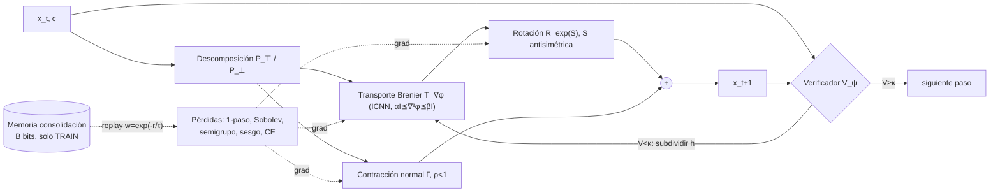

# TCV-Net — Red de Transporte Contractivo Verificado

**Rama:** `exp/arquitectura-propia-math` · **Fecha:** 2026-10-13 · **Estado:** diseño. No se ha implementado ni ejecutado nada. **No hay resultados en este documento.**
**Fuente matemática:** `github.com/openai/math` @ `1581d4c` (clon local `/workspace/research/openai-math`), licencia Apache-2.0 (`LICENSE`). Los teoremas de ese repo los produjo un modelo, y su `README.md` advierte que los no formalizados pueden tener errores. **Toda conexión entre un teorema y una componente de la red es una analogía de diseño**, salvo lo marcado como [ESTÁNDAR], que es literatura publicada.

---

## 1. Idea en una frase

Un paso de dinámica es un **mapa de transporte de Brenier** $\nabla\varphi_\theta$ (gradiente de un potencial convexo) seguido de una **corrección tangente/normal**: es contractiva fuera de la variedad de estados válidos y casi isométrica sobre ella. Lo vigila un **verificador por paso** inspirado en el par enunciado/prueba de Comparator, y lo alimenta una **memoria de consolidación con presupuesto de bits explícito**.

No es un transformer (no usa atención), no es el Dφ residual de v4 ($\Psi+\Delta$) ni la pérdida multi-horizonte de v5. Toma de ellos solo el protocolo de evaluación (E33, DEV/CONFIRM, auditoría queries=0).

## 2. Resultados del repo usados y cómo

| ID | Resultado | Archivo | Uso en TCV-Net | Tipo |
|---|---|---|---|---|
| 374 | Estabilidad 1/3 de mapas de Brenier: $\|T_\mu-T_\nu\|_{L^2(\rho)}\le C\,W_2(\mu,\nu)^{1/3}$, exponente óptimo | `preprints/Sharp-One-Third-Stability-of-Brenier-Maps-September-25-2026/article.pdf`; `lean/ComparatorChallenges/Brenier.lean` (`one_third_stability`, `one_third_exponent_is_sharp`) | (a) parametrizar el paso como mapa óptimo; (b) acotar la sensibilidad del mapa a la contaminación del teacher → peso de confianza | analogía + teorema de Brenier [ESTÁNDAR] |
| 148 | $\dim_H\mu=\min\{1,h_{RW}/\chi\}$, $\chi$ = contracción logarítmica media | `preprints/The-entropy-rate-dimension-formula-for-self-similar-measures-on-the-line-September-24-2026/main.pdf` | módulo de contracción normal con exponente de Lyapunov objetivo $\chi_\perp<0$ | analogía |
| 093 | Log-Sobolev libre de dimensión: $\mathrm{Ent}_\mu(f^2)\le Ca^2\int|Df|^2d\mu$ | `preprints/A-dimension-free-logarithmic-Sobolev-inequality-for-subgaussian-log-concave-measures-September-23-2026/paper.pdf` | pérdida Sobolev: control del Jacobiano ⇒ control de la varianza (vía Poincaré) | analogía |
| 140 | Memoria $o(d^2)$ bits ⇒ $T=\Omega(d\log 1/\epsilon)$ muestras | `preprints/Memory-and-precision-in-noiseless-Gaussian-regression-September-27-2026/paper.pdf` (+5 compañeros); `lean/ComparatorChallenges/NoiselessRegression.lean` | dimensionar la memoria de consolidación y el presupuesto de replay | analogía (la red no es regresión gaussiana) |
| 139 | $I\preceq\nabla^2V\preceq2I$ ⇒ $C_\varepsilon d^\varepsilon$ consultas de gradiente | `preprints/Subpolynomial-query-complexity-for-well-conditioned-log-concave-sampling-September-26-2026/article.pdf`; `LogConcaveQuery.lean` | restringir la curvatura del potencial: $\alpha I\preceq\nabla^2\varphi_\theta\preceq\beta I$ (mapa bi-Lipschitz bien condicionado) | analogía |
| 083 | Hilbert a lo largo de campos Lipschitz, escala $\lesssim 1/\mathrm{Lip}(v)$ | `preprints/A-uniform-Hilbert-transform-estimate-for-Lipschitz-directions-September-25-2026/main.pdf`; `LipschitzHilbert.lean` | paso temporal adaptativo $h\propto 1/\widehat{\mathrm{Lip}}$ | analogía débil |
| Comparator | verificar una prueba contra un enunciado fijo | `lean/ComparatorChallenges/README.md`, pares `*.json`/`*.lean` | diseño del verificador por paso (enunciado = invariante; prueba = transición) | inspiración de diseño |
| Corpus | 8007 `.tex` en `preprints/`, 122 876 `.lean` en `lean/` (conteo del clon) | — | corpus opcional para el verificador simbólico (fase 5) | datos |

## 3. Componentes y ecuaciones

### 3.1 Representación
El estado es $x_t\in\mathbb R^d$ (el vector del generador del proyecto) con contexto $c$ (familia/parámetros, solo si el protocolo lo permite). Un codificador fijo divide el espacio en una parte tangente y una normal a la variedad de estados válidos $\mathcal M$:
$$x=\pi_{\mathcal M}(x)+n,\qquad P_\top(x)=U(x)U(x)^\top,\quad P_\perp=I-P_\top ,$$
con $U(x)$ una base tangente. Puede venir de la geometría conocida del generador (la misma que usa la reproyección V1) o aprenderse por PCA local en TRAIN.

### 3.2 Núcleo de transporte (Brenier)
Teorema de Brenier [ESTÁNDAR]: el mapa óptimo cuadrático es $T=\nabla\varphi$ con $\varphi$ convexa. Se parametriza
$$\varphi_\theta(x;c)=\tfrac{\alpha}{2}\|x\|^2+\mathrm{ICNN}_\theta(x;c),\qquad T_\theta=\nabla_x\varphi_\theta ,$$
con ICNN (Amos et al., 2017 [ESTÁNDAR]: pesos $z\to z$ no negativos y activaciones convexas no decrecientes). Para el condicionamiento (motivado por 139) se pide $\alpha I\preceq\nabla^2\varphi_\theta\preceq\beta I$: el término $\alpha$ da la cota inferior, y la superior se impone recortando la norma espectral por capa (Miyato et al., 2018 [ESTÁNDAR]). Así $T_\theta$ es $\alpha$-fuertemente monótono, invertible y $\beta$-Lipschitz.

**Limitación honesta:** un gradiente de un convexo es simétrico ($\nabla T=\nabla^2\varphi$), así que **no puede representar rotaciones** por sí solo. Por eso se añade 3.3.

### 3.3 Corrección isométrica tangente
$$R_\theta(x;c)=\exp\!\big(S_\theta(x;c)\big),\qquad S_\theta=A_\theta-A_\theta^\top\ \ (\text{antisimétrica}),$$
con $\exp$ matricial (o Cayley $(I-S/2)^{-1}(I+S/2)$ por coste). $R_\theta$ es ortogonal por construcción. Paso completo:
$$\boxed{\;\Phi_\theta(x)=\pi\Big(R_\theta(x)\,T_\theta(x)\Big)+\Gamma_\theta(x)\;}$$
Descomposición polar no lineal: lo simétrico (deformación) lo hace el transporte y lo antisimétrico (giro/reflexión vía signo en $c$) la parte ortogonal. Los productos $q\cdot\mathrm{trig}(p)$ que en v4 resolvía la cabeza local-lineal aparecen aquí como $R_\theta(x)$ dependiente del estado.

### 3.4 Contracción normal (motivada por 148)
$$\Gamma_\theta(x)=-\big(I-\rho_\theta(x)\big)P_\perp n,\qquad \rho_\theta\in(0,\rho_{\max}],\ \rho_{\max}<1 .$$
El exponente normal $\chi_\perp=\mathbb E\log\|P_\perp J_\Phi P_\perp\|\le\log\rho_{\max}<0$ se cumple por construcción. Es una "reproyección suave aprendida" que no usa memoria ni targets.

### 3.5 Verificador por paso (inspirado en Comparator y en PRM)
Una red pequeña $V_\psi(x_t,x_{t+1},c)\to[0,1]$ estima la probabilidad de que la transición conserve los invariantes ("enunciado"): norma en familias isométricas, distancia a $\mathcal M$ y consistencia de semigrupo. Se entrena con etiquetas automáticas $y_t=\mathbb 1(\mathrm{rel}_t<\tau)$ calculadas en TRAIN. Puntuación de un rollout (PRM, Lightman 2023 [ESTÁNDAR]):
$$S(x_{0:H})=\prod_{t<H}V_\psi(x_t,x_{t+1},c).$$
**Inferencia:** si $V_\psi<\kappa$, se subdivide el paso, $\Phi_{h/2}\circ\Phi_{h/2}$ (posible gracias a 3.6). No consulta memoria ni targets; usa solo el estado actual.

### 3.6 Tiempo continuo y semigrupo
Todo se condiciona en $h$: $\Phi_\theta(x;h)$, con $S_\theta\propto h$, $\varphi_\theta=\tfrac12\|x\|^2+h\,\mathrm{ICNN}$ y $\rho^{h}$. Consistencia [ESTÁNDAR, Neural ODE/flows]:
$$\Phi_\theta(\cdot;2h)\approx\Phi_\theta(\cdot;h)\circ\Phi_\theta(\cdot;h).$$
Paso adaptativo (analogía con 083): $h_t=\min\{h_0,\ \gamma/\widehat{\mathrm{Lip}}(\Phi_\theta;x_t)\}$, con la Lipschitz local estimada por iteración de potencia sobre el JVP.

### 3.7 Memoria de consolidación con presupuesto (motivada por 140)
Un búfer de $B$ bits fijo (p. ej. prototipos cuantizados con su residuo del teacher $r_i$) que **solo se usa en entrenamiento** y se borra antes de TEST, igual que el protocolo E37. Peso de cada muestra (motivado por 374, porque el mapa se mueve como $W_2^{1/3}$ ante contaminación):
$$w_i=\exp(-r_i/\tau).$$
El presupuesto de replay se planifica como $N\propto d\log(1/\epsilon_{obj})$ y se mide empíricamente (V3); no se asume el teorema.

### 3.8 Pérdidas
$$\mathcal L=\underbrace{\textstyle\sum_i w_i\frac{\|\Phi_\theta(x_i)-y_i\|^2}{\|y_i-x_i\|^2}}_{\text{1 paso}}
+\lambda_S\underbrace{\mathbb E\,w\|J_\Phi-J_T\|_F^2}_{\text{Sobolev (093)}}
+\lambda_G\underbrace{\mathbb E\|\Phi(\cdot;2h)-\Phi(\cdot;h)^{\circ2}\|^2}_{\text{semigrupo}}
+\lambda_B\underbrace{\|\mathbb E_{\text{batch}}[\Phi_\theta(x)-y]\|^2}_{\text{sesgo medio}}
+\lambda_V\,\mathcal L_{CE}(V_\psi)$$
- $J_T$ se obtiene por diferencias finitas del teacher, solo donde $w_i$ es alto.
- El término de sesgo ataca el régimen lineal: con $L\approx1$, Gronwall discreto [ESTÁNDAR] da $e_H\le\varepsilon\frac{L^H-1}{L-1}\approx H\varepsilon$.
- $\lambda_V$ entrena $V_\psi$ con el gradiente cortado hacia $\Phi_\theta$ (stop-grad), para que el verificador no "colabore" con el modelo.

### 3.9 Entrenamiento
Adam con coseno, lotes de pares $(x_t,x_{t+1})$ y tripletes $(x_t,x_{t+1},x_{t+2})$ para el semigrupo. Las λ se fijan solo con seeds de tuning (`0xC500–0xC503`). Cómputo total igualado contra el control.

### 3.10 Inferencia
`for t in 1..H: x ← Φ(x; h_t)`; si $V_\psi<\kappa$, se subdivide hasta un máximo de $m$ veces. No hay consultas de CDT/RQM/tabla/NN/attractor (las auditorías existentes se reutilizan).

## 4. Diagrama



## 5. Esqueleto PyTorch (ilustrativo, sin ejecutar)

```python
import torch, torch.nn as nn, torch.nn.functional as F
from torch.nn.utils.parametrizations import spectral_norm

class ICNN(nn.Module):  # Amos et al. 2017
    def __init__(s, d, c, h=64, L=3):
        super().__init__()
        s.Wx = nn.ModuleList([nn.Linear(d + c + 1, h) for _ in range(L)])
        s.Wz = nn.ModuleList([spectral_norm(nn.Linear(h, h, bias=False)) for _ in range(L - 1)])
        s.out = nn.Linear(h, 1, bias=False)
    def forward(s, x, c, h):
        u = torch.cat([x, c, h], -1); z = F.softplus(s.Wx[0](u))
        for Wx, Wz in zip(s.Wx[1:], s.Wz):
            z = F.softplus(F.linear(z, Wz.weight.clamp_min(0)) + Wx(u))   # z→z no negativo
        return F.linear(z, s.out.weight.clamp_min(0)).squeeze(-1)

class TCV(nn.Module):
    def __init__(s, d, c, alpha=0.5, rho_max=0.9):
        super().__init__()
        s.d, s.alpha, s.rho_max = d, alpha, rho_max
        s.phi = ICNN(d, c)
        s.A = nn.Sequential(nn.Linear(d + c + 1, 64), nn.Tanh(), nn.Linear(64, d * d))
        s.rho = nn.Sequential(nn.Linear(d + c + 1, 32), nn.Tanh(), nn.Linear(32, 1))
    def transport(s, x, c, h):
        x = x.requires_grad_(True)
        pot = 0.5 * (x * x).sum(-1) + h.squeeze(-1) * s.phi(x, c, h)
        return torch.autograd.grad(pot.sum(), x, create_graph=True)[0]
    def forward(s, x, c, h, proj, Pperp):        # proj: π_M, Pperp: P_⊥(x) [B,d,d]
        u = torch.cat([x, c, h], -1)
        A = s.A(u).view(-1, s.d, s.d); S = h[..., None] * (A - A.transpose(1, 2))
        I = torch.eye(s.d, device=x.device).expand_as(S)
        R = torch.linalg.solve(I - S / 2, I + S / 2)                  # Cayley: ortogonal
        y = proj(torch.bmm(R, s.transport(x, c, h)[..., None]).squeeze(-1))
        n = torch.bmm(Pperp, x[..., None]).squeeze(-1)
        rho = s.rho_max * torch.sigmoid(s.rho(u)) ** h
        return y - (1 - rho) * n

class Verifier(nn.Module):
    def __init__(s, d, c):
        super().__init__(); s.f = nn.Sequential(nn.Linear(2 * d + c, 64), nn.ReLU(), nn.Linear(64, 1))
    def forward(s, x, y, c): return torch.sigmoid(s.f(torch.cat([x, y, c], -1))).squeeze(-1)

def loss_fn(m, V, batch, lam):
    x, y, y2, c, h, w, JT, proj, P = batch     # y2 = x_{t+2}; JT opcional
    yh = m(x, c, h, proj, P)
    l1 = (w * ((yh - y) ** 2).sum(-1) / ((y - x) ** 2).sum(-1).clamp_min(1e-12)).mean()
    lg = ((m(x, c, 2 * h, proj, P) - m(yh, c, h, proj, P)) ** 2).sum(-1).mean()
    lb = ((yh - y).mean(0) ** 2).sum()
    ls = torch.zeros(()) if JT is None else sobolev(m, x, c, h, proj, P, JT, w)   # JVPs aleatorios
    rel = ((yh - y).norm(dim=-1) / (y - x).norm(dim=-1).clamp_min(1e-12)).detach()
    lv = F.binary_cross_entropy(V(x, yh.detach(), c), (rel < lam["tau"]).float())
    return l1 + lam["S"] * ls + lam["G"] * lg + lam["B"] * lb + lam["V"] * lv
```
`sobolev` estima $\|J_\Phi-J_T\|_F^2$ con proyecciones aleatorias $v$: $\mathbb E_v\|J_\Phi v-J_Tv\|^2$ (`torch.func.jvp`). La implementación de producción debería ir en Rust para mantener paridad con el harness actual; este esqueleto sirve para prototipar en JAX/PyTorch.

## 6. Plan de datos
1. **Principal:** el generador sellado del proyecto (`generate_and_seal(seed)`), las mismas familias y splits TRAIN/DEV/TEST, y el teacher CDT consolidado con su residuo $r_i$. Sin datos nuevos para la comparación principal.
2. **Etiquetas del verificador:** se generan automáticamente en TRAIN ($\mathrm{rel}_t<\tau$, invariantes); nunca con TEST.
3. **Corpus `openai/math` (opcional, fase 5, separado):** pares enunciado/prueba de `lean/ComparatorChallenges/*.lean` (contienen `sorry`; el enunciado sirve de "invariante") y proposiciones de `lean/OAI/**` para preentrenar un **verificador simbólico** de pasos. Condiciones: licencia Apache-2.0 con atribución; excluir los manuscritos retirados (`history.md`); split por familia (IDs de `CONTENTS.md`) para evitar fugas. **Es una línea de investigación aparte**: el verificador de 3.5 trabaja sobre vectores de estado, no sobre texto, y transferir de Lean a dinámica no tiene base demostrada. No mezclar con el gate principal.

## 7. Construcción por fases (cada una con gate antes de pasar a la siguiente)
- **F0 (prototipo):** esqueleto, test de convexidad (Hessiano PSD numérico), ortogonalidad de $R$ ($\|R^\top R-I\|<10^{-6}$) y $\rho<1$. Smoke en seed `0x5A00`.
- **F1:** solo núcleo $R\circ T$ con pérdida de un paso; acc 1 paso vs E3 de §16 y el control MLP.
- **F2:** añadir contracción normal Γ y semigrupo; E33.
- **F3:** Sobolev + sesgo + pesos $w_i$ continuos.
- **F4:** verificador e inferencia adaptativa (con cómputo de inferencia reportado).
- **F5 (opcional):** verificador simbólico sobre el corpus Lean, con preregistro propio.

## 8. Experimentos de validación (preregistrables)
Comunes a todos: tuning `0xC500–0xC503`; DEV `0xA400–0xA40F`, luego CONFIRM `0xB400–0xB40F` con el mismo binario/SHA y sin retune; auditoría queries=0, leakage=0 y proceso nuevo bit-exacto. **Control MLP gated con el mismo número de parámetros y cómputo**, más el E3 de `main`. IC95 bootstrap pareado (10 000 remuestreos, semilla fija). Se reportan los negativos.

| # | Predicción falsable | Métrica | Éxito (DEV **y** CONFIRM) | Fallo |
|---|---|---|---|---|
| V1 | TCV ≥ MLP en acc de un paso a igual número de parámetros | acc 1 paso (rel<5 %), rel_err₁ | diferencia pareada con IC95 inferior > −0.02 (no inferioridad) | IC inferior ≤ −0.02 |
| V2 | La contracción Γ (Lyapunov normal <0) reduce la sensibilidad sin reproyección explícita | factor de crecimiento de perturbación h8, acc h16 | TCV sin reproyección ≥ E3+V1 en h16 (no inferior, −0.02) y factor < el de E3 V0 | peor que E3 V0 |
| V3 | El error de un paso escala con el replay según $N/d$ (analogía 140) | rel_err₁ vs $N\in\{0.5,1,2,4\}\times$ | pendiente <0 con IC excluyendo 0 | pendiente ≈0 (saturación) |
| V4 | La estructura (Brenier+rotación+semigrupo) da a TCV ventaja sobre el MLP en horizonte largo | acc h16, región E33 | TCV−MLP en h16 con IC95 >0 | IC incluye 0 → no hay ventaja estructural |
| V5 | Pesos continuos $w=e^{-r/\tau}$ ≥ máscara dura; sensibilidad sub-lineal ante contaminación $\eta$ (analogía 374) | acc, pendiente log-log de $\|\Delta\Phi\|$ vs $W_2$ | (a) IC ≥ 0; (b) pendiente con IC <1 | (a) negativo o (b) ≥1 |
| V6 | El verificador mejora el rollout más que gastar el mismo cómputo extra sin verificador | acc h16 con cómputo de inferencia igualado | IC95 >0 vs subdivisión uniforme | ≤ 0 |
| V7 | Ablación: cada componente aporta | h16 quitando T, R, Γ, semigrupo, Sobolev uno a uno | caída con IC95 <0 para el componente | sin caída → el componente se elimina |

## 9. Riesgos y limitaciones
- **Analogías (no teoremas aplicables):** 140 (regresión gaussiana ≠ destilación de Dφ), 148 (medidas autosimilares en ℝ ≠ dinámica en ℝ^d), 093 (LSI para medidas log-cóncavas; los datos no tienen por qué serlo), 139 (muestreo ≠ optimización), 083, y Comparator→verificador. Solo Brenier (gradiente de convexo), ICNN, Cayley, normalización espectral, Gronwall y PRM son resultados estándar.
- **Fiabilidad de la fuente:** resultados generados por modelo; 374 está enunciado en Lean (`Brenier.lean`), pero el archivo del reto contiene `sorry` (es el enunciado que se verifica con Comparator, no la prueba). El README admite posibles errores.
- **Expresividad:** $\nabla^2\varphi$ simétrica obliga a usar $R$; si $R$ dependiente del estado no captura `reflect` (det = −1), hace falta una rama de signo discreta (riesgo de reintroducir conocimiento de familias; prohibido por el protocolo).
- **Coste:** el gradiente del ICNN (doble backprop), el Cayley $d\times d$ y la Sobolev por JVP son más caros que la cabeza §16; V1–V7 deben igualar cómputo o reportar el cociente.
- **Supuesto de $P_\perp$:** si la variedad viene del generador, es conocimiento inyectado; hay que declararlo como en la reproyección V1 y ofrecer la versión aprendida.
- **Verificador:** puede aprender atajos (p. ej. puntuar alto por la norma). Se mitiga con stop-grad y con un control de verificador barajado.
- **Riesgo de no ganar:** es posible que TCV empate con el MLP (como §16). Eso sería un resultado válido y debe documentarse.
- **Sin cifras:** ninguna predicción numérica de este documento es un resultado; los umbrales son criterios de decisión.

## Referencias
`openai/math` @ `1581d4c` (archivos citados arriba) · Brenier (1991) *Polar factorization and monotone rearrangement of vector-valued functions* · Amos, Xu, Kolter (2017) *Input Convex Neural Networks* · Miyato et al. (2018) *Spectral Normalization* · Chen et al. (2018) *Neural ODEs* · Czarnecki et al. (2017) *Sobolev Training* · Lightman et al. (2023) *Let's Verify Step by Step* / `openai/prm800k` · Proyecto: `docs/resultados_v4.md` (§16), `docs/comparacion_v4_v5_preregistro.md`.
