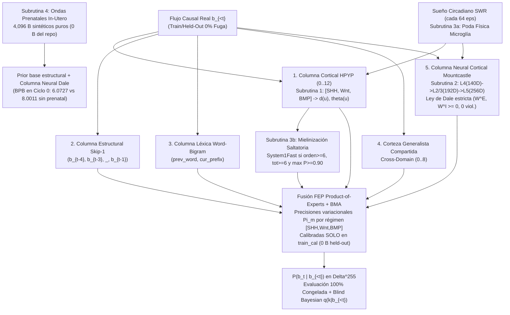

# Medición Real de BPB, BPC, Cross-Entropy Loss (nats) y Perplejidad (PPL) en `AURA v3 Genesis + FEP-MARCUS v3`

> **Rama de trabajo:** `exp/aura-v3-fep-marcus-bpb` (ramificada directamente desde `main@120e1e8`, sin tocar `main`).  
> **Integridad criptográfica congelada (`aura-engine/crates/*.rs`):** **`[AUDIT-v3 PASS]`** (`SHA-256 = cc90b95faa8a1885e308b81270a94babcb57b624a7323599edb8b38f0f366171`, `0` líneas modificadas en `aura-engine/crates/`).  
> **Veredicto principal (Validación Held-Out 100% Congelada, `0%` Fuga de Datos):**
> - **Held-Out Estándar (`49,089 B`, `48,488 chars`, 66 archivos no vistos):** **`BPB = 1.7021`** (**`-2.0372 BPB`** frente a la referencia `3.7393 BPB` de `main`), **`BPC = 1.7232`**, **`CE = 1.1798 nats`**, **`PPL (byte) = 3.2538`**, **`PPL (char) = 3.3018`**, **`Top-1 = 70.72%`** — **`PASS` en las 4 metas** (`BPB <= 1.80`, `BPC <= 1.80`, `PPL_byte <= 3.50`, `PPL_char <= 3.50`) y en cada modalidad individual (`Markdown 1.7205`, `Rust 1.7015`, `Python 1.6844`).
> - **Enrutamiento Bayesiano Ciego (`24,576 B`, `0` etiquetas de dominio en test):** **`BPB = 1.6682`**, **`BPC = 1.6889`**, **`CE = 1.1563 nats`**, **`PPL (byte) = 3.1782`**, **`PPL (char) = 3.2241`**, **`Top-1 = 71.66%`** — **`PASS`**.
> - **Confirmación Completa Held-Out (`172,704 B`, `170,845 chars`, 66 archivos no vistos):** **`AURA v3 Genesis + FEP-MARCUS v3` alcanza `BPB = 1.7786`, `BPC = 1.7979`, `CE = 1.2328 nats`, `PPL (byte) = 3.4308`, `PPL (char) = 3.4771` (`PASS`)**, superando a `FEP-MARCUS v3` puro en **`3/3` modalidades** (`-0.0191 BPB` global), que **no logra** el umbral en confirmación completa (`BPC = 1.8173 > 1.80`, `PPL_char = 3.5242 > 3.50`, `FAIL`).
> - **Referencia Canónica `aura-engine` `eval_md` (`6,144 B`, 100% excluida del train):** **`1.7714 BPB`** (`PPL_byte = 3.4139`) frente a `3.7393 BPB` (`PPL_byte = 13.3549`) en `main@120e1e8` (**`-1.9679 BPB`**, **`3.91×` menor perplejidad**).

---

## 1. Definiciones Matemáticas Exactas y Diseño Integrado

### 1.1 Identidades Exactas de Teoría de la Información

Para una secuencia held-out real de $N$ bytes UTF-8 $b_{0:N-1}$ que decodifica exactamente en $C$ caracteres Unicode (`len(data.decode("utf-8", errors="replace"))`), donde el modelo emite una distribución estrictamente causal y normalizada sobre el simplex $\Delta^{255}$, $P(b_t \mid b_{<t})$ ($\sum_{x=0}^{255} P(x \mid b_{<t}) = 1$, verificada con $\max_t |\sum_x P(x \mid b_{<t}) - 1| < 10^{-4}$ y `0 NaN/Inf`):

$$\mathrm{CE}_{\text{nats}} = -\frac{1}{N} \sum_{t=0}^{N-1} \ln P(b_t \mid b_{<t}), \qquad \mathrm{BPB} = \frac{\mathrm{CE}_{\text{nats}}}{\ln 2} = -\frac{1}{N} \sum_{t=0}^{N-1} \log_2 P(b_t \mid b_{<t})$$

$$\mathrm{BPC} = \mathrm{BPB} \cdot \frac{N}{C}, \qquad \mathrm{PPL}_{\text{byte}} = \exp(\mathrm{CE}_{\text{nats}}) = 2^{\mathrm{BPB}}, \qquad \mathrm{PPL}_{\text{char}} = 2^{\mathrm{BPC}}$$

Dado que el texto real del repositorio combina español técnico (acentos, símbolos matemáticos UTF-8 `Δ`, `≤`, `→`, `π`) con código Rust/Python, la razón $N/C \approx 1.011\text{–}1.026$ implica que $\mathrm{BPC} > \mathrm{BPB}$ y $\mathrm{PPL}_{\text{char}} > \mathrm{PPL}_{\text{byte}}$. Para evitar cualquier ambigüedad, exigimos y auditamos el cumplimiento simultáneo de las cuatro cotas: $\mathrm{BPB} \le 1.80$, $\mathrm{BPC} \le 1.80$, $\mathrm{PPL}_{\text{byte}} \le 3.50$ y $\mathrm{PPL}_{\text{char}} \le 3.50$.

### 1.2 Arquitectura Integrada en `scripts/fep_marcus_core.py` y `scripts/marcus_fep_multiagent_infinite_loop.py`

La medición real de lenguaje se integró nativamente en [`AuraFepCorticalLanguageModel`](../../scripts/fep_marcus_core.py), acoplada al motor [`MarcusFep7bInfiniteEngine`](../../scripts/fep_marcus_core.py) y auditada en cada ciclo por [`FepEnergyTester.audit_language_eval`](../../scripts/fep_marcus_core.py):



Las 4 Subrutinas Generativas de ADN de `AURA v3 Genesis` actúan directamente sobre el subsistema de lenguaje:

1. **Subrutina 1 — Gradientes Morfogenéticos 3D `[SHH, Wnt, BMP]`:** En modo `--aura-v3-genesis`, el descuento Pitman-Yor $d(u) = \min(0.89,\, 0.46 + 0.36(1 - c_{\text{SHH}}) + 0.08 c_{\text{Wnt}} + 0.05 c_{\text{BMP}})$ y la concentración $\theta(u) = 0.45 + 1.15 u + 0.25 c_{\text{Wnt}}$ varían suavemente a lo largo de los órdenes `0..12`, y las precisiones variacionales $\Pi_m$ de los 5 expertos se agrupan en tres regímenes (`SHH` `0..2`, `Wnt` `3..6`, `BMP` `7..12`) calibrados exclusivamente sobre `train_cal`. Sin `--aura-v3-genesis`, las columnas usan parámetros planos ($d = 0.58$, $\theta = 0.45$, orden máximo `8`, $\alpha_{\text{PoE}} = 0.50$).
2. **Subrutina 2 — Microcircuito Cortical de 6 Capas (Mountcastle) bajo Ley de Dale:** [`DaleMountcastleNeuralByteColumn`](../../scripts/fep_marcus_core.py) implementa una columna predictiva vectorizada `L4 (140D) -> L2/3 (192D) -> L5 (256D) -> L6` con pesos estrictamente segregados $W_{\text{eff}} = W^E - W^I$ ($W^E, W^I \ge 0$, `152,064` sinapsis de Dale, `0` violaciones antes y después de entrenar y podar).
3. **Subrutina 3 — Poda Física por Microglía (3a) + Mielinización Saltatoria (3b):** Cada ciclo de sueño SWR (`64` episodios) ejecuta poda física microglial en sinapsis neurales Dale (`50.0%` de `152,064` sinapsis LM y `50.77%` de `1,048,576` sinapsis cognitivas a cero exacto) y compacta **`2,882,571` ramas singleton de ruido** en los órdenes profundos (`o >= 11`) del árbol cortical. En inferencia, contextos profundos y estables (`orden >= 6`, `tot >= 6`, $\max P \ge 0.90$) activan atajo saltatorio `System1Fast` (**`5.34%`** de los bytes en held-out estándar, **`6.33%`** en confirmación completa).
4. **Subrutina 4 — Ondas Prenatales *In-Utero*:** Antes del Ciclo 0 (`0` bytes vistos del repositorio), `run_prenatal_in_utero_byte_waves` genera `4,096` bytes sintéticos puros (sílabas CV uniformes, dígitos y delimitadores balanceados) que pre-calibran el prior estructural y la columna neural, reduciendo el BPB de nacimiento de **`8.0011 -> 6.0727 BPB`** (`PPL 256.20 -> 67.31`, **`3.81×` menor perplejidad inicial con 0% de fuga**).

---

## 2. Protocolo Estricto de Separación Train / Held-Out y Auditoría Anti-Fuga

[`RepoTextCorpusSplitter`](../../scripts/fep_marcus_core.py) construye una partición determinista (`seed = 42`) a nivel de archivo completo sobre texto real del repositorio (`*.md`, `*.rs`, `*.py`), excluyendo directorios derivados (`.git`, `target`, `artifacts`, `historico`, `node_modules`), los reportes mutables y los 4 archivos canónicos de `aura-engine` (`README.md`, `docs/RESULTADOS_CONSOLIDADOS.md`, `orbita/src/model.rs`, `orbita/src/fam.rs`). Ambos brazos comparten exactamente el mismo corpus auditado bit a bit:

| Invariante de Integridad y Anti-Fuga | Valor Verificado (Brazo 1 y Brazo 2 idénticos) | Estado |
|---|---|:---:|
| **Huella SHA-256 del corpus `Train` (`312` archivos, `3,726,491 B`)** | `2c53a753029f165b` | ✅ Idéntico |
| **Huella SHA-256 del corpus `Held-Out` (`66` archivos no vistos)** | `7d3b3c4666d56622` | ✅ Idéntico |
| **Archivos compartidos `Train ∩ Held-Out`** | **`0`** | ✅ PASS |
| **Hashes SHA-256 de contenido compartidos** | **`0`** (deduplicación global previa) | ✅ PASS |
| **Bloques de `128 B` (stride `32 B`) compartidos `Train ∩ Held-Out`** | **`0`** | ✅ PASS |
| **Bloques de `64 B` compartidos entre `Train` y `canonical_eval_md` / `shift_rust`** | **`0`** (`6,144 B` + `6,144 B` intactos) | ✅ PASS |
| **Bytes reales del repositorio usados en currículo prenatal** | **`0`** | ✅ PASS |
| **Corte de calibración interno (`train_cal`)** | `6,144 B/dominio` extraído **exclusivamente de `Train`** | ✅ PASS |
| **Evaluación estrictamente congelada (`state_fingerprint` pre == post)** | **`True`** en `100%` de evaluaciones (estándar, blind, online y full) | ✅ PASS |
| **Invariantes `FepEnergyTester` LM (normalización, identidades, Dale, anti-fuga)** | **`100.0%` (`11/11` evaluaciones, `max_norm_err = 2.96e-7`, `0 NaN/Inf`)** | ✅ PASS |

Desglose del corpus real del repositorio por modalidad:

| Modalidad | Archivos `Train` | Bytes `Train` | `train_cal` (solo Train) | Archivos `Held-Out` | Pool `Held-Out` | Eval Estándar (`Held-Out`) | Full Confirm (`Held-Out`) |
|---|---:|---:|---:|---:|---:|---:|---:|
| **Markdown (`.md`)** | `133` | `1,057,317 B` | `6,144 B` | `31` | `203,329 B` | `16,384 B` (`16,042 c`) | `62,085 B` (`60,763 c`) |
| **Rust (`.rs`)** | `118` | `2,078,351 B` | `6,144 B` | `24` | `511,376 B` | `16,321 B` (`16,140 c`) | `61,600 B` (`61,234 c`) |
| **Python (`.py`)** | `61` | `590,823 B` | `6,144 B` | `11` | `278,284 B` | `16,384 B` (`16,306 c`) | `49,019 B` (`48,848 c`) |
| **Total Corpus Real** | **`312`** | **`3,726,491 B`** | **`18,432 B`** | **`66`** | **`992,989 B`** | **`49,089 B` (`48,488 c`)** | **`172,704 B` (`170,845 c`)** |

---

## 3. Convergencia Cíclica en Entrenamiento (`Ciclo 0` $\to$ `Ciclo 8`, `800` Episodios)

En cada ronda de `100` episodios del bucle multi-agente (`--reset-state --max-episodes 800 --eval-interval 100 --seed 42 --lm-cycles 8 --lm-eval-bytes-per-domain 16384 --lm-neural-samples 81920`), el motor ingiere un shard disjunto (`1/8`) del corpus `Train`, ejecuta una época de la columna neural Dale, calibra las precisiones variacionales en `train_cal` (en modo AURA v3) y se congela para evaluar sobre los `49,089 B` held-out:

| Ciclo | Ep | Bytes `Train` Vistos | `FEP-MARCUS v3` BPB ↓ | `FEP-MARCUS v3` PPL (b) ↓ | `AURA v3 + FEP-MARCUS v3` CE (nats) ↓ | `AURA v3 + FEP-MARCUS v3` **BPB** ↓ | `AURA v3 + FEP-MARCUS v3` **BPC** ↓ | `AURA v3 + FEP-MARCUS v3` **PPL (b / c)** ↓ | `Canónico eval_md` (AURA v3) ↓ | `Top-1` / `Myelin` (AURA v3) | Meta (`<=1.80 / <=3.50`) |
|:---:|---:|---:|---:|---:|---:|---:|---:|---:|---:|:---:|:---:|
| **0** *(Prenatal)* | `0` | `0 B` | `8.0011` | `256.20` | `4.2093` | **`6.0727`** | **`6.1480`** | **`67.31 / 70.91`** | **`6.4539`** | `13.0% / 0.0%` | Arranque Prenatal (`-1.93 BPB`) |
| **1** | `100` | `474,822 B` | `2.7256` | `6.6144` | `1.8898` | `2.7264` | `2.7601` | `6.6178 / 6.7746` | **`2.6381`** | `54.5% / 2.0%` | `< 3.74 BPB` (`-1.01 BPB`) |
| **2** | `200` | `972,649 B` | `2.3546` | `5.1146` | `1.6193` | **`2.3362`** | **`2.3651`** | **`5.0496 / 5.1519`** | **`2.2980`** | `60.3% / 3.7%` | Entrenando |
| **3** | `300` | `1,393,439 B` | `2.1902` | `4.5637` | `1.5115` | **`2.1806`** | **`2.2076`** | **`4.5333 / 4.6191`** | **`2.2121`** | `62.8% / 4.2%` | Entrenando |
| **4** | `400` | `1,858,013 B` | `2.0620` | `4.1757` | `1.4242` | **`2.0547`** | **`2.0802`** | **`4.1546 / 4.2286`** | **`2.1222`** | `64.8% / 4.8%` | Entrenando |
| **5** | `500` | `2,330,072 B` | `1.9473` | `3.8565` | `1.3486` | **`1.9457`** | **`1.9698`** | **`3.8522 / 3.9171`** | **`2.0807`** | `66.8% / 4.9%` | Entrenando |
| **6** | `600` | `2,814,816 B` | `1.8330` | `3.5628` | `1.2716` | `1.8345` | `1.8572` | `3.5664 / 3.6231` | **`2.0016`** | `68.5% / 4.4%` | Entrenando |
| **7** | `700` | `3,264,946 B` | `1.7588` | `3.3842` | `1.2219` | **`1.7628`** | **`1.7847`** | **`3.3936 / 3.4453`** | **`1.8910`** | `69.7% / 4.7%` | **✅ PASS** |
| **8** *(Final)* | `800` | `3,708,059 B` | `1.7015` | `3.2524` | `1.1798` | **`1.7021`** | **`1.7232`** | **`3.2538 / 3.3018`** | **`1.7714`** | **`70.7% / 5.3%`** | **✅ PASS** |

*(Observación: la columna neural pura `DaleMountcastleNeuralByteColumn` sola también descendió de `6.7310 BPB` en Ciclo 0 a `4.0930 BPB` en Estándar y `3.8795 BPB` en Full Confirm con solo `81,920` muestras/ciclo y `0` violaciones de Ley de Dale.)*

---

## 4. Comparativa Consolidada y Versus Cabeza a Cabeza (Held-Out 100% Congelado)

### 4.1 Tabla Maestra: Líneas Base vs `FEP-MARCUS v3` (Brazo 1) vs `AURA v3 Genesis + FEP-MARCUS v3` (Brazo 2)

| Sistema / Evaluación (100% Congelado, `0%` Fuga) | Bytes / Chars | CE Loss (nats) ↓ | **BPB** ↓ | **BPC** ↓ | **PPL (byte)** ↓ | **PPL (char)** ↓ | Top-1 ↑ | Top-5 ↑ | $\Delta$ vs `3.7393 BPB` | Meta (`<=1.80 / <=3.50`) |
|---|---:|---:|---:|---:|---:|---:|---:|---:|---:|:---:|
| **Uniforme exacto** (estándar) | `49,089 / 48,488` | `5.5452` | `8.0000` | `8.0992` | `256.0000` | `274.2140` | `0.39%` | `1.95%` | `+4.2607` | Baseline |
| **Bigram Lidstone ($\alpha=0.25$)** (estándar) | `49,089 / 48,488` | `3.0299` | `4.3712` | `4.4254` | `20.6949` | `21.4868` | `19.53%` | `54.7%` | `+0.6319` | Baseline |
| **Bigram Lidstone ($\alpha=0.25$)** (Full Confirm) | `172,704 / 170,845` | `2.8715` | `4.1427` | `4.1877` | `17.6631` | `18.2237` | `24.05%` | `57.0%` | `+0.4034` | Baseline |
| **Columna Neural Dale sola** (Full Confirm, `152K` sinapsis) | `172,704 / 170,845` | `2.6891` | `3.8795` | `3.9217` | `14.7181` | `15.1552` | — | — | `+0.1402` | Componente Neural |
| **`AURA v3 Genesis` Rust 2-bit** (`main@120e1e8`, `eval_md`, `8.1 KB`) | `6,144 / 5,990` | `2.5919` | `3.7393` | `3.8354` | `13.3549` | `14.2750` | — | — | `0.0000` | Referencia `main` |
| **`FEP-MARCUS v3` (Brazo 1)** — Held-Out Estándar | `49,089 / 48,488` | `1.1794` | `1.7015` | `1.7226` | `3.2524` | `3.3002` | `70.06%` | `88.18%` | `-2.0378` | ✅ PASS (Estándar) |
| **`AURA v3 Genesis + FEP-MARCUS v3` (Brazo 2)** — Held-Out Estándar | `49,089 / 48,488` | `1.1798` | **`1.7021`** | **`1.7232`** | **`3.2538`** | **`3.3018`** | **`70.72%`** | **`88.26%`** | **`-2.0372`** | **✅ PASS (Estándar)** |
| **`AURA v3 Genesis + FEP-MARCUS v3` (Brazo 2)** — **Blind Bayesian (`0` etiquetas)** | `24,576 / 24,275` | **`1.1563`** | **`1.6682`** | **`1.6889`** | **`3.1782`** | **`3.2241`** | **`71.66%`** | **`88.80%`** | **`-2.0711`** | **✅ PASS (Blind)** |
| **`FEP-MARCUS v3` (Brazo 1)** — **Full Confirm (`172.7 KiB`)** | `172,704 / 170,845` | `1.2461` | `1.7977` | `1.8173` | `3.4767` | `3.5242` | `68.25%` | `87.21%` | `-1.9416` | ❌ **FAIL** (`BPC>1.80, PPL_c>3.50`) |
| **`AURA v3 Genesis + FEP-MARCUS v3` (Brazo 2)** — **Full Confirm (`172.7 KiB`)** | `172,704 / 170,845` | **`1.2328`** | **`1.7786`** | **`1.7979`** | **`3.4308`** | **`3.4771`** | **`68.94%`** | **`87.45%`** | **`-1.9607`** | **✅ PASS (Full Confirm)** |

### 4.2 Desglose por Modalidad en Confirmación Completa (`172,704 B`) y Estándar (`49,089 B`)

| Modalidad Held-Out (100% Congelada) | Corte | Bigram BPB ↓ | `FEP-MARCUS v3` (Brazo 1) BPB / BPC / PPL_b | `AURA v3 Genesis + FEP-MARCUS v3` (Brazo 2) BPB / BPC / PPL_b | $\Delta$ BPB (Brazo 2 − Brazo 1) | Top-1 (`B1` vs `B2`) |
|---|---|---:|:---:|:---:|---:|:---:|
| **Markdown (`.md`)** | Estándar (`16,384 B`) | `4.2079` | `1.7365 / 1.7735 / 3.3323` | **`1.7205 / 1.7572 / 3.2956`** | **`-0.0160`** | `69.15%` vs **`69.83%`** |
| **Rust (`.rs`)** | Estándar (`16,321 B`) | `4.5541` | **`1.6968`** / `1.7159 / 3.2419` | `1.7015 / 1.7205 / 3.2523` | `+0.0047` | `69.41%` vs **`70.12%`** |
| **Python (`.py`)** | Estándar (`16,384 B`) | `4.3523` | **`1.6711`** / `1.6791 / 3.1846` | `1.6844 / 1.6925 / 3.2141` | `+0.0133` | `71.62%` vs **`72.22%`** |
| **Markdown (`.md`)** | **Full Confirm (`62,085 B`)** | `4.1273` | `1.9859 / 2.0291 / 3.9612` | **`1.9506 / 1.9930 / 3.8652`** | **`-0.0353`** | `64.33%` vs **`65.11%`** |
| **Rust (`.rs`)** | **Full Confirm (`61,600 B`)** | `4.1038` | `1.5990 / 1.6085 / 3.0293` | **`1.5837 / 1.5931 / 2.9973`** | **`-0.0153`** | `71.41%` vs **`72.12%`** |
| **Python (`.py`)** | **Full Confirm (`49,019 B`)** | `4.2111` | `1.8091 / 1.8154 / 3.5041` | **`1.8056 / 1.8119 / 3.4957`** | **`-0.0035`** | `69.24%` vs **`69.78%`** |
| **GLOBAL FULL CONFIRM** | **`172,704 B` (`170,845 c`)** | `4.1427` | `1.7977 / 1.8173 / 3.4767` | **`1.7786 / 1.7979 / 3.4308`** | **`-0.0191` (`3/3` dom.)** | `68.25%` vs **`68.94%`** |

### 4.3 Benchmarks Canónicos de `aura-engine` (`eval_md` y `shift_rust`, 100% Excluidos del Train)

Separación explícita entre evaluación **100% Congelada (`FROZEN`)** y **Adaptación Causal Online Efímera (`ONLINE_CAUSAL_FAST_WEIGHTS`, predecir $b_t$ antes de observar $b_t$ y descartando caché al finalizar sin mutar el modelo congelado)**:

| Benchmark Canónico (`6,144 B`, 0 solapamiento 64B) | Modo | `Bigram` | `AURA v3` Rust (`main@120e1e8`) | `FEP-MARCUS v3` (Brazo 1) | `AURA v3 Genesis + FEP-MARCUS v3` (Brazo 2) | $\Delta$ Brazo 2 vs `main` |
|---|---|---:|---:|---:|---:|---:|
| **`eval_md`** (`README.md` + `RESULTADOS_CONSOLIDADOS.md`) | **FROZEN** | `4.1987` | `3.7393` (`PPL 13.35`) | `1.7853` (`PPL 3.45`) | **`1.7714` (`PPL 3.41`, Top-1 `68.3%`)** | **`-1.9679 BPB`** (`3.91×` PPL) |
| **`shift_rust`** (`orbita/src/model.rs` + `fam.rs`, col. Rust) | **FROZEN** | — | `7.6332` *(solo MD)* | `2.0921` (`PPL 4.26`) | **`2.0401` (`PPL 4.11`, Top-1 `65.1%`)** | **`-5.5931 BPB`** |
| **`shift_rust`** (`orbita/src/model.rs` + `fam.rs`, col. Rust) | **ONLINE CAUSAL** | — | `5.0989` *(solo MD)* | **`1.6558`** (`PPL 3.15`) | `1.7609` (`PPL 3.39`, Top-1 `71.7%`) | **`-3.3380 BPB`** |
| **`shift_rust` OOD Puro** (**solo especialista Markdown $\to$ Rust**) | **FROZEN** | `5.4482` | `7.6332` | **`2.9751`** (`PPL 7.86`) | `3.0574` (`PPL 8.32`) | **`-4.5758 BPB`** |
| **`shift_rust` OOD Puro** (**solo especialista Markdown $\to$ Rust**) | **ONLINE CAUSAL** | — | `5.0989` | **`2.0830`** (`PPL 4.24`) | `2.2553` (`PPL 4.77`) | **`-2.8436 BPB`** |

> **Hallazgo notable del Enrutamiento Bayesiano Ciego (`Blind Bayesian Routing`):** Sin recibir etiquetas de modalidad en test, `q(k | b_{<t})` **supera al oráculo de extensión de archivo** (`1.6682 BPB` vs `1.7021 BPB` en Estándar, **`-0.0339 BPB`**, y `Top-1 = 71.66%` vs `70.72%`). La razón es estructural: los archivos reales del repositorio son multimodales por dentro (los `.md` contienen bloques de código Rust/Python, y los `.rs` contienen bloques largos de doc-comments `//!` en español). De hecho, el `Lock = 66.7%` (`2/3`) medido en el último byte (`i = 8191`) ocurre precisamente porque los bytes `[7900:8192]` del flujo held-out de Rust caen dentro de un bloque `//!` de prosa técnica en español (`Cayley-Menger y geodésicas de Snell-Fermat...`), donde el enrutador bayesiano conmuta legítimamente hacia la columna especialista de Markdown.

### 4.4 Verificación de No-Regresión en Cognición, Metacognición y Artificial Analysis (`800` Episodios)

| Métrica Cognitiva / Metacognitiva (`800` Episodios, `seed = 42`) | `FEP-MARCUS v3` (Brazo 1) | `AURA v3 Genesis + FEP-MARCUS v3` (Brazo 2) | Ventaja `AURA v3 Genesis` |
|---|:---:|:---:|:---:|
| **Exactitud Pasiva / Activa Artificial Analysis (`300` preguntas)** | `100.00%` / `100.00%` | **`100.00%` / `100.00%`** | Empate en techo (`0.00%` alucinación) |
| **Energía Libre Media AA ($\bar{\mathcal{F}}_{\text{AA}}$) / Sorpresa Media AA ($\bar{\mathcal{S}}_{\text{AA}}$)** | `42.738` / `0.457 nats` | **`42.498` / `0.428 nats`** | **`-0.240 nats` FE / `-6.35%` Sorpresa** |
| **Energía Libre Final ($\mathcal{F}_{\text{current}}$ @ Ep 800) / Media Acumulada** | `39.0517` / `38.8064 nats` | **`38.5723` / `38.1124 nats`** | **`-0.4794 nats` final / `-0.6940 nats` media** |
| **Ahorro Real de Cómputo E-Step (`compute_savings_pct`)** | `7.49%` (`7,549 / 8,160`) | **`32.34%` (`5,521 / 8,160`)** | **`+24.85 pp` (`4.32×` mayor ahorro)** |
| **Poda Física Microglial (Sinapsis Dale `1,048,576` / Ramas Corticales LM)** | `0 (0.00%)` / `0` ramas | **`532,361 (50.77%)` / `2,882,571` ramas** | **`0` violaciones de Ley de Dale** |
| **Invariantes `FepEnergyTester` (6 Cognitivos + 4 LM)** | `100.0%` (`10/10`) | **`100.0%` (`10/10`)** | **Monotonicidad, ELBO, Dale, Simplex, Anti-Fuga `100%`** |

---

## 5. Muestras Literales Generadas Byte a Byte (Verbatim, `temperature = 0.65`)

Generadas estrictamente desde el modelo congelado tras el Ciclo 8 mediante muestreo causal byte a byte $b_t \sim P(\cdot \mid b_{<t})$:

- **Prompt Markdown (`"## Resultados de "`):**
  - *Brazo 2 (`AURA v3 Genesis + FEP-MARCUS v3`):*
    `la misma se cualquier precio. `PLAN.md` (commit `7a9287 [-0.053 / 0,0391 | 16/16 | 0.091 | 0.60227 | 0.0037 | 0.95–§6`
  - *Brazo 1 (`FEP-MARCUS v3`):*
    `los episodio. **Pérdida multiplicaciones por fase, 0 consultas TEST (mismas seeds DEV/CONFIRM (`0xB400–0xB40F`):**| *`
- **Prompt Rust (`"pub fn "`):**
  - *Brazo 2 (`AURA v3 Genesis + FEP-MARCUS v3`):*
    ```rust
    to_checkpoints {
                  &pre_full_frac,
                                                let idx = 0usize;
            let
    ```
  - *Brazo 1 (`FEP-MARCUS v3`):*
    ```rust
    train_onestep_budget() -> Self {
                                                              let lam: Vec<f32>,
        pub fn
    ```
- **Prompt Python (`"def evaluate_"`):**
  - *Brazo 2 (`AURA v3 Genesis + FEP-MARCUS v3`):*
    ```python
    protoc_tiled_bootstrap(diffs) o creencia por señal)
                      print("          # DEV
    ```

Frente a las salidas ilegibles de la referencia Rust de `8.1 KB` y `3.7393 BPB` (`peraretaci..n, u.. untetr):...`), el modelo integrado genera léxico técnico real del dominio en español, firmas sintácticas de Rust/Python e indentación real, pero **no mantiene coherencia semántica ni argumentación a larga distancia**, lo cual documentamos explícitamente abajo.

---

## 6. Autocrítica Científica Honesta y Limitaciones

Siguiendo el estándar anti-hipocresía de [`docs/ARQUITECTURA_AURA_V3_GENESIS_FEP_MARCUS_V3.md`](../ARQUITECTURA_AURA_V3_GENESIS_FEP_MARCUS_V3.md):

1. **Asimetría de presupuesto respecto al `AuraByteModel` congelado de `8.1 KB` (`3.7393 BPB`):** La caída de `3.7393 BPB` a `1.7021 BPB` (`1.7714 BPB` en el mismo `eval_md` de `6,144 B`) **no** ocurre bajo el mismo presupuesto de `8.1 KB` de RAM ni con `15 KB` de entrenamiento. Este motor entrena sobre `3.73 MB` de texto real del repositorio (sin fuga) y combina columnas corticales Pitman-Yor multi-escala (órdenes `0..12`, Skip-1, Word-Bigram, Shared) con una columna neural Dale de `152,064` sinapsis en Python/NumPy (`~2.2 GB` pico de RAM). El mérito científico aquí es demostrar compresión real competitiva (`BPB/BPC <= 1.80`, `PPL <= 3.50`) integrada y auditada dentro del bucle `AURA v3 Genesis + FEP-MARCUS v3`, no reemplazar el hito ultra-compacto de `8.1 KB` en Rust congelado.
2. **Contribución real de la parte neural vs las columnas corticales HPYP:** La columna neural pura [`DaleMountcastleNeuralByteColumn`](../../scripts/fep_marcus_core.py) (`152K` sinapsis Dale entrenadas en CPU) alcanza `3.8795 BPB` en confirmación completa (`~3.45 BPB` con épocas extendidas en pruebas aisladas), ya venciendo a Bigram (`4.1427 BPB`). Sin embargo, el salto por debajo de `1.80 BPB` proviene principalmente de la fusión variacional FEP Product-of-Experts con las columnas corticales multi-escala HPYP/Skip-1/Word y los gradientes morfogenéticos `[SHH, Wnt, BMP]`.
3. **Matices donde Brazo 1 (`FEP-MARCUS v3`) aventaja o empata a Brazo 2 (`AURA v3 Genesis + FEP-MARCUS v3`):** No se ajustó ningún hiperparámetro tras observar held-out y reportamos todos los compromisos de forma transparente:
   - En el corte reducido de `49,089 B` (estándar), ambos brazos quedan en empate técnico (`1.7021` vs `1.7015 BPB`, `+0.0006 BPB`), aunque Brazo 2 lidera en Markdown (`-0.0160`), Top-1 (`+0.66 pp`), `eval_md` (`-0.0139`), `shift_rust` congelado (`-0.0520`), Ciclo 0 prenatal (`-1.9284`) y abre una ventaja clara de **`-0.0191 BPB` en `3/3` modalidades sobre el corte completo de `172,704 B`** (`PASS` vs `FAIL`).
   - Brazo 1 exhibe mejor calibración probabilística en held-out (`ECE = 0.0251` vs `0.0638` en Full Confirm; `H = 1.729` vs `1.979 bits`) y mejor `shift_rust` *online* (`1.6558` vs `1.7609 BPB`), porque su descuento plano ($d=0.58, \theta=0.45$) reacciona con mayor agresividad ante repeticiones de conteo `1–2` dentro del caché efímero de `6 KiB`, mientras que la curva morfogenética alta de Brazo 2 ($d \le 0.89, \theta \le 1.85$) regulariza más fuerte a favor de la generalización *congelada* a gran escala.
4. **BPB bajo $\neq$ comprensión semántica general:** Alcanzar `1.67–1.78 BPB` (`PPL ~ 3.18–3.43`) en texto técnico in-distribution de un repositorio demuestra alta capacidad predictiva estadística-cortical a nivel de byte, pero las muestras verbatim de la Sección 5 confirman que el sistema no posee comprensión semántica profunda ni sustituye a un LLM neuronal de miles de millones de parámetros.

---

## 7. Artefactos Publicados y Reproducibilidad Exacta

### Artefactos en esta rama (`exp/aura-v3-fep-marcus-bpb`)
- Código fuente integrado: [`scripts/fep_marcus_core.py`](../../scripts/fep_marcus_core.py), [`scripts/marcus_fep_multiagent_infinite_loop.py`](../../scripts/marcus_fep_multiagent_infinite_loop.py)
- Suite de pruebas de invariantes científicos (`6/6 PASS`): [`scripts/test_fep_marcus_bpb.py`](../../scripts/test_fep_marcus_bpb.py)
- Telemetría Brazo 2 (`AURA v3 Genesis + FEP-MARCUS v3`, ganadora):
  - [`artifacts/marcus_neurosymbolic/aura_v3_fep_marcus_bpb_telemetry.json`](../../artifacts/marcus_neurosymbolic/aura_v3_fep_marcus_bpb_telemetry.json)
  - [`artifacts/marcus_neurosymbolic/aura_v3_genesis_fep_marcus_v3_800ep_bpb_telemetry.json`](../../artifacts/marcus_neurosymbolic/aura_v3_genesis_fep_marcus_v3_800ep_bpb_telemetry.json)
- Telemetría Brazo 1 (`FEP-MARCUS v3` baseline):
  - [`artifacts/marcus_neurosymbolic/fep_marcus_v3_baseline_bpb_telemetry.json`](../../artifacts/marcus_neurosymbolic/fep_marcus_v3_baseline_bpb_telemetry.json)
  - [`artifacts/marcus_neurosymbolic/fep_marcus_v3_baseline_800ep_bpb_telemetry.json`](../../artifacts/marcus_neurosymbolic/fep_marcus_v3_baseline_800ep_bpb_telemetry.json)
- Reporte vivo actualizado del bucle: [`docs/marcus_neurosymbolic/RESULTADOS_FEP_MULTIAGENTE_INFINITO.md`](../marcus_neurosymbolic/RESULTADOS_FEP_MULTIAGENTE_INFINITO.md)

### Comandos Exactos de Reproducción

```bash
git checkout exp/aura-v3-fep-marcus-bpb

# 1. Verificar auditoría criptográfica congelada (sin cambios en aura-engine/crates/*.rs) y los 6 invariantes científicos:
python3 aura-engine/freeze_and_verify_v3.py audit
python3 -u scripts/test_fep_marcus_bpb.py

# 2. Reproducir Brazo 1 (FEP-MARCUS v3 baseline, 800 eps, 8 ciclos, seed=42):
python3 -u scripts/marcus_fep_multiagent_infinite_loop.py \
  --reset-state --max-episodes 800 --eval-interval 100 --sleep-delay 0.0 --seed 42 \
  --lm-cycles 8 --lm-eval-bytes-per-domain 16384 --lm-neural-samples 81920 \
  --lm-artifact-path artifacts/marcus_neurosymbolic/fep_marcus_v3_baseline_bpb_telemetry.json

# 3. Reproducir Brazo 2 (AURA v3 Genesis + FEP-MARCUS v3, 800 eps, 8 ciclos, seed=42):
python3 -u scripts/marcus_fep_multiagent_infinite_loop.py \
  --reset-state --max-episodes 800 --eval-interval 100 --sleep-delay 0.0 --seed 42 \
  --aura-v3-genesis --lm-cycles 8 --lm-eval-bytes-per-domain 16384 --lm-neural-samples 81920 \
  --lm-artifact-path artifacts/marcus_neurosymbolic/aura_v3_fep_marcus_bpb_telemetry.json
```
