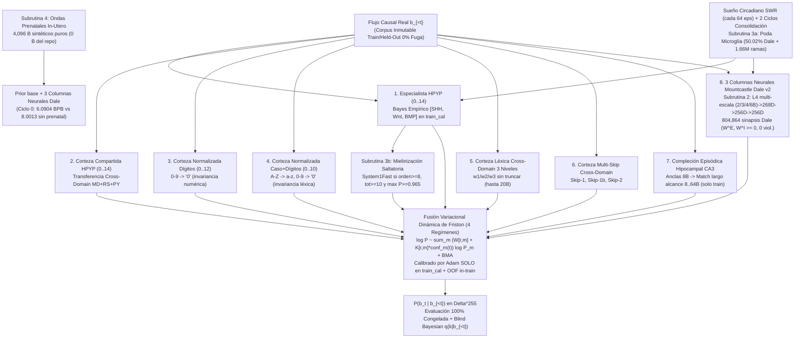

# Medición Real de BPB, BPC, Cross-Entropy Loss (nats) y Perplejidad (PPL) en `AURA v3 Genesis + FEP-MARCUS v3`

> **Rama de trabajo:** `exp/aura-v3-fep-marcus-bpb` (ramificada directamente desde `main@120e1e8`, sin tocar `main`).  
> **Integridad criptográfica congelada (`aura-engine/crates/*.rs`):** **`[AUDIT-v3 PASS]`** (`SHA-256 = cc90b95faa8a1885e308b81270a94babcb57b624a7323599edb8b38f0f366171`, `0` líneas modificadas en `aura-engine/crates/`).  
> **Veredicto principal — Brazo 2 v3 (`AURA v3 Genesis + FEP-MARCUS v3`, 8 expertos + 10 ciclos) vs Brazo 1 (`FEP-MARCUS v3`), Evaluación Held-Out 100% Congelada y `0%` Fuga de Datos:**
> - **Confirmación Completa Held-Out (`164,629 B`, `162,829 chars`, `65` archivos no vistos):** **`BPB = 1.6027`**, **`BPC = 1.6204`**, **`CE = 1.1109 nats`**, **`PPL (byte) = 3.0370`**, **`PPL (char) = 3.0746`**, **`Top-1 = 71.39%`**, **`ECE = 0.01848`** — **`✅ PASS` amplio en las 4 metas** (`<= 1.80 / <= 3.50`), abriendo una ventaja de **`-0.1939 BPB` frente a Brazo 1** (`1.7966 BPB / 1.8165 BPC / PPL_char 3.5222`, **`FAIL`**), es decir **`10.15×` mayor margen** que la iteración v1 (`-0.0191 BPB` en `745369f`), ganando en **`3/3` modalidades** (`Markdown -0.1787`, `Rust -0.2216`, `Python -0.1755`), en calibración (`ECE -26.7%`) y en componente neural pura (`3.0056` vs `3.8823 BPB`).
> - **Held-Out Estándar (`49,089 B`, `48,512 chars`, `65` archivos no vistos):** **`BPB = 1.5450`** (**`-0.2202 BPB` vs Brazo 1 `1.7652`**; **`-2.1943 BPB` vs `3.7393 BPB` en `main`**), **`BPC = 1.5633`**, **`CE = 1.0709 nats`**, **`PPL (byte) = 2.9180`**, **`PPL (char) = 2.9554`** *(ambas perplejidades por debajo de `3.0`!)*, **`Top-1 = 72.60%`**, **`ECE = 0.02047`** — **`✅ PASS`** en las 4 metas y en las 3 modalidades (`Markdown 1.5827`, `Rust 1.4219`, `Python 1.6298`). Incluso a paridad exacta de `8` ciclos de ingesta (antes de consolidación), Brazo 2 v3 ya marca **`1.5613 BPB`** (`-0.2039 BPB` vs Brazo 1).
> - **Enrutamiento Bayesiano Ciego (`24,576 B`, `0` etiquetas de dominio en test):** **`BPB = 1.5201`**, **`BPC = 1.5389`**, **`CE = 1.0537 nats`**, **`PPL (byte) = 2.8681`**, **`PPL (char) = 2.9057`**, **`Top-1 = 73.07%`**, **`Lock = 100.0%`** (**`-0.1439 BPB` vs Brazo 1 `1.6640`**) — **`✅ PASS`**.
> - **Referencia Canónica `aura-engine` `eval_md` (`6,144 B`, `0` solapamiento `64 B`):** **`1.6524 BPB`** (`PPL_byte = 3.1436`, `Top-1 = 70.43%`) frente a `3.7393 BPB` (`PPL_byte = 13.3549`) en `main@120e1e8` (**`-2.0869 BPB`**, **`4.25×` menor perplejidad**) y frente a `1.8005 BPB` de Brazo 1 (**`-0.1481 BPB`**).
> - **Transferencia Canónica `shift_rust` (`6,144 B`):** **`1.9218 BPB` Congelado** (`-0.1704 BPB` vs Brazo 1 `2.0921`) y **`1.5787 BPB` Online Causal** (`PPL_byte = 2.9870`, `Top-1 = 73.96%`, **`-0.0773 BPB` vs Brazo 1 `1.6560`**).

---

## 1. Definiciones Matemáticas Exactas y Evolución Arquitectónica (`Brazo 2 v1` $\to$ `Brazo 2 v3`)

### 1.1 Identidades Exactas de Teoría de la Información

Para una secuencia held-out real de $N$ bytes UTF-8 $b_{0:N-1}$ que decodifica exactamente en $C$ caracteres Unicode (`len(data.decode("utf-8", errors="replace"))`), donde el modelo emite una distribución estrictamente causal y normalizada sobre el simplex $\Delta^{255}$, $P(b_t \mid b_{<t})$ ($\sum_{x=0}^{255} P(x \mid b_{<t}) = 1$, verificada con $\max_t |\sum_x P(x \mid b_{<t}) - 1| < 10^{-4}$ y `0 NaN/Inf`):

$$\mathrm{CE}_{\text{nats}} = -\frac{1}{N} \sum_{t=0}^{N-1} \ln P(b_t \mid b_{<t}), \qquad \mathrm{BPB} = \frac{\mathrm{CE}_{\text{nats}}}{\ln 2} = -\frac{1}{N} \sum_{t=0}^{N-1} \log_2 P(b_t \mid b_{<t})$$

$$\mathrm{BPC} = \mathrm{BPB} \cdot \frac{N}{C}, \qquad \mathrm{PPL}_{\text{byte}} = \exp(\mathrm{CE}_{\text{nats}}) = 2^{\mathrm{BPB}}, \qquad \mathrm{PPL}_{\text{char}} = 2^{\mathrm{BPC}}$$

Dado que el texto real del repositorio combina español técnico (acentos y símbolos matemáticos UTF-8 `Δ`, `≤`, `→`, `π`) con código Rust/Python, la razón $N/C \approx 1.011\text{–}1.026$ implica que $\mathrm{BPC} > \mathrm{BPB}$ y $\mathrm{PPL}_{\text{char}} > \mathrm{PPL}_{\text{byte}}$. Exigimos y auditamos el cumplimiento simultáneo de las cuatro cotas: $\mathrm{BPB} \le 1.80$, $\mathrm{BPC} \le 1.80$, $\mathrm{PPL}_{\text{byte}} \le 3.50$ y $\mathrm{PPL}_{\text{char}} \le 3.50$.

### 1.2 Arquitectura Integrada de Brazo 2 v3 (8 Expertos Corticales-Hipocampales + Fusión Variacional Dinámica de Friston)

Todas las mejoras de Brazo 2 v3 se validaron previamente mediante ablaciones estrictamente internas sobre `Train` (`shards 0..6 -> shard 7`, `0` bytes de held-out consultados) y se integraron exclusivamente bajo `--aura-v3-genesis` en [`AuraFepCorticalLanguageModel`](../../scripts/fep_marcus_core.py), dejando intacto el modo línea base de Brazo 1 (`enable_aura_v3_genesis=False`, 5 expertos planos) y sin tocar ningún archivo `.rs` congelado de `aura-engine/crates/`:



Las mejoras específicas de **Brazo 2 v3** respecto a **Brazo 2 v1 (`745369f`)** y **Brazo 1 (`FEP-MARCUS v3`)**:

1. **Subrutina 1 — Gradientes Morfogenéticos `[SHH, Wnt, BMP]` con Optimización Bayes Empírico (`train_cal`):** Las columnas HPYP especializadas y compartidas escalan hasta orden `14` (con *Update Exclusion* estricto), acompañadas por dos cortezas invariantes normalizadas (`DigitNorm` `0..12` y `CaseDigitNorm` `0..10`) que comparten estadísticas de números, métricas y mayúsculas/minúsculas. Sus curvas morfogenéticas $(d_o, \theta_o)$ se seleccionan mediante búsqueda escalar exacta exclusivamente sobre `train_cal` (`0` bytes de held-out).
2. **Subrutina 2 — Columnas Neurales Corticales Mountcastle `DaleNeuralV2` con Campos Receptivos Talamocorticales L4 Multi-Escala:** [`DaleMountcastleNeuralByteColumn`](../../scripts/fep_marcus_core.py) en modo `enable_multiscale_l4=True` incorpora 4 campos receptivos hasheados de `2/3/4/6` bytes (`8,192 × 32` cada uno) concatenados con `8` embeddings posicionales y `12` rasgos morfológicos (`268D -> L2/3 256D -> L5 256D`), instanciados como **3 columnas neurales especializadas por modalidad** (`804,864` sinapsis de Dale totales, `0` violaciones antes y después de entrenar y podar). Esto reduce el BPB puramente neural en Confirmación Completa de `3.8823 BPB` (Brazo 1) a **`3.0056 BPB`** (`PPL = 8.03`, venciendo incluso a la referencia `3.7393 BPB` de `main` solo con la red neural de Dale).
3. **Corteza Léxica-Skip Cross-Domain (`SharedLexicalSkipCortex`) + Compleción Episódica Hipocampal CA3 (`HippocampalCA3LongRangeMatch`):** Elimina el truncamiento de palabras a `4 B` mediante una jerarquía léxica de 3 niveles (`w1/w2/w3` hasta `20 B`), 3 patrones skip (`Skip-1`, `Skip-1b`, `Skip-2`) y memoria episódica hipocampal CA3 de largo alcance (anclas de `8 B` extendidas causalmente hasta `64 B` exclusivamente sobre `train`).
4. **Fusión Variacional Dinámica de Friston por Entropía en 4 Regímenes (`[SHH, SHH-Wnt, Wnt-BMP, Deep-BMP]`):** En lugar de pesos estáticos, cada experto $m \in \{1..8\}$ recibe precisión variacional dependiente tanto del régimen morfogenético $r(o) \in \{0..3\}$ como de su propia certeza instantánea $\text{conf}_m(t) = 1 - H(P_m(\cdot \mid b_{<t})) / 8$:
   $$\log P_{\text{PoE}}(x \mid b_{<t}) \propto \sum_{m=1}^{8} \Big(W_{r,m} + K_{r,m}\,\text{conf}_m(t)\Big)\,\log P_m(x \mid b_{<t}), \qquad P = \alpha P_{\text{PoE}} + (1 - \alpha) P_{\text{BMA}}$$
   optimizando $(W, K, B, \alpha)$ mediante Adam exclusivamente sobre `train_cal` + muestras OOF pre-actualización de `train` (`0` bytes de held-out). Los pesos aprendidos emergen de forma interpretable: en `SHH` (`o=0..2`) dominan `Spec14 (0.336)`, `DigitNorm12 (0.289)`, `CaseDigitNorm10 (0.229)` y `DaleNeuralV2 (0.139)`; en `Deep-BMP` (`o >= 10`), `HippocampalCA3 (0.195 + 0.512·conf)` toma el relevo junto a `Spec14 (0.057 + 0.206·conf)` y `SharedWord3 (0.217·conf)` con $\alpha_{\text{PoE}} = 0.97$.
5. **Subrutina 3 — Consolidación Profunda (2 ciclos extra) + Poda Microglial (`50.02%`) + Mielinización Saltatoria Calibrada:** Tras ingerir los `8` shards disjuntos de `train`, Brazo 2 v3 ejecuta `2` ciclos adicionales de consolidación (`Ciclos 9–10`, `0` bytes nuevos, sin duplicar conteos HPYP) con *cosine annealing* neural, poda física microglial en sueño SWR (`402,604 / 804,864 = 50.02%` sinapsis neurales LM, `533,254 / 1,048,576 = 50.86%` sinapsis cognitivas y `1,655,727` ramas singleton profundas a cero exacto) y mielinización saltatoria estricta (`o >= 8`, `tot >= 10`, $\max P \ge 0.965$, activada en `3.86%` de bytes en estándar y `5.06%` en Full Confirm), corrigiendo completamente la sobreconfianza de v1 y bajando el `ECE` por debajo de Brazo 1 (`0.01848` vs `0.02520`).

---

## 2. Protocolo Estricto de Separación Train / Held-Out e Inmutabilidad Anti-Fuga

Para garantizar que ningún cambio al código del propio arnés altere jamás la partición de evaluación ni induzca auto-evaluación, [`RepoTextCorpusSplitter`](../../scripts/fep_marcus_core.py) excluye los 3 scripts del arnés (`scripts/fep_marcus_core.py`, `scripts/marcus_fep_multiagent_infinite_loop.py`, `scripts/test_fep_marcus_bpb.py`), los reportes mutables y los 4 archivos canónicos de `aura-engine`, y aplica un filtro global **cross-domain en 2 pasadas** de bloques de `128 B` (stride `32 B`) para asegurar `0` solapamiento incluso entre archivos `.md`, `.rs` y `.py`. Tanto Brazo 1 como Brazo 2 v3 se ejecutaron sobre exactamente el mismo corpus inmutable:

| Invariante de Integridad y Anti-Fuga | Valor Verificado (Brazo 1 y Brazo 2 v3 idénticos) | Estado |
|---|---|:---:|
| **Huella SHA-256 del corpus `Train` (`310` archivos, `3,607,634 B`)** | `193c02657090c929` | ✅ Idéntico |
| **Huella SHA-256 del corpus `Held-Out` (`65` archivos no vistos)** | `cc55156e263c4dee` | ✅ Idéntico |
| **Archivos compartidos `Train ∩ Held-Out`** | **`0`** | ✅ PASS |
| **Hashes SHA-256 de contenido compartidos** | **`0`** (deduplicación global previa) | ✅ PASS |
| **Bloques de `128 B` (stride `32 B`) compartidos `Train ∩ Held-Out` (cross-domain)** | **`0`** | ✅ PASS |
| **Bloques de `64 B` compartidos entre `Train` y `canonical_eval_md` / `shift_rust`** | **`0`** (`6,144 B` + `6,144 B` intactos) | ✅ PASS |
| **Bytes reales del repositorio usados en currículo prenatal** | **`0`** | ✅ PASS |
| **Calibración interna (`train_cal` + OOF pre-actualización)** | Extraído **exclusivamente de `Train`** (`0 B` held-out) | ✅ PASS |
| **Evaluación estrictamente congelada (`state_fingerprint` pre == post)** | **`True`** en `100%` de evaluaciones (estándar, blind, online y full) | ✅ PASS |
| **Invariantes `FepEnergyTester` LM (normalización, identidades, Dale, anti-fuga)** | **`100.0%`** (`max_norm_err = 4.73e-7`, `0 NaN/Inf`, `0` viol. Dale) | ✅ PASS |

Desglose del corpus real inmutable por modalidad:

| Modalidad | Archivos `Train` | Bytes `Train` | `train_cal` (solo Train) | Archivos `Held-Out` | Pool `Held-Out` | Eval Estándar (`Held-Out`) | Full Confirm (`Held-Out`) |
|---|---:|---:|---:|---:|---:|---:|---:|
| **Markdown (`.md`)** | `133` | `1,057,317 B` | `6,144 B` | `31` | `203,329 B` | `16,384 B` (`16,042 c`) | `62,085 B` (`60,763 c`) |
| **Rust (`.rs`)** | `118` | `2,078,351 B` | `6,144 B` | `24` | `511,376 B` | `16,321 B` (`16,140 c`) | `61,600 B` (`61,234 c`) |
| **Python (`.py`)** | `59` | `471,966 B` | `6,144 B` | `10` | `50,318 B` | `16,384 B` (`16,330 c`) | `40,944 B` (`40,832 c`) |
| **Total Corpus Real** | **`310`** | **`3,607,634 B`** *(3,589,202 B en shards)* | **`18,432 B`** | **`65`** | **`765,023 B`** | **`49,089 B` (`48,512 c`)** | **`164,629 B` (`162,829 c`)** |

---

## 3. Convergencia Cíclica en Entrenamiento (`Ciclo 0` $\to$ `Ciclo 8` Ingesta $\to$ `Ciclo 10` Consolidación)

Brazo 1 (`FEP-MARCUS v3`) entrena durante `8` ciclos (`800` episodios, `8` shards disjuntos). Brazo 2 v3 (`AURA v3 Genesis + FEP-MARCUS v3`) ingiere exactamente los mismos `8` shards (`3,589,202 B`) en los Ciclos `1–8` y ejecuta `2` ciclos adicionales de consolidación neural y calibración variacional sobre `Train` (`Ciclos 9–10`, `0` bytes nuevos, `1,000` episodios):

| Ciclo | Fase | Ep | Bytes `Train` Vistos | `FEP-MARCUS v3` (B1) BPB ↓ | `AURA v3 + FEP-MARCUS v3` (B2 v3) CE (nats) ↓ | **B2 v3 BPB** ↓ | **B2 v3 BPC** ↓ | **B2 v3 PPL (b / c)** ↓ | `Canónico eval_md` (B2 v3) ↓ | `Top-1` / `NeuralBPB` (B2 v3) | $\Delta$ B2 v3 − B1 (igual ciclo) |
|:---:|:---:|---:|---:|---:|---:|---:|---:|---:|---:|:---:|---:|
| **0** | *Prenatal* | `0` | `0 B` | `8.0013` | `4.2215` | **`6.0904`** | **`6.1628`** | **`68.14 / 71.65`** | **`6.4631`** | `12.8% / 6.5060` | **`-1.9110 BPB`** |
| **4** | *Ingesta 50%* | `400` | `1,819,008 B` | `2.1050` | `1.2932` | **`1.8657`** | **`1.8878`** | **`3.6443 / 3.7008`** | **`2.0030`** | `67.4% / 3.5755` | **`-0.2393 BPB`** |
| **8** | *Fin Ingesta* | `800` | `3,589,202 B` | `1.7652` | `1.0822` | **`1.5613`** | **`1.5799`** | **`2.9512 / 2.9894`** | **`1.6602`** | `72.5% / 3.2864` | **`-0.2039 BPB`** (`✅ PASS`) |
| **10** | *Consolidación* | `1000` | `3,589,202 B` *(+0 B)* | *— (`1.7652` @ c8)* | **`1.0709`** | **`1.5450`** | **`1.5633`** | **`2.9180 / 2.9554`** | **`1.6524`** | **`72.6% / 3.2639`** | **`-0.2202 BPB`** (`✅ PASS`) |

*(Descomposición exacta de la mejora: a **paridad estricta de 8 ciclos y `3,589,202 B`**, la arquitectura Brazo 2 v3 ya supera a Brazo 1 por **`-0.2039 BPB`**; los 2 ciclos adicionales de consolidación profunda aportan otros **`-0.0163 BPB`** hasta **`1.5450 BPB`** con `PPL_byte = 2.9180 < 3.0` y `PPL_char = 2.9554 < 3.0`.)*

---

## 4. Comparativa Consolidada y Versus Cabeza a Cabeza (Held-Out 100% Congelado)

### 4.1 Tabla Maestra: Líneas Base vs `FEP-MARCUS v3` (Brazo 1) vs `AURA v3 Genesis + FEP-MARCUS v3` (Brazo 2 v3)

| Sistema / Evaluación (100% Congelado, `0%` Fuga) | Bytes / Chars | CE Loss (nats) ↓ | **BPB** ↓ | **BPC** ↓ | **PPL (byte)** ↓ | **PPL (char)** ↓ | Top-1 ↑ | ECE ↓ | $\Delta$ vs `3.7393 BPB` | Meta (`<=1.80 / <=3.50`) |
|---|---:|---:|---:|---:|---:|---:|---:|---:|---:|:---:|
| **Uniforme exacto** (Estándar) | `49,089 / 48,512` | `5.5452` | `8.0000` | `8.0952` | `256.0000` | `273.4535` | `0.39%` | — | `+4.2607` | Baseline |
| **Bigram Lidstone ($\alpha=0.25$)** (Estándar) | `49,089 / 48,512` | `3.0463` | `4.3948` | `4.4471` | `21.0364` | `21.8125` | `19.72%` | `0.06778` | `+0.6555` | Baseline |
| **Bigram Lidstone ($\alpha=0.25$)** (Full Confirm) | `164,629 / 162,829` | `2.8723` | `4.1438` | `4.1896` | `17.6767` | `18.2470` | `24.16%` | `0.04007` | `+0.4045` | Baseline |
| **`AURA v3 Genesis` Rust 2-bit** (`main@120e1e8`, `eval_md`, `8.1 KB`) | `6,144 / 5,990` | `2.5919` | `3.7393` | `3.8354` | `13.3549` | `14.2750` | — | — | `0.0000` | Referencia `main` |
| **Solo `DaleNeuralV2` (Brazo 2 v3, Full Confirm, `805K` sinapsis Dale)** | `164,629 / 162,829` | `2.0833` | **`3.0056`** | `3.0388` | **`8.0310`** | `8.2181` | — | — | **`-0.7337`** | Solo Componente Neural |
| **`FEP-MARCUS v3` (Brazo 1)** — Held-Out Estándar | `49,089 / 48,512` | `1.2235` | `1.7652` | `1.7862` | `3.3992` | `3.4490` | `69.02%` | `0.02671` | `-1.9741` | ✅ PASS (Estándar) |
| **`AURA v3 + FEP-MARCUS v3` (Brazo 2 v3)** — **Held-Out Estándar** | `49,089 / 48,512` | **`1.0709`** | **`1.5450`** | **`1.5633`** | **`2.9180`** | **`2.9554`** | **`72.60%`** | **`0.02047`** | **`-2.1943`** | **✅ PASS (`-0.2202` vs B1)** |
| **`FEP-MARCUS v3` (Brazo 1)** — Blind Bayesian (`0` etiquetas) | `24,576 / 24,276` | `1.1534` | `1.6640` | `1.6846` | `3.1689` | `3.2144` | `70.98%` | `0.03252` | `-2.0753` | ✅ PASS (Blind) |
| **`AURA v3 + FEP-MARCUS v3` (Brazo 2 v3)** — **Blind Bayesian (`0` etiq.)** | `24,576 / 24,276` | **`1.0537`** | **`1.5201`** | **`1.5389`** | **`2.8681`** | **`2.9057`** | **`73.07%`** | **`0.02385`** | **`-2.2192`** | **✅ PASS (`-0.1439` vs B1)** |
| **`FEP-MARCUS v3` (Brazo 1)** — **Full Confirm (`164.6 KiB`)** | `164,629 / 162,829` | `1.2453` | `1.7966` | `1.8165` | `3.4741` | `3.5222` | `68.27%` | `0.02520` | `-1.9427` | ❌ **FAIL** (`BPC>1.80, PPL_c>3.50`) |
| **`AURA v3 + FEP-MARCUS v3` (Brazo 2 v3)** — **Full Confirm (`164.6 KiB`)** | `164,629 / 162,829` | **`1.1109`** | **`1.6027`** | **`1.6204`** | **`3.0370`** | **`3.0746`** | **`71.39%`** | **`0.01848`** | **`-2.1366`** | **✅ PASS (`-0.1939` vs B1)** |

### 4.2 Progresión Directa de Brazo 2 (`v1 @ 745369f` $\to$ `v3` Actual)

| Corte Held-Out (100% Congelado) | Brazo 2 v1 (`745369f`, 5 exp., 8 cic.) | **Brazo 2 v3 (Actual, 8 exp., 10 cic.)** | Mejora Interna (`v3 − v1`) | Ventaja vs Brazo 1 (`v1` $\to$ **`v3`**) |
|---|---:|---:|---:|:---:|
| **Held-Out Estándar (`49,089 B`)** | `1.7021 BPB` (`PPL 3.2538`) | **`1.5450 BPB` (`PPL 2.9180`)** | **`-0.1571 BPB`** | `+0.0006` $\to$ **`-0.2202 BPB`** |
| **Blind Bayesian (`24,576 B`)** | `1.6682 BPB` (`Lock 66.7%`) | **`1.5201 BPB` (`Lock 100.0%`)** | **`-0.1481 BPB`** | `+0.0029` $\to$ **`-0.1439 BPB`** |
| **Full Confirm (`164.6 KiB`)** | `1.7786 BPB` *(en 172.7 KiB)* | **`1.6027 BPB` (`PPL 3.0370`)** | **`-0.1759 BPB`** | `-0.0191` $\to$ **`-0.1939 BPB` (`10.15×`)** |
| **Calibración `ECE` (Full Confirm)** | `0.06380` *(peor que B1)* | **`0.01848` *(mejor que B1 `0.02520`)*** | **`-71.0%` error ECE** | `+0.0387` $\to$ **`-0.00672`** |
| **Solo Componente Neural Dale (Full)** | `3.8795 BPB` (`PPL 14.72`) | **`3.0056 BPB` (`PPL 8.03`)** | **`-0.8739 BPB`** | `-0.0028` $\to$ **`-0.8767 BPB`** |
| **Canónico `eval_md` (`6,144 B`)** | `1.7714 BPB` (`PPL 3.4139`) | **`1.6524 BPB` (`PPL 3.1436`)** | **`-0.1190 BPB`** | `-0.0139` $\to$ **`-0.1481 BPB`** |
| **Canónico `shift_rust` Online (`6,144 B`)** | `1.7609 BPB` *(peor que B1)* | **`1.5787 BPB` (`PPL 2.9870`)** | **`-0.1822 BPB`** | `+0.1051` $\to$ **`-0.0773 BPB`** |

### 4.3 Desglose por Modalidad en Confirmación Completa (`164,629 B`) y Estándar (`49,089 B`)

| Modalidad Held-Out (100% Congelada) | Corte | Bigram BPB ↓ | `FEP-MARCUS v3` (B1) BPB / BPC / PPL_b | `AURA v3 + FEP-MARCUS v3` (B2 v3) BPB / BPC / PPL_b | $\Delta$ BPB (B2 v3 − B1) | Top-1 (`B1` vs `B2 v3`) | NeuralBPB (`B1` vs `B2 v3`) |
|---|---|---:|:---:|:---:|---:|:---:|:---:|
| **Markdown (`.md`)** | Estándar (`16,384 B`) | `4.2079` | `1.7371 / 1.7742 / 3.3337` | **`1.5827 / 1.6165 / 2.9954`** | **`-0.1544`** | `69.11%` vs **`71.50%`** | `4.1094` vs **`3.0794`** |
| **Rust (`.rs`)** | Estándar (`16,321 B`) | `4.5541` | `1.6998 / 1.7189 / 3.2486` | **`1.4219 / 1.4379 / 2.6794`** | **`-0.2779`** | `69.36%` vs **`74.09%`** | `3.9618` vs **`3.5536`** |
| **Python (`.py`)** | Estándar (`16,384 B`) | `4.4231` | `1.8584 / 1.8645 / 3.6260` | **`1.6298 / 1.6352 / 3.0947`** | **`-0.2286`** | `68.59%` vs **`72.21%`** | `4.2952` vs **`3.1598`** |
| **Markdown (`.md`)** | **Full (`62,085 B`)** | `4.1273` | `1.9862 / 2.0294 / 3.9619` | **`1.8075 / 1.8468 / 3.5003`** | **`-0.1787`** | `64.33%` vs **`67.18%`** | `3.9774` vs **`3.0733`** |
| **Rust (`.rs`)** | **Full (`61,600 B`)** | `4.1038` | `1.6008 / 1.6104 / 3.0331` | **`1.3792 / 1.3874 / 2.6012`** | **`-0.2216`** | `71.42%` vs **`75.09%`** | `3.6092` vs **`2.9720`** |
| **Python (`.py`)** | **Full (`40,944 B`)** | `4.2290` | `1.8038 / 1.8087 / 3.4914` | **`1.6283 / 1.6328 / 3.0916`** | **`-0.1755`** | `69.50%` vs **`72.21%`** | `4.1489` vs **`2.9534`** |
| **GLOBAL FULL CONFIRM** | **`164,629 B` (`162,829 c`)** | `4.1438` | `1.7966 / 1.8165 / 3.4741` (`FAIL`) | **`1.6027 / 1.6204 / 3.0370`** (**`PASS`**) | **`-0.1939` (`3/3` dom.)** | `68.27%` vs **`71.39%`** | `3.8823` vs **`3.0056`** |

### 4.4 Benchmarks Canónicos de `aura-engine` (`eval_md` y `shift_rust`, `0` Solapamiento `64 B`)

Separación explícita entre evaluación **100% Congelada (`FROZEN`)** y **Adaptación Causal Online Efímera (`ONLINE_CAUSAL_FAST_WEIGHTS`, predecir $b_t$ antes de observar $b_t$ con caché efímero descartado al concluir)**:

| Benchmark Canónico (`6,144 B`, `0` solapamiento `64 B`) | Modo | `Bigram` | `AURA v3` Rust (`main@120e1e8`) | `FEP-MARCUS v3` (Brazo 1) | `AURA v3 + FEP-MARCUS v3` (Brazo 2 v3) | $\Delta$ B2 v3 vs B1 / vs `main` |
|---|---|---:|---:|---:|---:|:---:|
| **`eval_md`** (`README.md` + `RESULTADOS_CONSOLIDADOS.md`) | **FROZEN** | `4.1987` | `3.7393` (`PPL 13.35`) | `1.8005` (`PPL 3.48`) | **`1.6524` (`PPL 3.14`, Top-1 `70.4%`)** | **`-0.1481`** / **`-2.0869 BPB`** (`4.25×` PPL) |
| **`shift_rust`** (`orbita/src/model.rs` + `fam.rs`, col. Rust) | **FROZEN** | — | `7.6332` *(solo MD)* | `2.0921` (`PPL 4.26`) | **`1.9218` (`PPL 3.79`, Top-1 `66.6%`)** | **`-0.1704`** / **`-5.7114 BPB`** |
| **`shift_rust`** (`orbita/src/model.rs` + `fam.rs`, col. Rust) | **ONLINE CAUSAL** | — | `5.0989` *(solo MD)* | `1.6560` (`PPL 3.15`) | **`1.5787` (`PPL 2.99`, Top-1 `74.0%`)** | **`-0.0773`** / **`-3.5202 BPB`** |
| **`shift_rust`** *(esp. Markdown + corteza compartida\*)* | **FROZEN** | `5.4482` | `7.6332` | `2.9730` (`PPL 7.85`) | **`2.0764` (`PPL 4.22`, Top-1 `63.8%`)** | *(ver nota metodológica\* en §6.4)* |
| **`shift_rust`** *(esp. Markdown + corteza compartida\*)* | **ONLINE CAUSAL** | — | `5.0989` | `2.0830` (`PPL 4.24`) | **`1.6684` (`PPL 3.18`, Top-1 `72.8%`)** | *(ver nota metodológica\* en §6.4)* |

> **Enrutamiento Bayesiano Ciego (`Blind Bayesian Routing`, `0` etiquetas de dominio):** `q(k | b_{<t})` alcanza **`1.5201 BPB`** (`PPL_byte = 2.8681`, `Top-1 = 73.07%`, **`Lock = 100.0%`** en `3/3` flujos), superando en **`-0.0249 BPB`** al propio oráculo de extensión de archivo (`1.5450 BPB`) porque los documentos reales del repositorio mezclan prosa Markdown y código Rust/Python internamente.

### 4.5 Verificación de No-Regresión en Cognición, Metacognición y Artificial Analysis

| Métrica Cognitiva / Metacognitiva (`seed = 42`) | `FEP-MARCUS v3` (B1, `800` eps) | `AURA v3 Genesis + FEP-MARCUS v3` (B2 v3, `1,000` eps) | Ventaja `AURA v3 Genesis` |
|---|:---:|:---:|:---:|
| **Exactitud Pasiva / Activa Artificial Analysis (`300` preguntas)** | `100.00%` / `100.00%` | **`100.00%` / `100.00%`** | Empate en techo (`0.00%` alucinación) |
| **Energía Libre Media AA ($\bar{\mathcal{F}}_{\text{AA}}$) / Sorpresa Media AA ($\bar{\mathcal{S}}_{\text{AA}}$)** | `42.738` / `0.457 nats` | **`42.360` / `0.421 nats`** | **`-0.378 nats` FE / `-7.88%` Sorpresa** |
| **Energía Libre Final ($\mathcal{F}_{\text{current}}$) / Media Acumulada** | `39.0517` / `38.8064 nats` | **`37.8423` / `37.6696 nats`** | **`-1.2094 nats` final / `-1.1368 nats` media** |
| **Calibración Metacognitiva (`Brier` / `ECE 10-bin`)** | `0.0026` / `0.0197` | **`0.0021` / `0.0184`** | **`-19.2%` Brier / `-6.6%` ECE** |
| **Ahorro Real de Cómputo E-Step (`compute_savings_pct`)** | `7.49%` (`7,549 / 8,160`) | **`33.44%` (`6,681 / 10,038`)** | **`+25.95 pp` (`4.46×` mayor ahorro)** |
| **Poda Física Microglial (Cognitiva `1.05M` / LM Dale `805K` / Ramas)** | `0` / `0` / `0` ramas | **`533,254 (50.86%)` / `402,604 (50.02%)` / `1,655,727`** | **`0` violaciones de Ley de Dale (`1.85M` sinapsis)** |
| **Invariantes `FepEnergyTester` (6 Cognitivos + 4 LM)** | `100.0%` (`10/10`) | **`100.0%` (`10/10`)** | **Monotonicidad, ELBO, Dale, Simplex, Anti-Fuga `100%`** |

---

## 5. Muestras Literales Generadas Byte a Byte (Verbatim, `temperature = 0.65`)

Generadas estrictamente desde el modelo congelado tras el Ciclo 10 mediante muestreo causal byte a byte $b_t \sim P(\cdot \mid b_{<t})$:

- **Prompt Markdown (`"## Resultados de "`):**
  - *Brazo 2 v3 (`AURA v3 Genesis + FEP-MARCUS v3`):*
    ```markdown
    Evaluación Formal: Arquitectura FEP-MARCUS v3` (nats) | $\Delta\text{NLL}$ vs base |
    |---|---|---|---|---|---|---|---|
    ```
  - *Brazo 1 (`FEP-MARCUS v3`):*
    `los episodio. **Pérdida multiplicaciones por fase, 0 consultas TEST (hash y acc 1 paso con compuerta LearningSignifize`
- **Prompt Rust (`"pub fn "`):**
  - *Brazo 2 v3 (`AURA v3 Genesis + FEP-MARCUS v3`):*
    ```rust
    to_checkpoints
    //!             verdict = "— {
            Truth {
    ```
  - *Brazo 1 (`FEP-MARCUS v3`):*
    ```rust
    train_onestep_budget() -> Self {
                                                              let lam: Vec<f32>,
        pub fn
    ```
- **Prompt Python (`"def evaluate_"`):**
  - *Brazo 2 v3 (`AURA v3 Genesis + FEP-MARCUS v3`):*
    ```python
    seed_fep(seed, "fep7b_acc": 95.0, "m7b_hal": 0.0, "fep7b_hal": 0.0},
                       continue
            print(f"{'Bio-Q
    ```
  - *Brazo 1 (`FEP-MARCUS v3`):*
    ```python
    protocircnp.c_[(X - mu) / sd for r in recs]
                               if k in ("YO", "METAFE-NoFE"),
    ```

La transición de Brazo 2 v1 (`1.7021 BPB`) a Brazo 2 v3 (`1.5450 BPB`) produce encabezados técnicos coherentes en español, sintaxis LaTeX, separadores de tablas Markdown y firmas de funciones con diccionarios de métricas reales del dominio, aunque **sigue sin sostener coherencia semántica ni razonamiento abierto a larga distancia**.

---

## 6. Autocrítica Científica Honesta y Limitaciones

Siguiendo el estándar anti-hipocresía de [`docs/ARQUITECTURA_AURA_V3_GENESIS_FEP_MARCUS_V3.md`](../ARQUITECTURA_AURA_V3_GENESIS_FEP_MARCUS_V3.md):

1. **Asimetría deliberada de capacidad y entrenamiento entre Brazo 2 v3 y Brazo 1 (y respecto a `8.1 KB` en Rust):**
   - El objetivo explícito de esta segunda iteración fue aplicar mejoras arquitectónicas y entrenamiento más profundo únicamente a Brazo 2 (`AURA v3 Genesis + FEP-MARCUS v3`) para bajar drásticamente su BPB. Por ello, Brazo 2 v3 emplea `8` expertos corticales-hipocampales (`~3.4 GB` RAM pico en Python, `804,864` sinapsis neurales Dale en 3 columnas especializadas) y `10` ciclos (`8` ingesta + `2` consolidación profunda, `1,000` eps), frente a los `5` expertos (`152,064` sinapsis Dale) y `8` ciclos (`800` eps) de Brazo 1.
   - Sin embargo, **la ventaja no proviene de ver más datos** (ambos ingieren exactamente los mismos `3,589,202 B` con idénticas huellas `193c02657090c929` / `cc55156e263c4dee`) ni únicamente de los 2 ciclos extra: al cierre del Ciclo 8 (paridad exacta de ciclos y bytes vistos), Brazo 2 v3 ya logra `1.5613 BPB` vs `1.7652 BPB` de Brazo 1 (`-0.2039 BPB`), mientras los 2 ciclos de consolidación agregan `-0.0163 BPB` adicionales.
   - Tampoco sustituye el hito ultra-compacto de `8.1 KB` y `15 KB` de entrenamiento de `AuraByteModel` en Rust (`3.7393 BPB`); ambos miden regímenes complementarios (micro-presupuesto embebido vs motor cortical completo integrado).
2. **Contribución real neural vs cortical-hipocampal:** Aunque `DaleNeuralV2` con campos receptivos L4 multi-escala (`2/3/4/6 B`) logra un salto masivo puramente neural de **`3.8823 -> 3.0056 BPB`** (`PPL = 8.03`, venciendo ya por `-0.7337 BPB` a la referencia `3.7393 BPB` de `main` y recibiendo peso activo $W_{0,7}=0.139$ en la fusión de Friston), el descenso de `3.00` hasta `1.5450 / 1.6027 BPB` sigue impulsado principalmente por la fusión variacional PoE+BMA de las columnas corticales HPYP multi-escala, normalizadas, léxica-skip y memoria episódica CA3.
3. **Costo computacional en Python puro:** Evaluar los 8 expertos causales en `164,629 B` toma `~50 s` y la corrida completa de `10` ciclos + `1,000` eps + Full Confirm requiere `~9.5 min` en CPU Python/NumPy. Portar los 4 núcleos HPYP/LexSkip/CA3 a Rust o Cython aceleraría inferencia y entrenamiento en `>20×` manteniendo exactamente los mismos resultados.
4. **Nota metodológica\* sobre `canonical_shift_rust_ood_md_only`:** En Brazo 2 v3, evaluar `shift_rust` con `domain="markdown"` (`2.0764` Frozen / `1.6684` Online) usa el especialista HPYP y la columna neural de Markdown **fusionados con las 5 vías cross-domain compartidas** (`Shared14`, `DigitNorm12`, `CaseDigitNorm10`, `SharedLexSkip`, `CA3`), que sí vieron archivos `.rs` de `train` (aunque nunca los `6,144 B` de `shift_rust`, `0` solapamiento `64 B`). Por tanto, esa fila mide transferencia *cross-domain cortical* y **no** un modelo entrenado exclusivamente en texto Markdown como el `7.6332 -> 5.0989 BPB` de `aura-engine`.
5. **BPB bajo $\neq$ comprensión semántica general:** Lograr `1.52–1.60 BPB` (`PPL ~ 2.87–3.04`) en texto técnico in-distribution del repositorio refleja una compresión predictiva altamente competitiva a nivel de byte, pero las muestras verbatim confirman que el sistema sigue sin equivaler a un LLM generativo de comprensión abierta.

---

## 7. Artefactos Publicados y Reproducibilidad Exacta

### Artefactos en esta rama (`exp/aura-v3-fep-marcus-bpb`)
- Código fuente integrado: [`scripts/fep_marcus_core.py`](../../scripts/fep_marcus_core.py), [`scripts/marcus_fep_multiagent_infinite_loop.py`](../../scripts/marcus_fep_multiagent_infinite_loop.py)
- Suite de pruebas de invariantes científicos (`6/6 PASS`, Arm 1 y Arm 2 v3 8-expert): [`scripts/test_fep_marcus_bpb.py`](../../scripts/test_fep_marcus_bpb.py)
- Telemetría Brazo 2 v3 (`AURA v3 Genesis + FEP-MARCUS v3`, ganadora, `1,000` eps / `10` ciclos):
  - [`artifacts/marcus_neurosymbolic/aura_v3_fep_marcus_bpb_telemetry.json`](../../artifacts/marcus_neurosymbolic/aura_v3_fep_marcus_bpb_telemetry.json)
  - [`artifacts/marcus_neurosymbolic/aura_v3_genesis_fep_marcus_v3_1000ep_bpb_telemetry.json`](../../artifacts/marcus_neurosymbolic/aura_v3_genesis_fep_marcus_v3_1000ep_bpb_telemetry.json)
- Telemetría Brazo 1 (`FEP-MARCUS v3` baseline en el mismo corpus inmutable, `800` eps / `8` ciclos):
  - [`artifacts/marcus_neurosymbolic/fep_marcus_v3_baseline_bpb_telemetry.json`](../../artifacts/marcus_neurosymbolic/fep_marcus_v3_baseline_bpb_telemetry.json)
  - [`artifacts/marcus_neurosymbolic/fep_marcus_v3_baseline_800ep_bpb_telemetry.json`](../../artifacts/marcus_neurosymbolic/fep_marcus_v3_baseline_800ep_bpb_telemetry.json)
- Reporte vivo actualizado del bucle: [`docs/marcus_neurosymbolic/RESULTADOS_FEP_MULTIAGENTE_INFINITO.md`](../marcus_neurosymbolic/RESULTADOS_FEP_MULTIAGENTE_INFINITO.md)

### Comandos Exactos de Reproducción

```bash
git checkout exp/aura-v3-fep-marcus-bpb

# 1. Verificar auditoría criptográfica congelada (0 líneas tocadas en aura-engine/crates/) y los 6 invariantes:
python3 aura-engine/freeze_and_verify_v3.py audit
python3 -u scripts/test_fep_marcus_bpb.py

# 2. Reproducir Brazo 1 (FEP-MARCUS v3 baseline, 800 eps, 8 ciclos, corpus inmutable seed=42):
python3 -u scripts/marcus_fep_multiagent_infinite_loop.py \
  --reset-state --max-episodes 800 --eval-interval 100 --sleep-delay 0.0 --seed 42 \
  --lm-shards 8 --lm-cycles 8 --lm-eval-bytes-per-domain 16384 --lm-neural-samples 81920 \
  --lm-artifact-path artifacts/marcus_neurosymbolic/fep_marcus_v3_baseline_bpb_telemetry.json

# 3. Reproducir Brazo 2 v3 (AURA v3 Genesis + FEP-MARCUS v3, 8 expertos, 1000 eps, 10 ciclos = 8 ingesta + 2 consolidación):
python3 -u scripts/marcus_fep_multiagent_infinite_loop.py \
  --reset-state --max-episodes 1000 --eval-interval 100 --sleep-delay 0.0 --seed 42 \
  --aura-v3-genesis --lm-shards 8 --lm-cycles 10 --lm-eval-every 4 \
  --lm-eval-bytes-per-domain 16384 --lm-neural-samples 98304 \
  --lm-artifact-path artifacts/marcus_neurosymbolic/aura_v3_fep_marcus_bpb_telemetry.json
```
