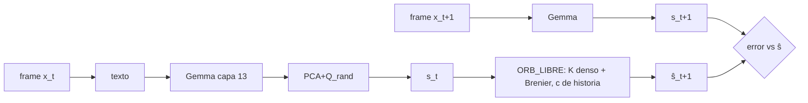

# PRERREGISTRO — ¿ÓRBITA aprende dinámica latente general (no geometría)? · rama `exp/orbita-dinamica-latente`

Fecha: 2026-10-26 (America/Mexico_City). Este documento se publica (commit+push) ANTES de ejecutar DEV. Nada de TEST (0 consultas).

## 1. Mejor versión y commit base
- Mejor versión de ÓRBITA: **ÓRBITA-v1** (núcleo Koopman congelado + corrector Brenier/ICNN), `exp/orbita` @ `1bc624f`
  (docs: `release/orbita-main` @ `b7fe616`; en el consolidado `exp/mejor-arquitectura` @ `7abd4e7`, ÓRBITA-v1 es la línea base; ganador global CST v4 `fd80320`).
- Rama creada desde `9166f1f` (`exp/orbita-yo`, origen del código de ÓRBITA en main según ORBITA_MAIN.md): contiene `1bc624f` como ancestro
  y además `orbita/src/gemma_embed.rs` y `orbita/llm/d3.py`, necesarios para la cadena Gemma. Worktree aparte: `/workspace/ngm-dinlat`.

## 2. Auditoría del sesgo geométrico (código en 9166f1f / main)
| Sesgo | Dónde |
|---|---|
| Estado = coordenadas 2-D de puntos | `orbita/src/model.rs` l. 2–7 |
| Núcleo con bloques rotación-escala impuestos ρ_j R(ω_j), Q Cayley | `model.rs` l. 44–63, 96–104, 117–126 |
| Corrector Brenier (gradiente de convexa; no geométrico per se) | `model.rs` l. 128–136 |
| Contexto = one-hot de familia + p | `src/v4_dataset.rs` l. 36, 136–141 |
| Familias todas geométricas, cos/sin explícitos | `v4_dataset.rs` l. 22–34, 92–124 |
| Familias “nuevas” = rotaciones + warps; re-identificación por rejilla sobre 8 familias | `orbita/src/fam.rs` l. 9–19, 23–32 |
| D3 = argmax de familia (D2) + p por regex → reconstruye one-hot | `orbita/llm/d3.py` l. 1–3, 23–26; `d2.py` l. 50/64 (CE sobre etiquetas) |
| Gemma solo codifica la instrucción; los estados son verdad numérica, no observaciones de Gemma | `orbita/llm/pipeline.py` |
| Ablación K libre (B1) y demás: registradas “En curso”; corridas en `/workspace/orbita-data/abl_B` fallaron (binario ausente / Killed) | **falta** resultado |

## 3. Diseño
Cadena: frame x_t → texto `estado: ±0.00 …` (8 números) → Gemma-2-2B-it Q4_K_M, salida tras capa 12 (`--exit-after 12`, “capa 13”), media de tokens → e_t ∈ R^2304
→ s_t = ((e_t − μ) Pᵀ / σ) Q_rand ∈ R^16 (PCA ajustada solo con frames train del seed, sin etiquetas; Q_rand ortogonal aleatoria fija por seed).
ÓRBITA predice ŝ_{t+1}; la validación es la observación real de Gemma s_{t+1} del frame siguiente (espacio de Gemma proyectado).

Familias (solo para generar datos y para el brazo con sesgo):
- Entrenamiento (6): rotar, trasladar, escalar (geométricas); logística r∈[3.6,3.99] (caótica); modsuma (aritmética modular); regla_signo (lógica por tramos).
- Transferencia (3, nunca vistas): cizalla (geom.), tienda (caótica), rodar_suma (lógica/aritmética).
- Por seed: 8 eps train ×6, 4 held-out ×6, 4 transferencia ×3 = 84 episodios × 9 frames = 756 textos.

Brazos:
- **PERS**: ŝ_{t+1}=s_t. **AR2**: ridge (α=1) sobre [s_t, s_{t−1}, 1].
- **ORB_LIBRE**: z=[s; g(s,c)] (lift 16), y = K(c) z + β(c), K(c)=K0+Σ_k mix_k(c) K_k **denso sin estructura**; corrector Brenier r=2;
  c = media de MLP([s_τ, s_{τ+1}−s_τ]) sobre transiciones observadas τ<t (**sin etiquetas**).
- **ORB_SESGO**: réplica en torch del núcleo de `model.rs` (Q Cayley, bloques ρ R(ω), β) + Brenier, con contexto VERDADERO one-hot(familia)+p.
- Entrenamiento: Adam lr 1e-3, wd 1e-3, 2500 pasos full-batch, pérdida MSE a 1 paso (t=1..7), parada temprana con 25 % de episodios train
  (validación interna, cada 50 pasos). Hiperparámetros fijos, no se ajustan con DEV.

Métrica: MSE_A = media sobre episodios y t=2..7 de ‖ŝ_{t+1}−s_{t+1}‖². G(A vs B) = log(MSE_B/MSE_A) por seed (>0 ⇒ A mejor).
IC95: bootstrap pareado por seed, 10 000 remuestreos, semilla 12345, percentil. δ = 0,05. DEV 0xA400–0xA40F, CONFIRM 0xB400–0xB40F.

Controles (re-entrenando AR2 y ORB_LIBRE): C1 permutado entre episodios por t; C2 barajado temporal dentro del episodio.
Secundarios: h3 autoregresivo; desglose geométricas/no geométricas; ORB_SESGO y AR2 vs PERS; transferencia vs AR2.

## 4. Hipótesis y criterios
- **H1 (primaria)**: G(ORB_LIBRE vs AR2) en held-out, IC95 inferior > δ en DEV **y** CONFIRM.
- H2: G(ORB_LIBRE vs PERS) held-out, IC inferior > δ. H3: no inferioridad vs ORB_SESGO, IC inferior > −δ.
- H4 (transferencia): G(ORB_LIBRE vs PERS) en familias nuevas, IC inferior > δ.
- V1/V2 (validez): en C1 y C2, G(ORB_LIBRE vs AR2) con IC superior < δ (sin ganancia espuria).
- Éxito = H1 en DEV y CONFIRM con V1 y V2. Fracaso = H1 no cumplida en alguna fase. Resto: no concluyente/descriptivo.
- **Gate DEV→CONFIRM**: media DEV de G(ORB_LIBRE vs AR2) > 0 **y** IC inferior DEV de H2 > 0. Si falla: no se corre CONFIRM, veredicto “no confirmado (parada en DEV)”.
- Sin relanzamientos: un seed que falle se reporta como falta.

## 5. Paso 0 (hecho antes de este commit)
- `orbita/dinlat/test_dinlat.py`: generación determinista, familias train∩transfer=∅, reproducibilidad bit a bit de `run.py`, AR2<PERS con embebido sintético. PASA.
- Determinismo Gemma: mismos 3 textos embebidos dos veces → max|diff| = 0,0.
- Coste medido: 0,72 s/texto (40 textos, 1 proceso, 8 CPU). Por fase 12 096 textos ⇒ ≈2,4 h de Gemma + ≈1 min/seed de entrenamiento.

## 6. Pseudocódigo
```
for seed in FASE: eps = gen(seed); E = gemma(texto(frames))       # 756 × 2304
  S = PCA_train(E) · Q_rand
  ajustar AR2, ORB_LIBRE (sin etiquetas), ORB_SESGO (one-hot+p) en S[train]
  MSE en S[ho], S[tf]; controles C1, C2
analyze: G por seed → bootstrap pareado → criterios
```

