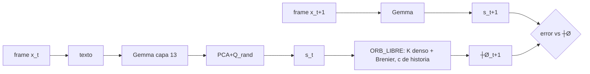

# PRERREGISTRO ÔÇö ┬┐├ôRBITA aprende din├ímica latente general (no geometr├¡a)? ┬À rama `exp/orbita-dinamica-latente`

Fecha: 2026-10-26 (America/Mexico_City). Este documento se publica (commit+push) ANTES de ejecutar DEV. Nada de TEST (0 consultas).

## 1. Mejor versi├│n y commit base
- Mejor versión de ÓRBITA: **ÓRBITA-v1** (núcleo Koopman congelado + corrector Brenier/ICNN), `exp/orbita` @ `1bc624f`
  (docs: `release/orbita-main` @ `b7fe616`; en el consolidado `exp/mejor-arquitectura` @ `7abd4e7`, ÓRBITA-v1 es la línea base; ganador global CST v4 `fd80320`).
- Rama creada desde `9166f1f` (`exp/orbita-yo`, origen del código de ÓRBITA en main según ORBITA_MAIN.md): contiene `1bc624f` como ancestro
  y además `orbita/src/gemma_embed.rs` y `orbita/llm/d3.py`, necesarios para la cadena Gemma. Worktree aparte: `/workspace/ngm-dinlat`.

## 2. Auditor├¡a del sesgo geom├®trico (c├│digo en 9166f1f / main)
| Sesgo | D├│nde |
|---|---|
| Estado = coordenadas 2-D de puntos | `orbita/src/model.rs` l. 2ÔÇô7 |
| N├║cleo con bloques rotaci├│n-escala impuestos ¤ü_j R(¤ë_j), Q Cayley | `model.rs` l. 44ÔÇô63, 96ÔÇô104, 117ÔÇô126 |
| Corrector Brenier (gradiente de convexa; no geom├®trico per se) | `model.rs` l. 128ÔÇô136 |
| Contexto = one-hot de familia + p | `src/v4_dataset.rs` l. 36, 136ÔÇô141 |
| Familias todas geom├®tricas, cos/sin expl├¡citos | `v4_dataset.rs` l. 22ÔÇô34, 92ÔÇô124 |
| Familias ÔÇ£nuevasÔÇØ = rotaciones + warps; re-identificaci├│n por rejilla sobre 8 familias | `orbita/src/fam.rs` l. 9ÔÇô19, 23ÔÇô32 |
| D3 = argmax de familia (D2) + p por regex  reconstruye one-hot | `orbita/llm/d3.py` l. 13, 2326; `d2.py` l. 50/64 (CE sobre etiquetas) |
| Gemma solo codifica la instrucci├│n; los estados son verdad num├®rica, no observaciones de Gemma | `orbita/llm/pipeline.py` |
| Ablaci├│n K libre (B1) y dem├ís: registradas ÔÇ£En cursoÔÇØ; corridas en `/workspace/orbita-data/abl_B` fallaron (binario ausente / Killed) | **falta** resultado |

## 3. Dise├▒o
Cadena: frame x_t ÔåÆ texto `estado: ┬▒0.00 ÔǪ` (8 n├║meros) ÔåÆ Gemma-2-2B-it Q4_K_M, salida tras capa 12 (`--exit-after 12`, ÔÇ£capa 13ÔÇØ), media de tokens ÔåÆ e_t Ôêê R^2304
ÔåÆ s_t = ((e_t ÔêÆ ╬╝) PßÁÇ / ¤â) Q_rand Ôêê R^16 (PCA ajustada solo con frames train del seed, sin etiquetas; Q_rand ortogonal aleatoria fija por seed).
├ôRBITA predice ┼Ø_{t+1}; la validaci├│n es la observaci├│n real de Gemma s_{t+1} del frame siguiente (espacio de Gemma proyectado).

Familias (solo para generar datos y para el brazo con sesgo):
- Entrenamiento (6): rotar, trasladar, escalar (geom├®tricas); log├¡stica rÔêê[3.6,3.99] (ca├│tica); modsuma (aritm├®tica modular); regla_signo (l├│gica por tramos).
- Transferencia (3, nunca vistas): cizalla (geom.), tienda (ca├│tica), rodar_suma (l├│gica/aritm├®tica).
- Por seed: 8 eps train ×6, 4 held-out ×6, 4 transferencia ×3 = 84 episodios × 9 frames = 756 textos.

Brazos:
- **PERS**: ┼Ø_{t+1}=s_t. **AR2**: ridge (╬▒=1) sobre [s_t, s_{tÔêÆ1}, 1].
- **ORB_LIBRE**: z=[s; g(s,c)] (lift 16), y = K(c) z + β(c), K(c)=K0+Σ_k mix_k(c) K_k **denso sin estructura**; corrector Brenier r=2;
  c = media de MLP([s_¤ä, s_{¤ä+1}ÔêÆs_¤ä]) sobre transiciones observadas ¤ä<t (**sin etiquetas**).
- **ORB_SESGO**: r├®plica en torch del n├║cleo de `model.rs` (Q Cayley, bloques ¤ü R(¤ë), ╬▓) + Brenier, con contexto VERDADERO one-hot(familia)+p.
- Entrenamiento: Adam lr 1e-3, wd 1e-3, 2500 pasos full-batch, p├®rdida MSE a 1 paso (t=1..7), parada temprana con 25 % de episodios train
  (validación interna, cada 50 pasos). Hiperparámetros fijos, no se ajustan con DEV.

M├®trica: MSE_A = media sobre episodios y t=2..7 de ÔÇû┼Ø_{t+1}ÔêÆs_{t+1}ÔÇû┬▓. G(A vs B) = log(MSE_B/MSE_A) por seed (>0 ÔçÆ A mejor).
IC95: bootstrap pareado por seed, 10 000 remuestreos, semilla 12345, percentil. ╬┤ = 0,05. DEV 0xA400ÔÇô0xA40F, CONFIRM 0xB400ÔÇô0xB40F.

Controles (re-entrenando AR2 y ORB_LIBRE): C1 permutado entre episodios por t; C2 barajado temporal dentro del episodio.
Secundarios: h3 autoregresivo; desglose geom├®tricas/no geom├®tricas; ORB_SESGO y AR2 vs PERS; transferencia vs AR2.

## 4. Hip├│tesis y criterios
- **H1 (primaria)**: G(ORB_LIBRE vs AR2) en held-out, IC95 inferior > ╬┤ en DEV **y** CONFIRM.
- H2: G(ORB_LIBRE vs PERS) held-out, IC inferior > ╬┤. H3: no inferioridad vs ORB_SESGO, IC inferior > ÔêÆ╬┤.
- H4 (transferencia): G(ORB_LIBRE vs PERS) en familias nuevas, IC inferior > ╬┤.
- V1/V2 (validez): en C1 y C2, G(ORB_LIBRE vs AR2) con IC superior < ╬┤ (sin ganancia espuria).
- Éxito = H1 en DEV y CONFIRM con V1 y V2. Fracaso = H1 no cumplida en alguna fase. Resto: no concluyente/descriptivo.
- **Gate DEVCONFIRM**: media DEV de G(ORB_LIBRE vs AR2) > 0 **y** IC inferior DEV de H2 > 0. Si falla: no se corre CONFIRM, veredicto no confirmado (parada en DEV).
- Sin relanzamientos: un seed que falle se reporta como falta.

## 5. Paso 0 (hecho antes de este commit)
- `orbita/dinlat/test_dinlat.py`: generaci├│n determinista, familias trainÔê®transfer=Ôêà, reproducibilidad bit a bit de `run.py`, AR2<PERS con embebido sint├®tico. PASA.
- Determinismo Gemma: mismos 3 textos embebidos dos veces  max|diff| = 0,0.
- Coste medido: 0,72 s/texto (40 textos, 1 proceso, 8 CPU). Por fase 12 096 textos  2,4 h de Gemma + 1 min/seed de entrenamiento.

## 6. Pseudoc├│digo
```
for seed in FASE: eps = gen(seed); E = gemma(texto(frames))       # 756 × 2304
  S = PCA_train(E) ┬À Q_rand
  ajustar AR2, ORB_LIBRE (sin etiquetas), ORB_SESGO (one-hot+p) en S[train]
  MSE en S[ho], S[tf]; controles C1, C2
analyze: G por seed  bootstrap pareado  criterios
```

