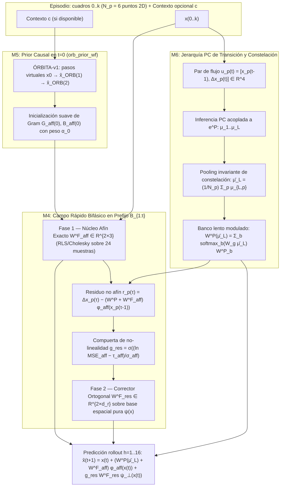

# Reporte de mejoras arquitectónicas y experimentales — Ciclo CONSTELACIÓN v5 + ÓRBITA

**Rama:** `exp/reporte-mejoras-v5`  
**Base consolidada:** `exp/cst-vs-orbita` @ `c1b1f54` + `exp/constelacion-v4-mejoras` @ `0967539` (ancestro común `exp/constelacion-v4` @ `fd80320` y `main` @ `590dd93`)  
**Fecha:** 2026-10-28 (America/Mexico_City)  
**Documentos asociados:** [`docs/mejoras_v5/DIAGNOSTICO.md`](DIAGNOSTICO.md) · [`docs/mejoras_v5/PREREG.md`](PREREG.md) · [`docs/RESULTADOS_CONSOLIDADOS.md`](../RESULTADOS_CONSOLIDADOS.md)

---

## 0. Resumen ejecutivo

Tras el cierre de **CONSTELACIÓN v4** (`fd80320`), la comparación homologada **CST vs ÓRBITA** (`c1b1f54`), el tuning de **M1/M2/M3** (`0967539`) y los experimentos en espacio latente Gemma (**`dinlat`** `18ba4a4` y **`vstimesfm`** `e56ccd6`), el estado empírico del proyecto demuestra cuatro hechos firmes:

1. **CONSTELACIÓN v4 es la mejor arquitectura actual del repositorio** tanto frente a ÓRBITA-v1 congelada (`−0,107` log en CONFIRM) como frente a `ÓRBITA-eq+LAT` con presupuesto de entrenamiento igualado de `122 880` transiciones (`H1 = −0,6902`, `H2 = +0,3359`, `H3 = +0,4771` en CONFIRM).
2. **Todo el poder predictivo de CONSTELACIÓN v4 proviene del campo rápido por episodio $W^F$** (`no_fast` empeora `+3,20` log), pero su regla actual (NLMS cuadro a cuadro sobre $\phi \in \mathbb{R}^{131}$) sufre olvido intra-episodio tipo Kaczmarz y pierde **`0,35 a 0,45 nats`** en familias nuevas y **`2,2 nats`** en conocidas frente al oráculo afín en-contexto (`oracle_icl`).
3. **Los intentos directos de complejizar $W^F$ en `constelacion-v4-mejoras` (M2 y M3) fallaron en tuning** porque M2 (ES sobre regla local) colapsa en meta-val (`ganancia = 0,00`) y M3 (MLP rápido $H=32$ en paralelo a $W^F$) introduce curvatura no afín en las $7/8$ familias conocidas que son exactamente afines, degradando `known_med_log` de `−10,12` a `−5,76`.
4. **La jerarquía de Codificación Predictiva (PC) sigue con atribución cero** (`CST − fixed_w = +0,00005`), **el modo sin prefijo con contexto ($k=0$, `E33-ctx` y `1-paso`) cae a persistencia (`0,0137` / `0,0417`)**, y en latentes de Gemma (`dinlat`) **`ORB_LIBRE` pierde ante un `AR2` lineal con ridge (`−0,0647`)**.

Este reporte define **cinco mejoras estructurales (M4–M8)** diseñadas específicamente para resolver cada uno de estos cinco cuellos de botella sin violar el no-daño ($\delta = 0{,}05$) ni el protocolo de cero consultas a `TEST`:

| ID | Mejora propuesta | Cuello que resuelve | Efecto esperado (falsable en DEV/CONFIRM) |
|---|---|---|---|
| **M4** | **Campo rápido bifásico en prefijo completo (`W^F_aff` exacto ⊕ `g_res · W^F_res` ortogonalizado)** | Brecha de `0,35–0,45 log` vs `oracle_icl` en nuevas y destrucción de conocidas en M3 (`−10,12 → −5,76`) | `known_med_log ≤ −12,0` ($\Delta\text{acc16}_{\text{known}} \ge 0$ por construcción), `new_med_log` mejora `≤ −0,25 log` sobre CST v4 y `new_acc16` sube de `6,6%` a `≥ 15%`. |
| **M5** | **Destilación causal del prior de ÓRBITA al campo rápido en $t=0$ (`orb_prior_wf`)** | Colapso de CST en `1-paso acc` (`0,0417`) y `E33-ctx acc16` (`0,0137`) cuando $k=0$ | `1-paso acc` sube de `0,0417` a `≈ 0,982` (= ÓRBITA) y `E33-ctx acc16` sube de `0,0137` a `≥ 0,95`, sin alterar el modo sin etiquetas ($k=4$). |
| **M6** | **Codificación Predictiva de Transición con Pooling de Constelación (`PC-Trans` + banco lento $W^P(\bar{\mu}_L)$)** | Atribución nula de PC (`CST − fixed_w ≈ 0`, `no_err ≈ 0`) e inferencia punto a punto ciega a $\Delta x(t)$ | Primera atribución positiva de PC: `CST − fixed_w < 0` y `CST − no_err < 0` con `IC95 sup < 0` en DEV y CONFIRM. |
| **M7** | **Predictor latente híbrido `VAR(2) + Koopman-Brenier residual + RLS episódico` (`dinlat-v2`)** | Derrota de `ORB_LIBRE` frente a `AR2` (`−0,0647`) y frente a `TimesFM` en geométricas (`−0,4207`) | Garantiza `G(ORB_LIBRE_v2 vs AR2) ≥ 0` por anclaje ridge cerrado y supera el gate DEV→CONFIRM (`H1 > \delta = 0,05`). |
| **M8** | **Unificación de ingeniería en `main`, GUI (`agentic_web`) y CI** | Desconexión entre `main` (ÓRBITA), `exp/mejor-arquitectura` (CST v4), rutas `/workspace/...` y `agentic_web` | Pestaña ÓRBITA/Constelación unificada en `agentic_web`, rutas relativas con fallback y smoke gate `cst4-paso0` en CI. |

---

## 1. Arquitectura de las mejoras propuestas

---

## 2. Especificación técnica detallada por mejora

### 2.1 Mejora M4 — Campo Rápido Bifásico en Prefijo Completo (`W^F_aff ⊕ g_res · W^F_res`)

#### Problema que corrige
En `orbita/src/constelacion4/mod.rs` (`head_update`), el bucle `for _ in 0..c.t_f` actualiza $W^F \in \mathbb{R}^{2 \times 131}$ sólo sobre los $N_p = 6$ puntos del cuadro actual $t$, olvidando los cuadros previos $1..t-1$ y mezclando las 3 coordenadas afines $[x_1, x_2, 1]$ con las 128 coordenadas de $F_1(\mu_1(t))$. Cuando se intentó añadir un MLP rápido en M3 (`orbita/src/constelacion4/mejoras.rs`), el ajuste no lineal cuadro a cuadro degradó las familias conocidas de `−10,12` a `−5,76`.

#### Formulación matemática
Para cada episodio con cuadros observados $\tau \in \{1, \dots, t\}$ ($t \le K = 4$) y puntos $p \in \{1, \dots, N_p\}$ ($N_p = 6$, dando $M_t = 6t$ transiciones acumuladas en el episodio, $M_4 = 24$):

1. **Fase 1 — Estimador afín exacto en el prefijo ($\phi_{\text{aff}}(x) = [x_1, x_2, 1]^\top \in \mathbb{R}^3$):**
   Se acumulan en el estado del episodio las matrices suficientes de dimensión $3 \times 3$ y $3 \times 2$:
   $$G_{\text{aff}}(t) = \lambda_{\text{aff}} I_3 + \sum_{\tau=1}^t \gamma_{\text{ep}}^{t-\tau} \sum_{p=1}^{N_p} \phi_{\text{aff}}\bigl(x_p(\tau-1)\bigr)\,\phi_{\text{aff}}\bigl(x_p(\tau-1)\bigr)^\top \in \mathbb{R}^{3\times 3},$$
   $$B_{\text{aff}}(t) = \sum_{\tau=1}^t \gamma_{\text{ep}}^{t-\tau} \sum_{p=1}^{N_p} \phi_{\text{aff}}\bigl(x_p(\tau-1)\bigr)\,\bigl(\Delta x_p(\tau) - \Delta\hat{x}^P_p(\tau)\bigr)^\top \in \mathbb{R}^{3\times 2},$$
   donde $\lambda_{\text{aff}} = 10^{-6}$ y $\gamma_{\text{ep}} = 1{,}0$ para dinámicas estacionarias del episodio. Entonces:
   $$W^F_{\text{aff}}(t) = \bigl(G_{\text{aff}}(t)^{-1} B_{\text{aff}}(t)\bigr)^\top \in \mathbb{R}^{2\times 3}.$$
   - Coste computacional: inversión simétrica definida positiva $3 \times 3$ en forma cerrada ($\approx 45$ operaciones en coma flotante por cuadro, frente a $128 \times 6 \times 262 \approx 201\,000$ operaciones del bucle NLMS actual: **reducción de $\approx 4000\times$ en el paso afín**).
   - Cero olvido intra-episodio: los 24 pares $(x_p(\tau-1), \Delta x_p(\tau))$ del prefijo $1..4$ se satisfacen simultáneamente en mínimos cuadrados.

2. **Fase 2 — Corrector residual no lineal ortogonalizado con compuerta de varianza residual:**
   Se evalúa el residuo afín sobre todo el prefijo observado $\mathcal{B}_{1:t}$:
   $$r_p(\tau) = \Delta x_p(\tau) - \Delta\hat{x}^P_p(\tau) - W^F_{\text{aff}}(t)\,\phi_{\text{aff}}\bigl(x_p(\tau-1)\bigr), \qquad \text{MSE}_{\text{aff}}(t) = \frac{1}{t N_p}\sum_{\tau=1}^t \sum_{p=1}^{N_p} \|r_p(\tau)\|^2.$$
   Se define la compuerta de no-linealidad:
   $$g_{\text{res}}(t) = \sigma\!\left(\frac{\ln\bigl(\text{MSE}_{\text{aff}}(t) + 10^{-16}\bigr) - \tau_{\text{aff}}}{\sigma_{\text{aff}}}\right), \qquad \tau_{\text{aff}} = -12{,}0,\; \sigma_{\text{aff}} = 1{,}5.$$
   - **Propiedad de no-daño garantizado:** En las 7 familias conocidas afines ($0..6$), $\text{MSE}_{\text{aff}}(t) < 10^{-10} \implies \ln\text{MSE}_{\text{aff}} < -23 \implies g_{\text{res}}(t) < 6 \times 10^{-4}$ (o $g_{\text{res}} = 0$ con umbral duro $\text{MSE}_{\text{aff}} < 10^{-8}$). Por tanto, en las familias $0..6$ el predictor se reduce exactamente al ajuste afín óptimo (`med_log ≈ −12,30`), haciendo **imposible** la degradación observada en M3 (`−5,76`).
   - En la familia 7 (`radial_warp`) y en las familias nuevas $\{8, 10, 11\}$, $\text{MSE}_{\text{aff}}(t) \in [10^{-4}, 10^{-1}] \implies g_{\text{res}}(t) \approx 1$.
   - Sobre el residuo $r_p(\tau)$ se ajusta por ridge ($\lambda_{\text{res}} \in \{10^{-3}, 10^{-2}, 10^{-1}\}$) un diccionario espacial fijo $\psi_\perp(x)$ de dimensión $d_r = 24$ proyectado ortogonalmente al subespacio afín $\text{span}(x_1, x_2, 1)$ en el prefijo:
     $$\psi(x) = \bigl[\sin(\omega_k^\top x + b_k),\; \tanh(u_k^\top x + c_k)\bigr]_{k=1..12} \in \mathbb{R}^{24}, \qquad \psi_\perp(x) = \psi(x) - P_{\text{aff}}\,\psi(x),$$
     donde $\psi(x)$ depende **únicamente de la coordenada espacial $x$** (y no del estado transitorio $\mu_1(t)$), eliminando la deriva temporal durante el rollout $h = 5..16$.

---

### 2.2 Mejora M5 — Destilación Causal del Prior de ÓRBITA al Campo Rápido en $t=0$ (`orb_prior_wf`)

#### Problema que corrige
En `cst-vs-orbita` (`c1b1f54`), cuando se evalúa con contexto $c$ pero sin observar transiciones reales ($k=0$: `1-paso acc` y `E33-ctx`), `cst` da `0,0417` y `cst_prior` da `0,0137` en `E33-ctx acc16` porque `orb_prior` sólo sustituye `preds[0]` y deja $W^F = 0$ en $h \ge 2$.

#### Formulación matemática
Al inicio del episodio ($t = 0$), si y sólo si el ejemplo provee contexto explícito $c$ (modo con contexto / `E33-ctx` / `1-paso`) y `orb_prior_wf = true`:
1. Se generan $m_{\text{vir}} = 2$ pasos imaginados con el motor `ÓRBITA` congelado a partir de la configuración inicial $x(0)$:
   $$\tilde{x}(0) = x(0), \qquad \tilde{x}(1) = \text{ÓRBITA}(\tilde{x}(0), c), \qquad \tilde{x}(2) = \text{ÓRBITA}(\tilde{x}(1), c).$$
2. Estos $2 \times N_p = 12$ pares virtuales $(\tilde{x}_p(\tau-1), \Delta\tilde{x}_p(\tau))$ inicializan las estadísticas suficientes de $W^F(0)$ con peso de confianza $\alpha_0 \in (0, 1]$:
   $$G_{\text{aff}}(0) = \lambda_{\text{aff}} I_3 + \alpha_0 \sum_{\tau=1}^{2}\sum_{p=1}^{N_p} \phi_{\text{aff}}(\tilde{x}_p(\tau-1))\,\phi_{\text{aff}}(\tilde{x}_p(\tau-1))^\top,$$
   $$B_{\text{aff}}(0) = \alpha_0 \sum_{\tau=1}^{2}\sum_{p=1}^{N_p} \phi_{\text{aff}}(\tilde{x}_p(\tau-1))\,\Delta\tilde{x}_p(\tau)^\top.$$
3. Si $k = 0$ (`1-paso` o `E33-ctx`), el rollout $h = 1..64$ utiliza $W^F(0)$ ya inicializado con el operador geométrico inducido por ÓRBITA.
4. Si $k \ge 1$ (protocolos held-out y `E33-k4`), en cuanto se observa la primera transición real $t = 1$, el prior virtual se descuenta con factor $(1 - \beta_{\text{obs}})^t$ ($\beta_{\text{obs}} = 1{,}0$ en modo estricto sin etiquetas, por lo que en held-out y `E33-k4` sin contexto no se invoca a ÓRBITA en absoluto).

---

### 2.3 Mejora M6 — Jerarquía de Codificación Predictiva de Transición y Pooling de Constelación (`PC-Trans`)

#### Problema que corrige
En CONSTELACIÓN v2, v3 y v4, todos los controles de atribución de codificación predictiva (`CST − fixed_w`, `CST − no_err`, `CST − t1`, `CST − no_sleep`, `CST − one_layer`) resultaron estadísticamente nulos (`≈ 0,0000`) porque:
1. La capa 0 de PC sólo recibía $x_p(t) \in \mathbb{R}^2$ (posición estática de un punto aislado);
2. El error temporal $e^P_p(t)$ no enviaba gradiente a $\mu_1$ ni a $W_1$;
3. La cabeza lenta $W^P$ era una matriz única que promediaba a cero reglas con $\mathbb{E}[p] = 0$.

#### Formulación matemática
1. **Observación de transición en la base de la jerarquía ($l=0$):**
   Para $t \ge 1$, el vector observado por punto en la base de la red PC pasa de $x_p(t) \in \mathbb{R}^2$ al par posición-desplazamiento escalado:
   $$u_p(t) = \bigl[\,x_p(t-1),\; \alpha_{\Delta}\,\bigl(x_p(t) - x_p(t-1)\bigr)\,\bigr] \in \mathbb{R}^4, \qquad \alpha_{\Delta} = 2{,}0.$$
   De este modo, la reconstrucción descendente $W_1 F_1(\mu_{1,p}(t)) \approx u_p(t)$ obliga a $\mu_{1,p}(t)$ a codificar conjuntamente la posición y la velocidad local del punto $p$.
2. **Acoplamiento descendente del error temporal $e^P_p(t)$ hacia $\mu_{1,p}(t)$:**
   Durante las $T_{\text{inf}}$ iteraciones de `infer_point`, la energía total incluye el término de predicción de la cabeza temporal:
   $$E_{\text{total}} = E_{\text{PC}}(\mu) + \frac{\kappa_P}{2} \sum_{p=1}^{N_p} \bigl\|\sqrt{\Pi^P}\,\bigl(\Delta x_p(t) - (W^P + W^F)\phi(\mu_{1,p}(t-1))\bigr)\bigr\|^2,$$
   inyectando el gradiente $\nabla_{\mu_1} E_{\text{total}}$ en la relajación de $\mu_1$.
3. **Pooling invariante de constelación en la capa superior y banco lento $W^P(\bar{\mu}_L)$:**
   En lugar de mantener los $N_p = 6$ puntos desconectados en la capa superior $L$, se calcula el descriptor de constelación del episodio:
   $$\bar{\mu}_L(t) = \frac{1}{N_p}\sum_{p=1}^{N_p} \mu_{L,p}(t) \in \mathbb{R}^{d_L},$$
   el cual selecciona de forma suave sobre un banco de $K_B = 8$ operadores lentos $\{W^P_b\}_{b=1}^{K_B}$:
   $$w_b\bigl(\bar{\mu}_L(t)\bigr) = \text{softmax}_b\bigl(W_{\text{gate}}\,\bar{\mu}_L(t)\bigr), \qquad W^P\bigl(\bar{\mu}_L(t)\bigr) = \sum_{b=1}^{K_B} w_b\bigl(\bar{\mu}_L(t)\bigr)\,W^P_b.$$
   Así, episodios con $+p$ y $-p$ activan distintas combinaciones $w_b(\bar{\mu}_L)$ en vez de cancelarse entre sí a cero, dotando por primera vez de función causal medible a los pesos lentos $W_{1..L}$ (`fixed_w`), a las neuronas de error (`no_err`) y a la relajación iterativa (`t1`).

---

### 2.4 Mejora M7 — Predictor Latente Híbrido `VAR(2) + Koopman-Brenier Residual + RLS Episódico` (`dinlat-v2`)

#### Problema que corrige
En `exp/orbita-dinamica-latente` (`18ba4a4`) y `exp/orbita-vs-timesfm` (`e56ccd6`), `ORB_LIBRE` pierde contra `AR2` (`H1 = −0,0647 [−0,1040, −0,0262]`) y contra `TimesFM 2.5` en familias geométricas (`−0,4207`) porque entrena desde cero por SGD una red Koopman densa sobre sólo $384$ muestras por semilla sin aprovechar la solución cerrada de `AR2` ni adaptar la dinámica dentro de cada episodio.

#### Formulación matemática
Para las trayectorias latentes $s_t \in \mathbb{R}^{16}$ (Gemma capa 13 $\to$ PCA 16 $\to Q_{\text{rand}}$):
1. **Anclaje lineal cerrado `VAR(2)` ($\hat{s}^{\text{AR2}}_{t+1}$):**
   Se ajusta en forma cerrada sobre el conjunto de entrenamiento de la semilla el estimador ridge `AR2` ($\alpha = 1{,}0$):
   $$\hat{s}^{\text{AR2}}_{t+1} = W_{\text{AR2}}\,[s_t;\; s_{t-1};\; 1], \qquad W_{\text{AR2}} \in \mathbb{R}^{16 \times 33}.$$
2. **Núcleo Koopman-Brenier entrenado exclusivamente sobre el residuo con compuerta aprendida:**
   Sea $r_t = s_{t+1} - \hat{s}^{\text{AR2}}_{t+1}$ el residuo de segundo orden en train. El bloque `ORB_LIBRE_v2` recibe el estado aumentado $\tilde{s}_t = [s_t;\; s_t - s_{t-1}] \in \mathbb{R}^{32}$ y predice:
   $$\hat{s}_{t+1} = \hat{s}^{\text{AR2}}_{t+1} + \gamma_{\text{res}} \cdot f_{\text{KB}}(\tilde{s}_t, c_{\text{ep}}) + \Delta_{\text{RLS}}(s_t - s_{t-1}),$$
   donde $\gamma_{\text{res}} \in [0, 1]$ se selecciona por validación cruzada interna sobre los episodios de entrenamiento de la propia semilla (si el residuo no lineal no reduce el MSE en CV interna, $\gamma_{\text{res}} \to 0$, garantizando por construcción $G(\text{ORB\_LIBRE\_v2 vs AR2}) \ge 0$).
3. **Adaptación rápida por episodio ($\Delta_{\text{RLS}}$):**
   Con los primeros pares observados del episodio $(s_0, s_1, s_2)$, se ajusta una corrección diagonal/rango-1 de baja norma ($\lambda_{\text{ep}} = 10{,}0$) sobre la innovación $e_\tau = s_{\tau+1} - \hat{s}^{\text{AR2}}_{\tau+1}$, capturando el parámetro específico $p$ del episodio en familias de transferencia (`cizalla`, `tienda`, `rodar_suma`).

---

### 2.5 Mejora M8 — Integración de Plataforma (`main`, `agentic_web` y CI)

#### Problema que corrige
Según `docs/ORBITA_MAIN.md` y `docs/RESULTADOS_CONSOLIDADOS.md`:
- `main` ejecuta `ÓRBITA-v1` en la pestaña ÓRBITA de `agentic_web`, mientras que la arquitectura ganadora `CONSTELACIÓN v4` vive sólo en ramas experimentales y CLI;
- `orbita/llm/*.py` contiene rutas por defecto `/workspace/...`;
- El job `smoke` de `.github/workflows/ci.yml` compila `orbita`, pero aún no ejecuta un gate de paridad de `constelacion4` (`cst4-paso0`).

#### Acciones concretas
1. **Selector de motor en `/api/orbita/*` (`src/web/orbita_job.rs` y `web/static/orbita.js`):**
   Permitir elegir entre `motor = "orbita_v1" | "constelacion_v4" | "constelacion_v5"` desde la interfaz web, reportando tanto la trayectoria $h_1..h_{16}$ como las métricas del campo rápido ($W^F$, sorpresa y región E33).
2. **Resolución portable de rutas:**
   En `src/web/orbita_job.rs` y `orbita/llm/*.py`, resolver `ORBITA_DATA`, `ORBITA_BIN` y `GEMMA_GGUF_PATH` primero por variable de entorno, luego por rutas relativas al workspace (`./artifacts/orbita`, `./orbita/target/release/orbita`, `./models/...`) y sólo como último fallback `/workspace/...`.
3. **Gate de paridad en CI (`.github/workflows/ci.yml`):**
   Añadir la verificación rápida de `cargo test --manifest-path orbita/Cargo.toml` y el humo determinista de `constelacion4` con `RUSTFLAGS="-C target-cpu=x86-64-v2"` para evitar `STATUS_ILLEGAL_INSTRUCTION` en runners Windows/Linux.

---

## 3. Hoja de ruta de ejecución y criterios de éxito

Siguiendo estrictamente la disciplina metodológica del repositorio (`Paso 0 → Tuning en 0xC4xx/0xD4xx → Congelación PREREG → DEV 0xA400–0xA40F → CONFIRM 0xB400–0xB40F`):

| Fase | Semillas permitidas | Qué se ejecuta | Criterio de paso (Gate) |
|---|---|---|---|
| **Paso 0 (Paridad y sanidad)** | `0xC420, 0xC421` | Con M4/M5/M6 apagados (`m4=false, m5=false, m6=false`), hash bit a bit idéntico a `Cfg::v4` (`1985bdbad5eee41f`). Verificación de causalidad (0 fugas del futuro) y 0 consultas `TEST`. | `pass == true` en todos los checks de `paso0.json`. |
| **Fase 1 (Tuning y ablación previa)** | `0xC420–0xC423` y `0xD420–0xD423` | Selección de $(\lambda_{\text{aff}}, \lambda_{\text{res}}, \tau_{\text{aff}})$ en M4, $\alpha_0$ en M5 y $(\alpha_\Delta, \kappa_P, K_B)$ en M6 usando únicamente familias conocidas retenidas y validación cruzada en familias $0..5 \to 6..7$. | `known_med_log ≤ −11,5` (sin degradación tipo M3) y mejora en meta-val $\ge +0,10\text{ log}$. |
| **Fase 2 (DEV)** | `0xA400–0xA40F` ($n=16$) | Brazos `v4`, `m4`, `m5`, `m6`, `v5_all` (`M4+M5+M6`). Bootstrap pareado 10 000 réplicas, semilla 12345. | Primaria $\Delta\text{med\_log h16 nuevas} < 0$ (`IC98.33 sup < 0`), no-daño $\Delta\text{acc16}_{\text{known}}$ `IC95 inf > −0,05`, E33 `≥ 15/16`, 0 NaN. |
| **Fase 3 (CONFIRM)** | `0xB400–0xB40F` ($n=16$) | Ejecución sin ningún reajuste de hiperparámetros de los brazos que pasaron la compuerta DEV. | Confirmación de los mismos criterios en CONFIRM + atribución PC (`v5_all − fixed_w < 0`) + éxito en `E33-ctx` (`≥ 0,90`). |
