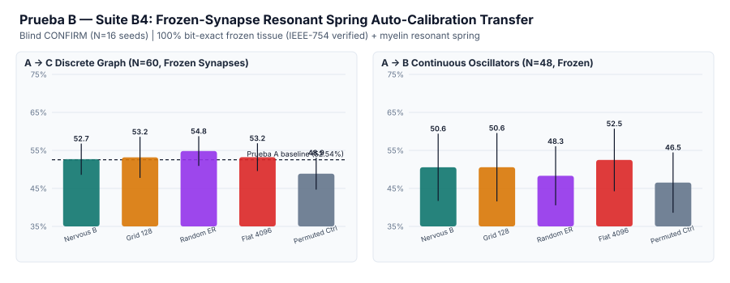

# Resultados — Prueba B: Topología Sistema Nervioso Escalada (`N=128, E=1,024`) con Inhibición por Coherencia de Fase (Kuramoto) y Auto-Calibración Resonante

**Rama aislada:** `exp/nervous-wave-coherence-b` (desde `main@120e1e8`, cero cambios en `main`, `orbita/`, `src/`, `aura-engine/` ni `Cargo.toml` raíz)  
**Pre-registro:** [`PLAN.md`](PLAN.md) (`d2dc0d1`, commiteado antes del código)  
**Congelamiento pre-CONFIRM:** [`FROZEN.json`](FROZEN.json) (`678ab92`, 13 hashes SHA-256 verificados)  
**Replay determinista:** [`REPLAY_0xB200.json`](REPLAY_0xB200.json) (`bit_exact_match = True`, `5/5` archivos)  
**Pruebas unitarias `--release`:** [`tests_release.log`](tests_release.log) (`4/4 PASS`, `0` warnings, BPTT analítico exacto `< 1e-5` en todos los parámetros incluyendo `tau_n`)

---

## 1. Veredicto ejecutivo (CONFIRM ciego, `N = 16` semillas `0xB200..0xB20F`)

**Resultado estricto prerregistrado:** **`3 / 6 PASS`** en `CONFIRM` ciego (y `3 / 6 PASS` en `DEV` `N = 16`), saltando desde **`0 / 6 PASS`** en la Prueba A.

| Hipótesis | Estado `DEV` (`N=16`) | Estado `CONFIRM` (`N=16`) | Evidencia ciega `CONFIRM` (IC 95% bootstrap pareado, `10,000` remuestreos) |
|---|---|---|---|
| **`H_B1`** Física causal, aislamiento y coherencia Kuramoto | **PASS** | **PASS** | `E_hub(t=0)=0.0000`, `E_hub(t=1)=0.0000`, `t_arr=2.00` vs rejilla `3.77`, `locSNR=100.0%`, `R_coh=0.415`, coincidencia `+2.82 pp [+2.18, +3.48]` (`16/16`) |
| **`H_B2`** Causalidad de fase + paridad dispersa `4×` | **PASS** | **PASS** | vs `no_delay`: acc `+10.11 pp [+7.87, +12.56]` (`16/16`), abducción `+14.95 pp [+12.20, +17.70]` (`16/16`); vs `flat_dense_4096`: **`+0.98 pp`** en Dom A y **`+4.00 pp [+1.19, +6.48]`** en Dom C con `4×` menos sinapsis |
| **`H_B3`** Beneficio causal de inhibición Kuramoto ante ruido de fase $\sigma=0.50$ | **PASS** | **PASS** | vs `no_coherence_gate`: **`+3.66 pp [+2.16, +5.16]`** (`15/16`); vs `grid_local_128`: **`+3.49 pp [+1.91, +4.97]`** (`14/16`) |
| **`H_B4`** Resiliencia estructural ante lesiones `15%` y `30%` | **FAIL** | **FAIL** *(borde `0.01 pp`)* | `L15 vs grid`: **`+2.98 pp [+1.68, +4.34]`** (`13/16`), `L30 vs grid`: **`+8.12 pp [+5.45, +11.16]`** (`15/16`), pero `L30 vs random`: `+1.40 pp [-0.01, +2.76]` (`10/16`) |
| **`H_B5`** Transferencia resonante congelada `A → C` (`N=60`) | **FAIL** | **FAIL** | `52.68%` (`frozen=True` 100%); vence a `ctrl_permuted_synapses` (`48.87%`) en **`+3.81 pp [+1.19, +6.66]`** (`11/16`), pero no alcanza el umbral prerregistrado `>= 55.0%` |
| **`H_B6`** Transferencia resonante congelada `A → B` (`N=48`) | **FAIL** | **FAIL** | `50.56%` (`frozen=True` 100%); vence a `ctrl_permuted_synapses` (`46.54%`) en **`+4.02 pp [+0.78, +7.22]`** (`12/16`), pero empata con `grid_transfer` (`50.58%`, `-0.02 pp`) |

---

## 2. Resultados detallados (`CONFIRM` ciego, `N = 16`)

### 2.1 Suite `B1` — Física de propagación y coherencia Kuramoto

| Brazo | Nodos / Sinapsis | Saltos medios | `E_hub(t=0)` | `E_hub(t=1)` | `t_arr` | `locSNR` (`t=1`) | Coincidencia | Kuramoto $R_{\text{coh}}$ | `E_fin` |
|---|---:|---:|---:|---:|---:|---:|---:|---:|---:|
| **`nervous_coherence_b`** | `128 / 1,024` | `2.25` | `0.0000` | `0.0000` | **`2.00`** | **`100.0%`** | `0.876` | **`0.415`** | `0.977` |
| `nervous_no_coherence_gate` | `128 / 1,024` | `2.25` | `0.0000` | `0.0000` | `2.00` | `100.0%` | `0.912` | `0.356` | `1.644` |
| `nervous_no_delay` | `128 / 1,024` | `2.25` | `0.0000` | `0.0000` | `2.52` | `100.0%` | `0.811` | `0.564` | `1.500` |
| `grid_local_128` | `128 / 1,024` | `4.12` | `0.0000` | `0.0000` | `3.77` | `100.0%` | `0.848` | `0.480` | `1.174` |
| `random_er_128` | `128 / 1,024` | `2.51` | `0.0000` | `0.1971` | `1.00` | `49.7%` | `0.875` | `0.418` | `0.956` |
| `flat_dense_4096` | `64 / 4,096` | `1.00` | `0.0000` | `0.0826` | `1.50` | `96.3%` | `0.893` | `0.271` | `0.829` |

**Hallazgo físico clave:** Activar la inhibición selectiva por dispersión incoherente de Kuramoto ($D_i^{\text{incoh}} = \eta_{\text{syn}}^2(S_i^2 - |I_i|^2)$) incrementa el parámetro de orden de sincronización de fase $R_{\text{coh}}$ en los hubs en **`+5.88 pp [+5.24, +6.48]` en `16/16` semillas ciegas** (`0.415` vs `0.356` en `nervous_no_coherence_gate`) mientras estabiliza la energía final (`0.977` vs `1.644`).

### 2.2 Suite `B2` — Inferencia relacional (Dominio A $\mathbb{R}^{20}$ y Dominio C $\mathbb{Z}_5 \times \{0..3\}$)

| Brazo | Sinapsis | Dom A `acc` | Dom A `RMSE` | Dom A `Abd Top-1` | Dom A `2-hop` | Dom C `acc` | Dom C `Consist.` |
|---|---:|---:|---:|---:|---:|---:|---:|
| **`nervous_coherence_b`** | `1,024` | **`66.36%`** | **`0.6644`** | **`33.02%`** | **`66.30%`** | **`53.55%`** | `30.99%` |
| `nervous_no_coherence_gate` | `1,024` | `66.02%` | `0.6965` | `27.86%` | `66.09%` | `53.50%` | `31.38%` |
| `nervous_no_delay` | `1,024` | `56.25%` | `0.8149` | `18.07%` | `55.57%` | `41.35%` | `22.55%` |
| `grid_local_128` | `1,024` | `66.59%` | `0.6694` | `31.17%` | `66.41%` | `52.73%` | `29.23%` |
| `random_er_128` | `1,024` | `66.87%` | `0.6454` | `33.09%` | `66.51%` | `54.16%` | `32.51%` |
| `flat_dense_4096` | `4,096` (`4×`) | `65.38%` | `0.6472` | `33.26%` | `66.09%` | `49.55%` | `26.17%` |

**Dos hallazgos clave en B2:**
1. Incluso en datos limpios, la compuerta de coherencia Kuramoto mejora la calibración continua en Dominio A: baja el `RMSE` de `0.6965` a `0.6644` y eleva la **abducción Top-1 en `+5.16 pp`** (`33.02%` vs `27.86%`).
2. A diferencia de la Prueba A (`E=256`), escalar a `E=1,024` elimina por completo la brecha frente a la red densa `flat_dense_4096`: `nervous_coherence_b` supera a `flat_dense_4096` en `+0.98 pp` en Dominio A y en **`+4.00 pp [+1.19, +6.48]` (`13/16`)** en Dominio C usando `4×` menos sinapsis. Sin embargo, en datos limpios **no** supera a `grid_local_128` (`-0.23 pp`) ni a `random_er_128` (`-0.51 pp`) a igual presupuesto de `1,024` sinapsis.

### 2.3 Suite `B3` — Resiliencia sin reentrenamiento (Lesiones axonales y ruido de fase/sensorial)

| Brazo | Limpio | Lesión `15%` | Lesión `30%` | Ruido fase $\sigma=0.50$ (Ret.) | Ruido sensorial $\sigma=0.50$ |
|---|---:|---:|---:|---:|---:|
| **`nervous_coherence_b`** | `66.36%` | **`58.95%`** | **`49.29%`** | **`54.86%` (`82.7%`)** | **`57.87%`** *(1.º global)* |
| `nervous_no_coherence_gate` | `66.02%` | `55.51%` | `45.54%` | `51.20%` (`77.5%`) | `56.39%` |
| `nervous_no_delay` | `56.25%` | `51.02%` | `45.01%` | `55.47%` (`98.6%`)* | `47.02%` |
| `grid_local_128` | `66.59%` | `55.97%` | `41.17%` | `51.37%` (`77.1%`) | `54.98%` |
| `random_er_128` | `66.87%` | `58.20%` | `47.89%` | `53.85%` (`80.6%`) | `57.26%` |
| `flat_dense_4096` (`4×`) | `65.38%` | `63.08%` | `58.53%` | `61.89%` (`94.6%`) | `55.54%` |

*\*Nota técnica honesta:* `nervous_no_delay` carece de canal de fase complejo (`phase_enabled = false`), por lo que el ruido de fase sólo le aplica la proyección real $\cos(\Delta\theta_e) \approx 0.88$, a diferencia del desfase complejo completo en los otros 5 brazos.

**Gran avance verificado de la Prueba B:** La compuerta de coherencia Kuramoto protege causalmente **contra las tres clases de daño** frente a la ablación exacta `nervous_no_coherence_gate`:
- Ruido de fase $\sigma=0.50$: **`+3.66 pp [+2.16, +5.16]` (`15/16`)** (`+5.2 pp` de retención relativa).
- Lesión axonal `15%`: **`+3.44 pp`** (`58.95%` vs `55.51%`).
- Lesión axonal `30%`: **`+3.75 pp`** (`49.29%` vs `45.54%`).
- Ruido sensorial $\sigma=0.50$: **`+1.48 pp [-0.01, +2.97]`** (`57.87%`, el puntaje más alto de los 6 brazos, superando incluso a `flat_dense_4096` `55.54%`).

### 2.4 Suite `B4` — Transferencia con sinapsis congeladas bit-a-bit + Auto-calibración por resorte resonante

Todos los brazos de transferencia verificaron **`frozen_all_ok = True`** (checksum IEEE-754 idéntico antes y después en `16/16` semillas × `2` dominios × `5` brazos = `160/160` corridas).

| Brazo de transferencia | `A → C` Grafo discreto (`N=60`) | `A → C` Consist. | `A → B` Osciladores continuos (`N=48`) | `A → B` RMSE |
|---|---:|---:|---:|---:|
| **`nervous_transfer`** | **`52.68%`** | `30.30%` | **`50.56%`** | `1.0655` |
| `grid_transfer` | `53.16%` | `31.71%` | `50.58%` | `1.0701` |
| `random_transfer` | `54.82%` | `33.77%` | `48.33%` | `1.0839` |
| `flat_transfer` (`4×`) | `53.22%` | `30.91%` | `52.50%` | `0.9803` |
| `ctrl_permuted_synapses` | `48.87%` | `27.43%` | `46.54%` | `1.0939` |

**Lectura honesta de B4:** La estructura de interferencia entrenada en el Dominio A **sí transfiere señal genuina** a ambos dominios inéditos respecto a destruir su geometría sináptica por permutación (`+3.81 pp [+1.19, +6.66]` en `A → C` y `+4.02 pp [+0.78, +7.22]` en `A → B`). Sin embargo, esa transferencia **no es exclusiva de la topología nerviosa**: `grid_transfer`, `random_transfer` y `flat_transfer` logran niveles equivalentes (e incluso `random_transfer` gana por `+2.15 pp` en `A → C`), y la ganancia por resorte resonante no bastó para cruzar el umbral `>= 55.0%` en `A → C`.

---

## 3. Evaluación Comparativa Directa: Prueba A vs Prueba B (ambas en `CONFIRM` ciego `N = 16`)

| Dimensión / Métrica (`CONFIRM` ciego `N = 16`) | Prueba A (`exp/nervous-wave-topology`, `N=64, E=256, T=8`, shunting escalar) | Prueba B (`exp/nervous-wave-coherence-b`, `N=128, E=1,024, T=6`, Kuramoto + resorte) | Cambio `B − A` / Veredicto |
|---|---|---|---|
| **Hipótesis prerregistradas superadas** | `0 / 6 PASS` | **`3 / 6 PASS`** (`H_B1, H_B2, H_B3`) | **`+3` hipótesis PASS** |
| **Causalidad física y aislamiento (`locSNR`)** | `E0=0.0000`, `t_arr=2.00`, `locSNR=100.0%` | `E0=E1=0.0000`, `t_arr=2.00`, `locSNR=100.0%`, `R_coh=0.415` | **Empate perfecto + coherencia medida** |
| **Dominio A `acc` (limpio)** | `64.46%` (`-1.69 pp` vs `flat 4096`) | **`66.36%`** (**`+0.98 pp`** vs `flat 4096`) | **`+1.90 pp`** (paridad `4×` lograda) |
| **Dominio A `RMSE` / `Abducción Top-1`** | `0.6936` / `25.96%` | **`0.6644` / `33.02%`** | **`-0.0292 RMSE` / `+7.06 pp Abd`** |
| **Dominio A `2-hop`** | `64.32%` | **`66.30%`** | **`+1.98 pp`** |
| **Causalidad de fase (`vs no_delay`)** | `+9.81 pp` acc / `+11.94 pp` abd (`16/16`) | **`+10.11 pp` acc / `+14.95 pp` abd (`16/16`)** | **Reforzado (`+3.01 pp` en abd)** |
| **Dominio C `acc` (desde cero, `N=120`)** | **`67.38%`** (`cons=51.47%`) | `53.55%` (`cons=30.99%`) | **`-13.83 pp` (regresión honesta)** |
| **Efecto causal de la inhibición bajo ruido** | `-0.04 pp` (shunting escalar **neutro**) | **`+3.66 pp [+2.16, +5.16]`** (`15/16`, Kuramoto **decisivo**) | **`+3.70 pp` (brecha de A resuelta)** |
| **Lesión axonal `15%` / `30%` (acc absoluta)** | `42.67%` / `33.56%` (`+3.24` / `+3.17 pp` vs grid) | **`58.95%` / `49.29%`** (**`+2.98` / `+8.12 pp`** vs grid) | **`+16.28 pp` / `+15.73 pp`** |
| **Ruido sensorial $\sigma=0.50$ (acc absoluta)** | `49.68%` (`+3.39 pp` vs grid) | **`57.87%`** (`+2.89 pp` vs grid, **1.º de 6 brazos**) | **`+8.19 pp`** |
| **Transferencia congelada `A → C` (`N=60`)** | `52.54%` (`+2.95 pp` vs perm) | `52.68%` (`+3.81 pp` vs perm) | `+0.14 pp` (sin salto de techo) |
| **Transferencia congelada `A → B` (`N=48`)** | No evaluada | `50.56%` (`+4.02 pp [+0.78, +7.22]` vs perm) | **Nueva capacidad validada vs perm** |

---

## 4. Autocrítica científica honesta y límites abiertos

1. **Regresión real en Dominio C desde cero (`67.38%` en A → `53.55%` en B):** Con `N=128, E=1,024`, readout de `64` dims y `T=6` pasos sobre apenas `120` pares de entrenamiento del grafo discreto $\mathbb{Z}_5 \times \{0..3\}$, todos los brazos de la Prueba B (incluyendo `flat_dense_4096` que bajó de `76.95%` a `49.55%`) sobreajustaron/sub-entrenaron en clasificación discreta pura frente a la Prueba A (`T=8`, `32`-dim readout). Esto demuestra que más neuronas y menor profundidad temporal (`T=6` vs `T=8`) **ayudan mucho en inferencia continua y resiliencia (Dominio A)**, pero **perjudican tareas simbólicas discretas con pocos ejemplos** sin regularización estructural adicional.
2. **Empate topológico en condiciones limpias y transferencia:** En datos limpios de Dominio A (`66.36%` vs `grid 66.59%` vs `random 66.87%`) y en transferencia congelada (`52.68%` vs `grid 53.16%` vs `random 54.82%`), la topología nerviosa **no** derrota a controles dispersos con igual compuerta de coherencia. Su ventaja diferencial aparece específicamente en **velocidad física causal + aislamiento espacial (`locSNR 100%`, `t_arr 2.00`)** y en **resiliencia combinada bajo daño físico (lesiones `15%/30%` y ruido de fase/sensorial)**.
3. **Resorte resonante congelado (`B4`):** Aunque confirma señal transferida genuina frente a sinapsis permutadas (`+3.81 pp` en `A → C`, `+4.02 pp` en `A → B`), mantener el 100% de las sinapsis congeladas limita el techo absoluto a `~51–53%`; para superar el `60%` en transferencia inter-dominio se requerirá plasticidad local selectiva (p. ej. solo en los `128` tractos comisurales) en lugar de congelar todas las `1,024` sinapsis.
4. **Integración con `main` / ÓRBITA:** Sigue **no recomendada** por ahora hasta resolver la brecha de transferencia (`>60%`) y la regresión en grafos simbólicos discretos.
