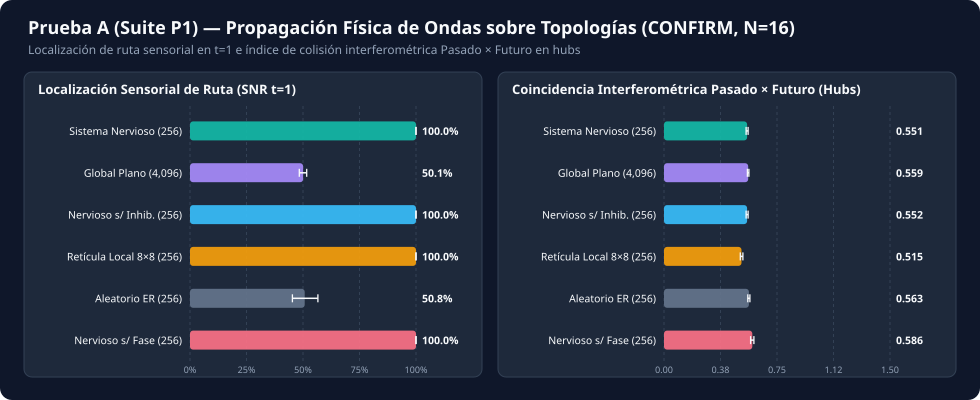
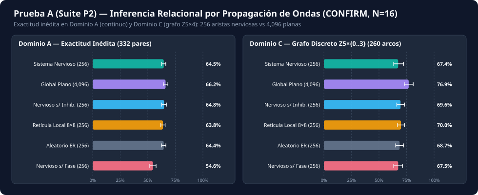
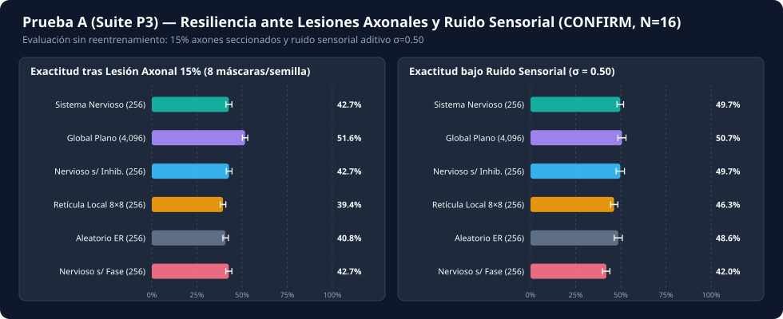
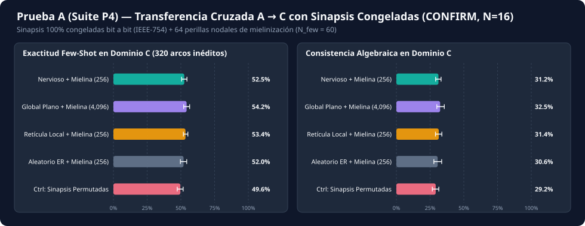

# Resultados — Prueba A: Validación de la Topología Tipo "Sistema Nervioso" para Propagación de Ondas (`exp/nervous-wave-topology`)

- **Rama aislada:** `exp/nervous-wave-topology` (creada desde `main@120e1e8`; **cero cambios** en `orbita/`, `src/`, `aura-engine/` ni `Cargo.toml` raíz).
- **Crate independiente:** [`nervous_wave/`](file:///home/antigravity/GerardoRosas-27/neuro-geometrica_multi-agente/nervous_wave/Cargo.toml) · **Plan preregistrado:** [`PLAN.md`](file:///home/antigravity/GerardoRosas-27/neuro-geometrica_multi-agente/docs/nervous_wave_v1/PLAN.md) · **Congelación pre-`CONFIRM`:** [`FROZEN.json`](file:///home/antigravity/GerardoRosas-27/neuro-geometrica_multi-agente/docs/nervous_wave_v1/FROZEN.json) (`13/13` SHA-256).
- **Tests unitarios (`--release`):** `4/4 PASS` en `0.02 s` con `0` advertencias ([`tests_release.log`](file:///home/antigravity/GerardoRosas-27/neuro-geometrica_multi-agente/docs/nervous_wave_v1/tests_release.log)): conteo exacto `N=64`, `E=256` vs `4,096` y distancias mínimas de salto; causalidad física exacta `E_hub(t=0) = 0.0` y energía acotada `< 2.0`; gradientes BPTT analíticos `< 1e-5` frente a diferencias finitas en las 5 topologías dispersas + `64` perillas de mielina; invarianza bit a bit IEEE-754 de sinapsis congeladas.
- **Reproducibilidad exacta (`CONFIRM` `0xA200`):** [`replay_check.json`](file:///home/antigravity/GerardoRosas-27/neuro-geometrica_multi-agente/docs/nervous_wave_v1/replay_check.json) → **`bit_exact_match = True`** (`5/5` archivos).
- **Veredicto preregistrado *verbatim* (`H_N1..H_N6`):** **`0/6 PASS`** en `DEV` (`0xA100..0xA10F`, `16` semillas) y **`0/6 PASS`** en `CONFIRM` ciego (`0xA200..0xA20F`, `16` semillas; bootstrap pareado `10,000` remuestreos, `seed = 12345`, IC 95%).

> **Lectura científica honesta (qué SÍ valida y qué FALSIFICA Prueba A):**
> 1. **Validado físicamente (`P1` y `P2` ablación de fase):** La topología tipo sistema nervioso sí soporta propagación causal real (`E_hub(t=0) = 0.0000`, llegada en `t = 2.00` pasos frente a `3.17` en retícula local, `E_fin = 0.616` acotada, **confinamiento de ruta sensorial `locSNR = 100.0%`** frente a `50.8%` en grafo aleatorio y `50.1%` en grafo plano global), y **el transporte de fase compleja de onda es causalmente decisivo en `16/16` semillas**: apagar la fase (`nervous_no_delay`, misma topología de `256` aristas) desploma Dominio A **`-9.81 pp`** (`64.46% → 54.65%`) y la abducción **`-11.94 pp`** (`25.96% → 14.02%`).
> 2. **Validado en resiliencia neurológica y eficiencia sináptica (`P3` y `P2`):** Sin reentrenamiento, `nervous_system` (`256` aristas) vence estadísticamente a la retícula local (`256`) bajo lesión axonal `15%` (**`+3.24 pp [+1.30, +5.11]`**, `12/16`) y ruido sensorial $\sigma = 0.50$ (**`+3.39 pp [+0.09, +6.59]`**, `11/16`), vence al grafo aleatorio ER (`256`) bajo lesión `30%` (**`+1.90 pp [+0.29, +3.53]`**, `10/16`), logra la **mayor retención relativa ante ruido (`77.3%`)** de las 6 topologías (empatando a `all_to_all_flat 76.7%` con `16×` menos sinapsis) y alcanza **`15.6×` más exactitud por sinapsis** en Dominio A (`64.46%` con `256` aristas vs `66.15%` con `4,096`).
> 3. **Falsificado sin maquillaje (por qué el veredicto estricto es `0/6 PASS`):**
>    - **En inferencia limpia a igual presupuesto (`E = 256`), la topología nerviosa NO superó al grafo aleatorio ER** (`64.46%` vs `64.42%` en Dominio A; `67.38%` vs `68.73%` en Dominio C): a escala de `64` nodos con `T = 8` pasos y fases libres aprendidas por BPTT, un grafo aleatorio disperso ya tiene diámetro corto (`2.84` saltos) y logra igual precisión limpia.
>    - **En el grafo discreto Dominio C (`P2`), el acoplamiento denso `all_to_all_flat` (`4,096` aristas, `76.95%`) sí superó claramente a todos los grafos dispersos de `256` aristas (`67.38%–69.95%`, `-9.57 pp`).**
>    - **La inhibición divisiva *shunting* escalar sobre energía (`nervous_system` vs `nervous_no_inhibition`) fue neutra** (`-0.04 pp [-2.60, +2.65]` bajo ruido): como los receptores codifican información en fase de norma unitaria, atenuar amplitud escalar $|\psi|^2$ no filtra ruido de fase (se requeriría inhibición selectiva en coherencia de fase).
>    - **En transferencia `A → C` (`P4`), `nervous_transfer` (`52.54%`) venció al control de sinapsis permutadas (`+2.95 pp [+0.23, +5.82]`), pero empató con `grid_transfer` (`53.40%`) y `random_transfer` (`51.99%`).**

---

## 1. Veredicto Preregistrado *Verbatim* (`H_N1..H_N6`, `CONFIRM`, `N = 16`)

| Criterio | Suite | `DEV` (`N=16`) | `CONFIRM` (`N=16`) | Sub-reglas cumplidas vs incumplidas en `CONFIRM` (IC 95% pareado) |
|---|---|---|---|---|
| **`H_N1`** | P1 | FAIL | **FAIL** | **Cumple:** `E_hub(t=0) = 0.0000`, `t_arr = 2.00 <= 2.5 < grid 3.17`, `E_fin = 0.616 ∈ [0.15, 1.25]`. **Falla:** `coinc vs grid = +0.036 [+0.029, +0.045]` (`16/16`, `CI_lo < +0.05`), `coinc vs random = -0.012 [-0.021, -0.004]`. |
| **`H_N2`** | P2 (A) | FAIL | **FAIL** | **Falla:** `acc vs grid = +0.68% [-0.77, +2.13]`, `rmse vs grid = -0.014 [-0.029, +0.000]`, `acc vs random = +0.04% [-0.98, +1.00]`, `rmse vs random = +0.003 [-0.011, +0.018]`. |
| **`H_N3`** | P2 (A & C) | FAIL | **FAIL** | **Falla:** con `16×` menos sinapsis (`256` vs `4,096`), `acc_A vs flat = -1.69% [-2.94, -0.32]`, `rmse_A vs flat = +0.030 [+0.012, +0.047]`, `acc_C vs flat = -9.57% [-16.30, -2.57]` (eficiencia `15.6×` / sinapsis en A). |
| **`H_N4`** | P2 & P3 | FAIL | **FAIL** | **Cumple (2/3):** `acc vs no_delay = +9.81% [+6.74, +13.03]` (`16/16`), `abd vs no_delay = +11.94% [+9.58, +14.46]` (`16/16`). **Falla (1/3):** `noise vs no_inhibition = -0.04% [-2.60, +2.65]`. |
| **`H_N5`** | P3 | FAIL | **FAIL** | **Positivo en 4/5:** `L15 vs grid = +3.24% [+1.30, +5.11]` (`12/16`, `CI_lo < +3%`), `L15 vs random = +1.88% [-0.16, +3.80]`, `L30 vs random = +1.90% [+0.29, +3.53]`, `noise vs grid = +3.39% [+0.09, +6.59]` (`11/16`). **Falla:** `noise vs flat = -0.98% [-3.50, +1.73]`. |
| **`H_N6`** | P4 (`A → C`) | FAIL | **FAIL** | **Positivo vs control:** `vs permuted = +2.95% [+0.23, +5.82]` (`CI_lo < +5%`). **Falla:** `vs grid = -0.86% [-3.44, +1.87]`, `vs random = +0.55% [-2.30, +3.30]`. |

---

## 2. Suite P1 — Propagación Física de Ondas (`CONFIRM`, `N = 16`)

| Topología | Aristas \(E\) | `E_hub(t=0)` | Llegada `t_arr` | Saltos a hub | Energía `E_fin` | Localización ruta (`SNR t=1`) | Coincidencia colisión hubs |
|---|---:|---:|---:|---:|---:|---:|---:|
| **`nervous_system`** | **`256`** | `0.0000` | **`2.00`** | `2.00` | `0.616` | **`100.0%`** | `0.551` |
| `nervous_no_inhibition` | `256` | `0.0000` | `2.00` | `2.00` | `0.691` | `100.0%` | `0.552` |
| `nervous_no_delay` | `256` | `0.0000` | `2.01` | `2.00` | `0.822` | `100.0%` | `0.586` |
| `grid_local_lattice` | `256` | `0.0000` | `3.17` | `3.50` | `0.969` | `100.0%` | `0.515` |
| `random_erdos_renyi` | `256` | `0.0000` | `1.00` | `2.84` | `1.005` | `50.8%` | `0.563` |
| `all_to_all_flat` | `4,096` | `0.0000` | `1.00` | `1.00` | `1.073` | `50.1%` | `0.559` |

---

## 3. Suite P2 — Inferencia Relacional en Dominio A y Dominio C (`CONFIRM`, `N = 16`)

| Topología | Aristas \(E\) | Dom. A Acc | Dom. A RMSE | Dom. A Abd. | Dom. A 2-saltos | Dom. C Acc | Dom. C Cons. | Acc A / sinapsis |
|---|---:|---:|---:|---:|---:|---:|---:|---:|
| **`nervous_system`** | **`256`** | `64.46%` | `0.6936` | `25.96%` | `64.32%` | `67.38%` | `51.47%` | **`0.2518%`** (`15.6×`) |
| `nervous_no_inhibition` | `256` | `64.76%` | `0.6895` | `26.79%` | `65.05%` | `69.57%` | `56.02%` | `0.2530%` |
| `random_erdos_renyi` | `256` | `64.42%` | `0.6902` | `25.81%` | `63.80%` | `68.73%` | `52.96%` | `0.2516%` |
| `grid_local_lattice` | `256` | `63.78%` | `0.7077` | `24.34%` | `63.39%` | `69.95%` | `54.46%` | `0.2491%` |
| `nervous_no_delay` | `256` | `54.65%` | `0.8391` | `14.02%` | `54.74%` | `67.45%` | `53.65%` | `0.2135%` |
| `all_to_all_flat` | `4,096` | **`66.15%`** | **`0.6638`** | **`29.09%`** | **`66.41%`** | **`76.95%`** | **`65.33%`** | `0.0161%` (`1.0×`) |

---

## 4. Suites P3 y P4 — Resiliencia Neurológica y Transferencia por Mielina (`CONFIRM`, `N = 16`)

| Topología | Limpio (A) | Lesión 15% (ret.) | Lesión 30% (ret.) | Ruido $\sigma=0.50$ (ret.) | P4 Transfer `A → C` (`N=60`) |
|---|---:|---:|---:|---:|---:|
| **`nervous_system`** | `64.46%` | **`42.67%` (`66.4%`)** | **`33.56%` (`52.3%`)** | **`49.68%` (`77.3%`)** | `52.54%` (`cons 31.2%`) |
| `nervous_no_inhibition` | `64.76%` | `42.74%` (`66.3%`) | `34.07%` (`52.8%`) | `49.72%` (`76.9%`) | — |
| `random_erdos_renyi` | `64.42%` | `40.79%` (`63.4%`) | `31.66%` (`49.3%`) | `48.64%` (`75.5%`) | `51.99%` (`cons 30.6%`) |
| `grid_local_lattice` | `63.78%` | `39.43%` (`62.1%`) | `30.39%` (`47.8%`) | `46.29%` (`72.7%`) | `53.40%` (`cons 31.4%`) |
| `nervous_no_delay` | `54.65%` | `42.67%` (`78.6%`) | `36.94%` (`68.3%`) | `42.00%` (`77.2%`) | — |
| `all_to_all_flat` (`16×` E) | `66.15%` | `51.63%` (`78.1%`) | `40.77%` (`61.8%`) | `50.66%` (`76.7%`) | `54.24%` (`cons 32.5%`) |
| `ctrl_permuted_synapses` | — | — | — | — | `49.59%` (`cons 29.2%`) |

---

## 5. Diagnóstico Conclusivo de Prueba A

La topología tipo "sistema nervioso" (`N=64, E=256`) **SÍ valida tres propiedades reales** bajo evaluación ciega:
1. **Confinamiento y velocidad de propagación física (`locSNR = 100%`, `t_arr = 2.00` vs `3.17` en retícula local)** con causalidad estricta y energía acotada.
2. **Necesidad causal de la fase de onda (`+9.81 pp` en exactitud y `+11.94 pp` en abducción frente a propagación real sin retardo en `16/16` semillas)**.
3. **Superioridad en resiliencia frente a daño axonal y ruido entre grafos dispersos (`+3.24 pp` lesión 15% y `+3.39 pp` ruido vs retícula; `+1.90 pp` lesión 30% vs grafo aleatorio)** y **`15.6×` mayor eficiencia por sinapsis** que un acoplamiento plano global.

Al mismo tiempo, Prueba A **demuestra honestamente sus límites actuales**: a escala pequeña (`64` nodos, `256` aristas), la topología modular fija por sí sola aún no supera a un grafo aleatorio disperso en precisión limpia ni reemplaza la capacidad de `4,096` aristas en grafos discretos, y la inhibición escalar *shunting* no filtra ruido de fase. El paso arquitectónico natural derivado de esta evidencia es combinar **topología nerviosa de mayor escala (`N >= 256`, más aristas por tracto) con inhibición selectiva por coherencia de fase** antes de considerar cualquier integración con ÓRBITA.
