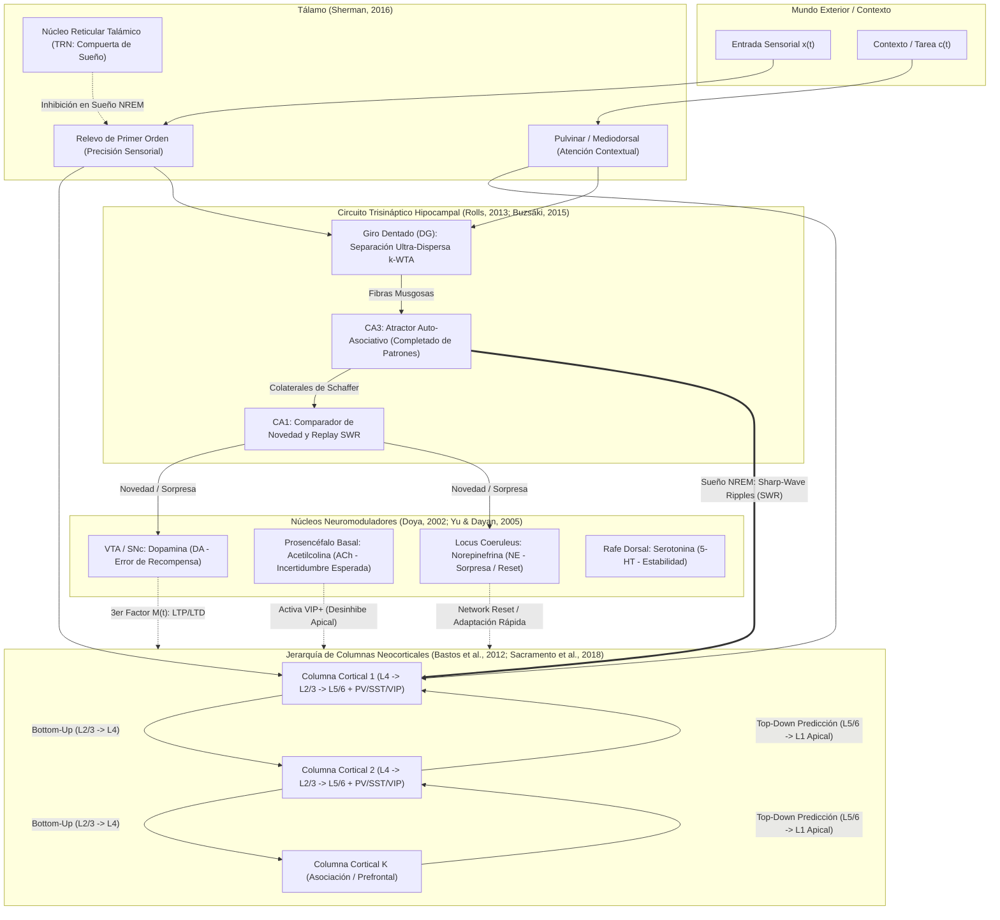

# Arquitectura Neuronal Bioinspirada `neocortex` (`BioBrain`): Fundamentos de Neurociencia y Similitudes con Redes Neuronales

Esta documentación describe la investigación neurocientífica y matemática detrás del crate independiente [`neocortex/`](../neocortex/Cargo.toml), desarrollado en una rama separada (`exp/neocortex-bioinspirado`) para modelar con la mayor fidelidad biofísica posible el funcionamiento conjunto de la **Neocorteza humana**, el **Tálamo**, el **Circuito Trisináptico Hipocampal (DG–CA3–CA1)** y los **Núcleos Neuromoduladores Subcorticales (DA, ACh, NE, 5-HT)**.

---

## 1. Similitudes y Diferencias Estructurales: Cerebro Humano vs. Deep Learning vs. `BioBrain`

Las redes neuronales artificiales modernas (MLP, CNN, RNN, Transformers) nacieron como simplificaciones extremas de la neurobiología (McCulloch & Pitts, 1943; Rosenblatt, 1958). En las últimas dos décadas, la neurociencia computacional ha descubierto que muchas operaciones que en Deep Learning se imponen mediante trucos matemáticos globales (retropropagación, normalización por lotes, atención explícita, buffers de repetición) tienen equivalentes biofísicos **locales y distribuidos** en el cerebro humano:

| Principio / Mecanismo | Redes Neuronales Artificiales (Deep Learning Estándar) | Cerebro Humano (Neurobiología Experimental) | Implementación en `neocortex` (`BioBrain`) |
| :--- | :--- | :--- | :--- |
| **Unidad Computacional Básica** | Neurona puntual: suma lineal + activación escalar $y = \sigma(Wx + b)$ | **Neurona Piramidal Multicompartimental**: dendritas basales ($v_B$), penacho apical distal ($v_A$) con espigas de $\text{Ca}^{2+}$, y soma ($u_S$) (*Larkum, 2013*) | [`PyramidalNeuron`](../neocortex/src/dendritic_neuron.rs): 3 compartimentos acoplados + potencial de meseta de $\text{Ca}^{2+}$ + código multiplexado de eventos ($e_i$) y ráfagas ($b_i$) |
| **Asignación de Crédito (Aprendizaje Profundo)** | **Backpropagation global**: requiere grafo inverso exacto, pesos simétricos ($W^\top$, *weight transport problem*) y fases forward/backward congeladas | **Asignación de Crédito Dendrítica Local + Codificación Predictiva**: el compartimento apical recibe predicciones *top-down* y las interneuronas SST cancelan la parte esperada (*Sacramento et al., 2018; Payeur et al., 2021; Rao & Ballard, 1999*) | 100% **Backprop-Free**: $\delta_{\text{dend}, i} = v_{A, i} \, \phi'(v_{B, i})$ más error predictivo ponderado por precisión $\xi_\ell = \Pi_\ell(x - \hat{x})$ en [`CorticalColumn`](../neocortex/src/cortical_column.rs) |
| **Signo de los Pesos Sinápticos** | Pesos reales sin restricción ($W_{ij} \in \mathbb{R}$), cambian de signo libremente durante SGD | **Ley de Dale** (*Eccles, 1954*): una neurona es puramente excitatoria (Glutamato, $\ge 0$) o puramente inhibitoria (GABA, $\le 0$) | [`BioSynapseMatrix`](../neocortex/src/synapse_stp.rs): descomposición disináptica $W_{\text{eff}} = W^E - W^I$ con restricción estricta $W^E_{ij} \ge 0, W^I_{ij} \ge 0$ (*Parisien et al., 2008*) |
| **Normalización y Control de Ganancia** | `LayerNorm` / `RMSNorm` / `BatchNorm` + `Dropout` | **Microcircuito Inhibitorio GABAérgico (PV+, SST+, VIP+)**: PV+ realiza inhibición divisiva perisomática y competición *k-WTA*; VIP+ inhibe a SST+ para abrir la compuerta apical (*Pfeffer et al., 2013*) | [`InhibitoryMicrocircuit`](../neocortex/src/cortical_column.rs) + umbral deslizante metaplástico **BCM** $\theta_M(t)$ + excitabilidad intrínseca homeostática (*Turrigiano & Nelson, 2004*) |
| **Memoria de Trabajo de Corto Plazo (ms a s)** | Estado oculto recurrente $h_t$ o caché KV de Atención ($O(T^2)$) | **Plasticidad Sináptica de Corto Plazo (STP de Tsodyks-Markram, 1997)**: facilitación por $\text{Ca}^{2+}$ residual $u(t)$ y agotamiento de vesículas $x(t)$ (*Mongillo et al., 2008*) | Dinámica presináptica continua $(u_j(t), x_j(t))$ en [`BioSynapseMatrix::forward`](../neocortex/src/synapse_stp.rs) |
| **Regla de Actualización Sináptica** | Descenso por gradiente $\Delta W = -\eta \frac{\partial \mathcal{L}}{\partial W}$ | **Regla Neo-Hebbiana de 3 Factores**: (1) Pre, (2) Post/Dendrita $\rightarrow$ traza de elegibilidad $e_{ij}(t)$, modulada por (3) Neuromoduladores globales **DA, ACh, NE, 5-HT** (*Gerstner et al., 2018*) | [`BioSynapseMatrix::update_three_factor`](../neocortex/src/synapse_stp.rs) + [`NeuromodulatorySystem`](../neocortex/src/oscillations_neuromod.rs) |
| **Prevención del Olvido Catastrófico** | Entrenamiento offline i.i.d. o regularización artificial (EWC) | **Sistemas de Aprendizaje Complementarios (CLS)** + **Etiquetado Sináptico** + **Sueño NREM (Sharp-Wave Ripples)**: aprendizaje rápido en Hipocampo (DG–CA3–CA1) y consolidación estructural nocturna (*McClelland et al., 1995; Buzsáki, 2015; Benna & Fusi, 2016*) | [`HippocampalSystem`](../neocortex/src/hippocampus_cls.rs) + consolidación metaplástica $W^{\text{cons}}_{ij}$ con rigidez $\Omega_{ij}$ + [`BioBrain::sleep_consolidation_cycle`](../neocortex/src/thalamocortical_brain.rs) |

---

## 2. Arquitectura General del Sistema (`BioBrain`)



---

## 3. Fundamentación Matemática por Subsistema y Papers de Referencia

### 3.1. Neurona Piramidal de Tres Compartimentos y Espigas de Calcio Apicales
**Referencias clave:**
- **Larkum, M. (2013)**. *A cellular mechanism for cortical associations: an organizing principle for the cerebral cortex*. Trends in Neurosciences, 36(3), 141–151.
- **Guerguiev, J., Lillicrap, T. P., & Richards, B. A. (2017)**. *Towards deep learning with segregated dendrites*. eLife, 6:e22901.
- **Sacramento, J., Ponte Costa, R., Bengio, Y., & Senn, W. (2018)**. *Dendritic cortical microcircuits approximate the backpropagation algorithm*. Advances in Neural Information Processing Systems (NeurIPS), 31.
- **Payeur, A., Guerguiev, J., Zenke, F., Richards, B. A., & Naud, R. (2021)**. *Burst-dependent synaptic plasticity can coordinate learning in hierarchical circuits*. Nature Neuroscience, 24, 1010–1019.

En [`dendritic_neuron.rs`](../neocortex/src/dendritic_neuron.rs), cada neurona piramidal $i$ integra tres potenciales acoplados:
1. **Compartimento Basal ($v_{B, i}$)** — impulsado por entradas aferentes *bottom-up* $I_{\text{basal}, i}$ y la excitabilidad homeostática intrínseca $b_{\text{homeo}, i}$:
   $$\tau_m \frac{dv_{B, i}}{dt} = -v_{B, i} + I_{\text{basal}, i} + b_{\text{homeo}, i}$$
2. **Compartimento Apical Distal ($v_{A, i}$)** — situado en la Capa 1 cortical; recibe predicciones o señales contextuales *top-down* $I_{\text{top-down}, i}$ menos la cancelación inhibitoria de las interneuronas SST+ (células de Martinotti), modulada por la compuerta de desinhibición VIP+ ($g_{\text{VIP}}$):
   $$\tau_m \frac{dv_{A, i}}{dt} = -v_{A, i} + \left(I_{\text{top-down}, i} - \frac{I_{\text{SST}, i}}{1 + \alpha_{\text{VIP}} \, g_{\text{VIP}}}\right)\left(1 + \beta_{\text{VIP}} \, g_{\text{VIP}}\right)$$
3. **Potencial de Meseta de Calcio ($\text{Ca}^{2+}$ Plateau Potential) y Acoplamiento BAC**:
   $$p_{\text{Ca}, i} = \sigma\!\left(\kappa_{\text{Ca}} (v_{A, i} - \Theta_{\text{Ca}})\right), \qquad I_{\text{BAC}, i} = g_{\text{BAC}} \tanh(v_{B, i}) (2 p_{\text{Ca}, i} - 1)$$
4. **Compartimento Somático ($u_{S, i}$) y Multiplexación Evento/Ráfaga (Payeur et al., 2021)**:
   $$u_{S, i}^{\text{eq}} = \frac{g_B v_{B, i} + g_A v_{A, i} + I_{\text{BAC}, i} - \frac{1}{2} I_{\text{PV}, i}}{g_L + g_B + g_A + I_{\text{PV}, i}}$$
   La neurona emite una **tasa de eventos** $e_i$ (dominada por el flujo basal/somático) y una **tasa de ráfagas** $b_i = e_i \cdot p_{\text{Ca}, i}$. La señal instructiva dendrítica local $\delta_{\text{dend}, i} = v_{A, i} \, \phi'(v_{B, i})$ sustituye al término $\delta_i$ de backpropagation sin violar la localidad biológica.

---

### 3.2. Ley de Dale, Plasticidad de Corto Plazo (Tsodyks-Markram) y Consolidación de Espinas
**Referencias clave:**
- **Eccles, J. C. (1954)**. *The Neurophysiological Basis of Mind*. Oxford University Press.
- **Parisien, C., Anderson, C. H., & Eliasmith, C. (2008)**. *Solving the problem of negative synaptic weights in cortical models*. Neural Computation, 20(6), 1473–1494.
- **Tsodyks, M. V., & Markram, H. (1997)**. *The neural code between neocortical pyramidal neurons depends on neurotransmitter release probability*. PNAS, 94(2), 719–723.
- **Mongillo, G., Barak, O., & Tsodyks, M. (2008)**. *Synaptic theory of working memory*. Science, 319(5869), 1543–1546.
- **Frey, U., & Morris, R. G. (1997)**. *Synaptic tagging and long-term potentiation*. Nature, 385, 533–536.
- **Benna, M. K., & Fusi, S. (2016)**. *Computational principles of synaptic memory consolidation*. Nature Neuroscience, 19, 1697–1706.

En [`synapse_stp.rs`](../neocortex/src/synapse_stp.rs):
- **Ley de Dale Estricta**: Cada conexión entre el axón presináptico $j$ y la neurona postsináptica $i$ se descompone en una sinapsis excitatoria glutamatérgica directa $W^E_{ij} \ge 0$ y una vía inhibitoria disináptica $W^I_{ij} \ge 0$, dando un peso efectivo $W_{\text{eff}, ij} = W^E_{ij} - W^I_{ij}$.
- **Dinámica Vesicular y de Calcio de Corto Plazo (Tsodyks-Markram)**:
  $$\Delta u_j = \frac{\Delta t}{\tau_{\text{facil}}}(U_0 - u_j) + U_0(1 - u_j)|r_{\text{pre}, j}|$$
  $$\Delta x_j = \frac{\Delta t}{\tau_{\text{rec}}}(1 - x_j) - u_j x_j |r_{\text{pre}, j}|$$
- **Regla de 3 Factores con Trazas de Elegibilidad y Consolidación Metaplástica**:
  $$e_{ij}(t) = \gamma_e e_{ij}(t-1) + \delta_{\text{dend}, i}(t) \, r_{\text{pre}, j}(t)$$
  $$\Delta W_{\text{eff}, ij} = \frac{\eta \, M(t)}{1 + \Omega_{ij}} \, e_{ij}(t) + \eta \, \kappa_{\text{cons}} \, \Omega_{ij} \left(W^{\text{cons}}_{ij} - W_{\text{eff}, ij}\right) - \eta \, \lambda_{\text{Oja}} \, r_{\text{post}, i}^2 W_{\text{eff}, ij}$$
  donde $M(t)$ es la ganancia neuromoduladora global (Dopamina + Acetilcolina + Norepinefrina), $W^{\text{cons}}_{ij}$ es el andamiaje estructural consolidado durante el sueño y $\Omega_{ij} \ge 0$ es la madurez de la espina dendrítica.

---

### 3.3. Columna Cortical Laminada (L4, L2/3, L5/6) e Interneuronas PV+, SST+, VIP+
**Referencias clave:**
- **Mountcastle, V. B. (1997)**. *The columnar organization of the neocortex*. Brain, 120(4), 701–722.
- **Rao, R. P., & Ballard, D. H. (1999)**. *Predictive coding in the visual cortex: a functional interpretation of some extra-classical receptive-field effects*. Nature Neuroscience, 2(1), 79–87.
- **Friston, K. (2010)**. *The free-energy principle: a unified brain theory?* Nature Reviews Neuroscience, 11(2), 127–138.
- **Bastos, A. M., Usrey, W. M., Adams, R. A., Mangun, G. R., Fries, P., & Friston, K. J. (2012)**. *Canonical microcircuits for predictive coding*. Neuron, 76(4), 695–711.
- **Pfeffer, C. K., Xue, M., He, M., Huang, Z. J., & Scanziani, M. (2013)**. *Inhibition of inhibition in visual cortex: the logic of connections between molecularly distinct interneurons*. Nature Neuroscience, 16, 1068–1076.

En [`cortical_column.rs`](../neocortex/src/cortical_column.rs):
- **Capa 4 (Granular)**: Recibe el flujo aferente desde el tálamo o desde la capa anterior.
- **Capa 2/3 (Supragranular)**: Recibe la proyección de L4 en sus dendritas basales y la señal *top-down* en sus dendritas apicales (Capa 1), regulada por el microcircuito inhibitorio:
  - **PV+ (Parvalbúmina)**: Implementa normalización divisiva perisomática y competición lateral *soft k-WTA*.
  - **SST+ (Somatostatina / Martinotti)**: Aprende localmente con regla Hebbiana ($\Delta w_{\text{SST}} \propto (I_{\text{apical}} - I_{\text{SST}}) r_{\text{pyr}}$) para cancelar el feedback esperado y dejar sólo la sorpresa instructiva en el penacho apical.
  - **VIP+ (Péptido Intestinal Vasoactivo)**: Impulsada por Acetilcolina ($\text{ACh}$) y Norepinefrina ($\text{NE}$); inhibe a SST+ para abrir la plasticidad apical ante estímulos novedosos.
- **Capa 5/6 (Infragranular)**: Integra la salida de L2/3, proyecta hacia áreas superiores y hacia la lectura cortico-estriatal, y genera la predicción descendente $\hat{x}_{\ell-1}$ cuyo residuo ponderado por precisión $\xi_\ell = \Pi_\ell^{1/2}(x_{\ell-1} - \hat{x}_{\ell-1})$ minimiza la energía libre variacional de Friston.

---

### 3.4. Sistemas de Aprendizaje Complementarios (CLS): Hipocampo (DG–CA3–CA1) y Sueño SWR
**Referencias clave:**
- **McClelland, J. L., McNaughton, B. L., & O'Reilly, R. C. (1995)**. *Why there are complementary learning systems in the hippocampus and neocortex*. Psychological Review, 102(3), 419–457.
- **Rolls, E. T. (2013)**. *The mechanisms for pattern completion and pattern separation in the hippocampus*. Frontiers in Systems Neuroscience, 7:74.
- **Buzsáki, G. (2006)**. *Rhythms of the Brain*. Oxford University Press.
- **Buzsáki, G. (2015)**. *Hippocampal sharp wave-ripple: A cognitive biomarker for episodic memory and planning*. Hippocampus, 25(10), 1073–1188.
- **Tononi, G., & Cirelli, C. (2014)**. *Sleep and the price of plasticity: from synaptic and cellular homeostasis to memory consolidation and integration*. Neuron, 81(1), 12–34.
- **Ramsauer, H., et al. (2020)**. *Hopfield Networks is All You Need*. ICLR 2021.

En [`hippocampus_cls.rs`](../neocortex/src/hippocampus_cls.rs):
1. **Giro Dentado (DG)**: Proyecta la entrada entorrinal a un espacio de dimensión expandida ($8\times$) y aplica inhibición competitiva estricta *k-WTA* (10% de células granulares activas), reduciendo la similitud coseno entre estímulos parecidos (**Separación de Patrones**).
2. **CA3**: Almacena engramas episódicos en un solo paso (*one-shot*) y recupera estados completos a partir de entradas con hasta 50% de oclusión mediante relajación de energía libre de Hopfield continuo (**Completado de Patrones**).
3. **CA1**: Calcula la novedad comparando la representación entorrinal/cortical con el atractor recuperado por CA3, alimentando al Área Tegmental Ventral (Dopamina) y al Locus Coeruleus (Norepinefrina).
4. **Consolidación en Sueño NREM (`sleep_consolidation_cycle`)**: El Núcleo Reticular Talámico (TRN) bloquea las entradas sensoriales externas; CA3 emite ráfagas de **Sharp-Wave Ripples (SWR)** priorizadas por saliencia que entrenan a la neocorteza, seguidas de consolidación de etiquetas sinápticas (*Synaptic Tagging & Capture*) y reescalado homeostático **SHY** (Tononi & Cirelli, 2014).

---

## 4. Cómo Compilar y Ejecutar los Experimentos

Desde la raíz del repositorio en la rama `exp/neocortex-bioinspirado`:

```powershell
cd neocortex
cargo test
cargo run --release
```
