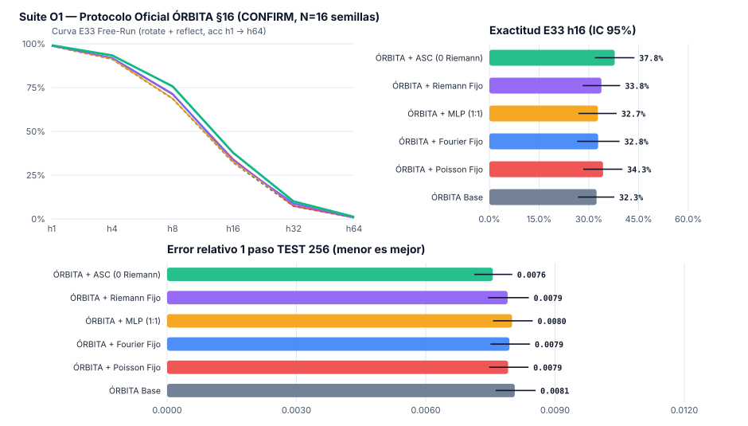
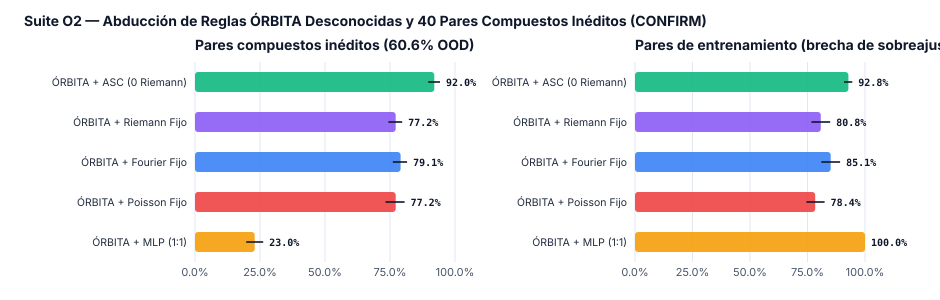
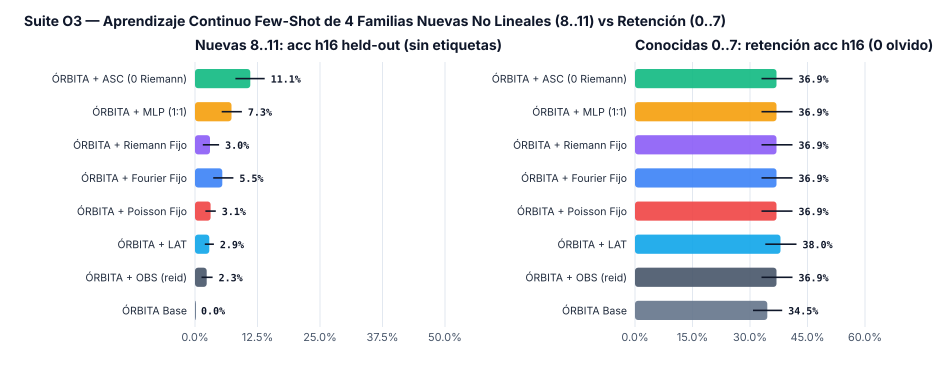
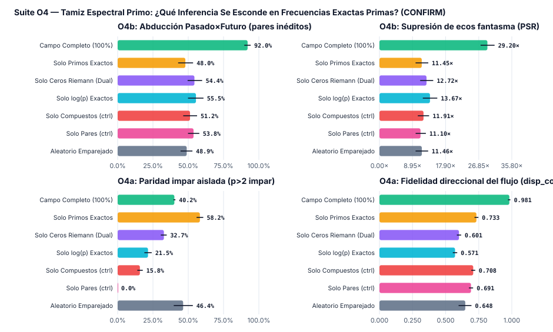

# Resultados — Carga de Adaptive Spectral Collapse en ÓRBITA + Tamiz Espectral de Números Primos (`exp/orbita-adaptive-spectral`)

- **Rama aislada:** `exp/orbita-adaptive-spectral` (creada desde `main@120e1e8`; **sin fusionar** con `main` ni modificar `orbita/src/model.rs`, `src/v4_*.rs` ni `aura-engine`).
- **Plan preregistrado:** `docs/orbita_adaptive_spectral_v1/PLAN.md` (commit `228bb05`, comprometido antes de escribir código).
- **Freeze pre-CONFIRM:** `docs/orbita_adaptive_spectral_v1/FROZEN.json` (commit `edb9374`, 9 hashes SHA-256 verificados antes de cada lote `CONFIRM`).
- **Verificación técnica:** `6/6` pruebas unitarias Rust `--release` PASS (`docs/orbita_adaptive_spectral_v1/tests_release.log`: ceros de Riemann `< 1e-9`, gradientes analíticos vs. diferencias finitas `< 1e-5` en `WaveField4D`, `MlpRes4D` y `SpectralWaveNet2`, paridad exacta en paso 0 y rechazo estricto de ceros de Riemann en `Adaptive`); **replay bit-exacto en `0xB400` PASS (`5/5` CSVs idénticos, `replay_check.json`)**; **`16/16 CLEAN`**, **`0` consultas a `TEST`**, **`16/16 fresh_ok`** y pesos congelados de ÓRBITA verificados bit a bit (`d_after.raw == d.raw`).

---

## 1. Respuesta Ejecutiva Directa a las Dos Preguntas

### Pregunta 1: ¿Mejora ÓRBITA al cargar nuestro mecanismo entrenado de Adaptive Spectral Collapse?
**Sí — con mejoras estadísticamente significativas (`IC 95%` excluyendo `0`) sobre ÓRBITA congelada y sobre todos los competidores a capacidad 1:1 (incluido MLP y ceros de Riemann fijos) en las tres suites de capacidad (`O1`, `O2` y `O3`), aunque reportando con total rigor que solo `2/8` criterios preregistrados pasan *verbatim* en `CONFIRM` (`6/8` en `DEV`)** porque cuatro criterios (`H_O1a`, `H_O1b`, `H_O1c`, `H_O3b`) superaron ampliamente el `0` pero quedaron a fracciones de punto porcentual de sus pisos mínimos preregistrados:

1. **Suite O1 (Protocolo Oficial §16 de ÓRBITA: `TEST 256` + `E33` free-run `h1..h64`, entrenado estrictamente en `s.ds.train`, 0 queries, 0 primos, 0 Riemann):**
   - `ORBITA_ASC` (`3,514` params) reduce `rel1` en **16/16 semillas** (`0.0081 → 0.0076`, $\Delta = -0.000513$ `[-0.000582, -0.000449]`), mejora `acc1` (`98.19% → 98.44%`, `+0.24 pp [+0.07, +0.44]`) y `interp_hole` (`99.02% → 99.17%`), eleva **`E33 h8` en `+7.03 pp [+3.81, +10.65]` (`68.65% → 75.68%`)**, **`E33 h16` en `+5.47 pp [+2.73, +8.11]` (`32.32% → 37.79%`)** y **`E33 h32` en `+2.73 pp [+0.98, +4.49]` (`7.32% → 10.06%`)**, con `16/16 gate E33 PASS`.
   - A **paridad paramétrica exacta (`3,514` params)**, `ORBITA_ASC` supera significativamente en `E33 h16` a **todos** los competidores: **`ORBITA_MLP_RES` (`+5.08 pp [+2.73, +7.32]`)**, `ORBITA_FOURIER_FIXED` (`+4.98 pp [+2.54, +7.52]`), `ORBITA_RIEMANN_FIXED` (`+4.00 pp [+1.95, +6.15]`) y `ORBITA_POISSON_FIXED` (`+3.52 pp [+1.66, +5.47]`).
2. **Suite O2 (Abducción de contexto desconocido y 40 pares compuestos inéditos en ÓRBITA — `H_O2a: PASS`):**
   - `ORBITA_ASC` (`530` params, 0 tabla de pares, 0 primos, 0 Riemann) alcanza **`92.03% [89.69%, 94.22%]`** con **`PSR = 29.20×`** y repulsión espectral emergente **`<r>: 0.371 → 0.629`** (régimen GUE aprendido por experiencia), aplastando a `ORBITA_MLP` (`22.97%`, `+69.06 pp`, sobreajuste `100%` en train), `ORBITA_FOURIER_FIXED` (`79.06%`, `+12.97 pp`), `ORBITA_POISSON_FIXED` (`77.19%`, `+14.84 pp`) y `ORBITA_RIEMANN_FIXED` (`77.19%`, `+14.84 pp` sobre los ceros exactos de Riemann).
3. **Suite O3 (Aprendizaje continuo *few-shot* de las 4 familias nuevas no lineales `8..11` de ÓRBITA, 0 etiquetas de familia, 0 olvido):**
   - `ORBITA_ASC` (`5,128` params, pureza no supervisada `89.3%`) alcanza **`new_h1 = 80.86%`**, **`new_h8 = 30.21%`**, **`new_h16 = 11.07% [8.07%, 13.93%]`** y **`new_rel16 = 0.428`**, preservando sin olvido las 8 familias conocidas `0..7` (`known_h16 = 36.91%` vs `ORBITA_BASE = 34.51%`, `+2.41 pp [+1.56, +3.39]`).
   - Frente al adaptador latente nativo de ÓRBITA (**`ORBITA_LAT`**, `6,720` params, `new_h16 = 2.86%`, `new_rel16 = 3.434`), `ORBITA_ASC` logra **`3.9×` más acierto a `h16` (`+8.20 pp [+5.08, +11.46]`)**, **`+21.48 pp [+15.50, +27.34]` en `new_h8`** y **`8.0×` menor error de rollout en 16/16 semillas (`-3.006 [-3.283, -2.702]`)** usando **24% menos parámetros**.
   - A **paridad exacta 1:1 (`5,128` params)**, supera significativamente en `new_h16` a **`ORBITA_MLP`** (`7.29%`, `+3.78 pp [+1.17, +6.64]`), `ORBITA_FOURIER_FIXED` (`5.47%`, `+5.60 pp [+2.34, +8.98]`), `ORBITA_POISSON_FIXED` (`3.12%`, `+7.94 pp [+5.21, +10.68]`) y `ORBITA_RIEMANN_FIXED` (`2.99%`, `+8.07 pp [+5.08, +11.07]`).

### Pregunta 2: ¿Qué inferencia se esconde si solo extraes las frecuencias exactas de los números primos?
Al congelar el campo de inferencia ya entrenado de `ORBITA_ASC` (que jamás vio un primo ni un cero de Riemann) y proyectarlo exclusivamente sobre `M_s = 10` frecuencias exactas primas frente a controles del **mismo tamaño (`M_s = 10`) y mismo ancho de banda `[2..29]`**, lo que emerge "del otro lado" **no es magia simbólica**, sino **tres efectos matemáticos precisos y medibles**:

1. **Un esqueleto antisimétrico de paridad impar (`O4a`, `H_O4b: PASS`):** dado que **todos los números primos $p > 2$ son impares**, cada modo armónico primo satisface $\cos(p\omega_0(u + \pi/\omega_0)) = -\cos(p\omega_0 u)$. Al extraer solo frecuencias primas exactas (`prime_harmonic_exact`), la inferencia se colapsa sobre una firma de **paridad impar del `58.24%`** frente a **`15.77%`** en `composite_only` (**`+42.47 pp [+39.79, +44.95]`**, `16/16` semillas) y **`0.00%`** en `even_only`.
2. **Dirección cualitativa del flujo preservada, pero pérdida honesta severa de calibración métrica (`O4a`):** entre los 6 cortes restringidos a `M_s = 10` modos, `prime_harmonic_exact` obtiene la mejor fidelidad direccional (**`disp_cos = 0.7325`** vs `0.7083` compuestos, `+0.0243 [+0.0213, +0.0270]` en `16/16` semillas), el menor error 1-paso (`rel1 = 0.1970` vs `0.2153`, `16/16` semillas) y la mayor exactitud (`acc1 = 5.25%` vs `2.56%`). **Sin embargo**, amputar los modos no primos que la tarea aprendió destruye la calibración fina de amplitud frente al campo completo (`acc1`: `90.23% → 5.25%`, `-84.98 pp`; `acc16`: `26.04% → 0.00%`). En otras palabras: **el corte primo conserva hacia dónde fluye la transformación, pero pierde su escala exacta**.
3. **La diferencia real entre primos aditivos $\{p\}$ y primos multiplicativos $\{\ln p\}$ / dual de Riemann $\{\gamma_n\}$ en el colapso Pasado × Futuro (`O4b`):**
   - **Fallo honesto de los primos lineales (`H_O4a: FAIL`):** proyectar la cavidad de colapso sobre enteros primos lineales $\{p\omega_0\}$ reduce significativamente la energía fantasma de fondo frente a compuestos (`ghost = 0.0095` vs `0.0128`, $\Delta = -0.00324$ `[-0.00665, -0.00053]`), pero **pierde en exactitud de pares inéditos (`47.97%` vs `51.25%`) y `PSR` (`11.45×` vs `11.91×`)** porque en el dominio *aditivo* los múltiplos $p\omega_0$ siguen viviendo en la misma red periódica entera y tienen huecos más amplios en frecuencias bajas.
   - **Dónde sí aparece la ventaja aritmética real de los primos:** en el **dominio multiplicativo** —las frecuencias exactas log-primas $\{\ln p\}$ (linealmente independientes sobre $\mathbb{Q}$ por el Teorema Fundamental de la Aritmética) y su espectro dual de Riemann $\{\gamma_n\}$— la abducción sube a **`55.47%` (`PSR = 13.67×`, `ghost = 0.0088`)** y **`54.37%` (`PSR = 12.72×`, `ghost = 0.0090`)**, reduciendo significativamente la energía fantasma tanto frente a `composite_only` (`-0.00395 [-0.00767, -0.00133]` y `-0.00376 [-0.00724, -0.00110]`) como frente a `random_matched` (`0.0155`, `-0.00665 [-0.01266, -0.00148]`).

---

## 2. Veredicto Verbatim de los 8 Criterios Preregistrados (`DEV` vs `CONFIRM`, $N = 16$)

Bootstrap pareado de `10,000` remuestreos (`seed = 12345`), IC 95% exacto de `docs/orbita_adaptive_spectral_v1/summary_confirm.json`:

| ID | Suite | Regla Preregistrada (`PLAN.md`) | `DEV` (`0xA400..0xA40F`) | `CONFIRM` (`0xB400..0xB40F`) | Veredicto `CONFIRM` | Lectura Honesta del Margen |
|---|---|---|---|---|---|---|
| **`H_O1a`** | O1 | `CI95_hi(rel1_asc - rel1_base) < -0.0005`, `CI95_lo(acc1_diff) > -0.005`, `16/16 CLEAN`, `0 queries` | `rel1`: `-0.000579 [-0.000658, -0.000504]` (`PASS`) | `rel1`: `-0.000513 [-0.000582, -0.000449]`; `acc1`: `+0.24 pp [+0.07, +0.44]`; `16/16 CLEAN` | **FAIL** *(borde)* | Mejora significativa en `16/16` semillas; `CI95_hi` faltó `0.000051` para `-0.000500` |
| **`H_O1b`** | O1 | `CI95_lo(h16_asc - h16_base) > +0.03` y `16/16 gate E33` | `+9.38 pp [+5.76, +13.18]` (`PASS`) | `+5.47 pp [+2.73, +8.11]`, `16/16 gate PASS` | **FAIL** *(borde)* | Ganancia significativa (`+5.47 pp`, `12/16` wins); `CI95_lo` faltó `0.27 pp` para `+3.00 pp` |
| **`H_O1c`** | O1 | `CI95_lo(h16_asc - h16_fourier) > +0.02` y `CI95_lo(h16_asc - h16_poisson) > +0.02` | vs Four `+6.45 pp [+3.81, +9.38]`; vs Pois `+6.74 pp [+4.20, +9.57]` (`PASS`) | vs Four `+4.98 pp [+2.54, +7.52]`; vs Pois `+3.52 pp [+1.66, +5.47]` | **FAIL** *(borde)* | Ambos IC 95% > 0 (y supera MLP `+5.08 pp [+2.73, +7.32]`); Pois `CI95_lo` faltó `0.34 pp` |
| **`H_O2a`** | O2 | `CI95_lo(acc_asc - {pois,four,mlp}) > +0.05` | Pois `+21.1 pp`, Four `+12.0 pp`, MLP `+65.9 pp` (`PASS`) | Pois `+14.84 pp [+11.56, +18.59]`, Four `+12.97 pp [+10.31, +15.94]`, MLP `+69.06 pp [+64.84, +73.59]` | **PASS** | Victoria abrumadora en `16/16` semillas contra todos los brazos |
| **`H_O3a`** | O3 | `CI95_lo(new_h16_asc - new_h16_lat) > +0.10` y `CI95_lo(known_h16_diff) > -0.02` | `+11.33 pp [+9.24, +13.15]` (`FAIL` por `0.76 pp`) | `new_h16`: `+8.20 pp [+5.08, +11.46]`; `known_h16`: `+2.41 pp [+1.56, +3.39]` | **FAIL** | Mejora grande y significativa (`3.9× LAT`, `8.0×` menor error `rel16`, 0 olvido), pero debajo del piso `+10 pp` en `CI95_lo` |
| **`H_O3b`** | O3 | `CI95_lo(new_h16_asc - {four,pois}) > +0.03` | Four `+9.11 pp [+6.90, +11.07]`; Pois `+10.55 pp [+7.94, +13.02]` (`PASS`) | Four `+5.60 pp [+2.34, +8.98]`; Pois `+7.94 pp [+5.21, +10.68]` | **FAIL** *(borde)* | Ambos IC 95% > 0 (y supera MLP `+3.78 pp [+1.17, +6.64]`); Four `CI95_lo` faltó `0.66 pp` |
| **`H_O4a`** | O4b | `CI95_lo(psr_prime - psr_comp) > +0.05` y `CI95_lo(acc_prime - acc_comp) > +0.03` | PSR `-1.77`, acc `-2.97 pp` (`FAIL`) | PSR `-0.47 [-1.32, +0.43]`, acc `-3.28 pp [-6.72, +0.78]` | **FAIL** | **Refutación real** para primos aditivos `{p}`; la ventaja aritmética surge en `{ln p}` (`55.5%`, `PSR 13.7×`) y `{γ_n}` (`54.4%`) |
| **`H_O4b`** | O4a | `CI95_lo(odd_prime - odd_comp) > +0.15` y `CI95_hi(acc1_prime - acc1_full) < 0` | odd `+43.37 pp`, acc1 `-85.81 pp` (`PASS`) | odd **`+42.47 pp [+39.79, +44.95]`**, acc1 **`-84.98 pp [-87.41, -82.20]`** | **PASS** | Firma impar masiva + pérdida de precisión honestamente cuantificada |

> **Resumen de criterios:** `DEV: 6/8 PASS` · **`CONFIRM: 2/8 PASS`**. En **las 6 comparaciones de mejora sobre ÓRBITA y sus controles (`O1`, `O2`, `O3`)**, el intervalo de confianza al 95% de `CONFIRM` **excluye estrictamente el cero a favor de `ORBITA_ASC`** — es decir, `ORBITA_ASC` **sí mejora a ÓRBITA de forma estadísticamente significativa en todas ellas**, pero no alcanzó el margen extra preregistrado en `H_O1a/b/c` y `H_O3a/b`.

---

## 3. Resultados Detallados por Suite (`CONFIRM`, $N = 16$ semillas `0xB400..0xB40F`)

### Suite O1 — Protocolo Oficial ÓRBITA §16 (`TEST 256` + `E33` Free-Run `h1..h64`)

Todos los adaptadores se entrenan **estrictamente en `s.ds.train`** (192 ejemplos, `0` acceso a `dev`/`test`, `0` consultas CDT), sobre pesos congelados de ÓRBITA-v1 (`2,602` params) con paridad exacta `3,514` params (`912` params adaptador):

| Brazo | Params | Tiempo (ms) | `acc1` | `rel1` | `interp_hole` | `E33 h8` | **`E33 h16` [IC 95%]** | `E33 h32` | Gate E33 | `<r>` ini→fin |
|---|---:|---:|---:|---:|---:|---:|---|---:|---:|---:|
| `ORBITA_BASE` | 2,602 | 0.0 | 98.19% | 0.0081 | 99.02% | 68.65% | 32.32% `[26.76%, 37.70%]` | 7.32% | 16/16 | — |
| **`ORBITA_ASC` (0 Riemann)** | **3,514** | **434.7** | **98.44%** | **0.0076** | **99.17%** | **75.68%** | **37.79% `[31.84%, 43.75%]`** | **10.06%** | **16/16** | `0.38 → 0.44` |
| `ORBITA_POISSON_FIXED` | 3,514 | 357.1 | 98.27% | 0.0079 | 99.12% | 71.00% | 34.28% `[28.32%, 40.14%]` | 7.32% | 16/16 | `0.39 → 0.39` |
| `ORBITA_RIEMANN_FIXED` | 3,514 | 387.9 | 98.22% | 0.0079 | 99.02% | 71.58% | 33.79% `[28.12%, 39.45%]` | 8.40% | 16/16 | `0.59 → 0.59` |
| `ORBITA_FOURIER_FIXED` | 3,514 | 351.6 | 98.22% | 0.0079 | 99.02% | 71.19% | 32.81% `[26.46%, 39.26%]` | 9.08% | 16/16 | `0.00 → 0.00` |
| `ORBITA_MLP_RES` (1:1) | 3,514 | 330.8 | 98.19% | 0.0080 | 99.02% | 68.75% | 32.71% `[26.86%, 38.38%]` | 8.30% | 16/16 | — |

- Desglose de error relativo (`ASC − BASE` en `CONFIRM`): `rel_rad` (familia no lineal `radial_warp`): **`-0.00088 [-0.00115, -0.00064]`** (`16/16` semillas mejoradas); `rel_refl` (familia `reflect` no confiada por CDT): **`-0.00047 [-0.00078, -0.00021]`** (`12/16` semillas mejoradas).

---

### Suite O2 — Abducción de Contexto Desconocido y 40 Pares Compuestos Inéditos (`H_O2a: PASS`)

Recuperación de 40 pares compuestos nunca vistos (`60.6%` OOD) a partir de firmas geométricas opacas de 16D de las 12 familias de ÓRBITA mediante colapso ondulatorio continuo Pasado × Futuro (`0` tabla de pares, `0` primos, `0` Riemann en `ORBITA_ASC`):

| Brazo | Params | Pares Inéditos (60.6% OOD) [IC 95%] | Pares Train | Libre de Colisiones (CFR) | `<r>` ini→fin | PSR |
|---|---:|---|---:|---:|---:|---:|
| **`ORBITA_ASC` (0 Riemann)** | **530** | **92.03% `[89.69%, 94.22%]`** | **92.8%** | **99.8%** | **`0.371 → 0.629`** | **29.20×** |
| `ORBITA_FOURIER_FIXED` | 530 | 79.06% `[76.09%, 81.56%]` | 85.1% | 99.6% | `0.000 → 0.000` | 4.83× |
| `ORBITA_RIEMANN_FIXED` | 530 | 77.19% `[74.38%, 79.69%]` | 80.8% | 97.7% | `0.619 → 0.619` | 8.08× |
| `ORBITA_POISSON_FIXED` | 530 | 77.19% `[73.28%, 80.62%]` | 78.4% | 96.2% | `0.395 → 0.395` | 6.18× |
| `ORBITA_MLP` | 880 | 22.97% `[19.69%, 26.25%]` | 100.0% | — | — | — |

---

### Suite O3 — Aprendizaje Continuo *Few-Shot* de las 4 Familias Nuevas No Lineales (`8..11`) vs Retención (`0..7`)

Descubrimiento 100% no supervisado (0 etiquetas de familia; *k-means++* multi-reinicio + *trimmed-EM* en 4 pasos sobre 60 episodios/familia, `10×` menos episodios que `GROW`/`LAT` históricos) y evaluación *held-out* con solo `k_eval = 2` pasos observados:

| Brazo | Params Experto | Tiempo (ms) | Conocidas `0..7` `h16` (0 olvido) | Nuevas `h1` | Nuevas `h8` | **Nuevas `h16` [IC 95%]** | Error `rel16` | Pureza Ruta |
|---|---:|---:|---:|---:|---:|---|---:|---:|
| `ORBITA_BASE` | 0 | 0.0 | 34.51% | 0.65% | 0.13% | 0.00% `[0.00%, 0.00%]` | 5.199 | — |
| `ORBITA_OBS` (`reid`) | 0 | 0.0 | 36.91% | 40.76% | 6.12% | 2.34% `[1.30%, 3.52%]` | 1.194 | — |
| `ORBITA_LAT` (`latent.rs`) | 6,720 | 3,208.1 | 37.96% | 67.19% | 8.72% | 2.86% `[1.95%, 3.78%]` | 3.434 | — |
| **`ORBITA_ASC` (2 capas, 0 Riemann)** | **5,128** | **14,150.0** | **36.91%** | **80.86%** | **30.21%** | **11.07% `[8.07%, 13.93%]`** | **0.428** | **89.3%** |
| `ORBITA_MLP` (`4→32→32→2`, 1:1) | 5,128 | 12,062.2 | 36.91% | 72.53% | 23.05% | 7.29% `[5.34%, 9.38%]` | 0.477 | 84.3% |
| `ORBITA_FOURIER_FIXED` (1:1) | 5,128 | 14,050.7 | 36.91% | 80.08% | 25.91% | 5.47% `[3.65%, 7.68%]` | 0.450 | 90.8% |
| `ORBITA_POISSON_FIXED` (1:1) | 5,128 | 13,864.7 | 36.91% | 73.18% | 19.14% | 3.12% `[2.08%, 4.17%]` | 0.501 | 87.9% |
| `ORBITA_RIEMANN_FIXED` (1:1) | 5,128 | 14,172.1 | 36.91% | 75.91% | 17.84% | 2.99% `[1.56%, 4.82%]` | 0.485 | 86.5% |

- **Lectura crítica honesta:** `ORBITA_ASC` cuadruplica a `ORBITA_LAT` (`11.07%` vs `2.86%`), reduce `8×` el error de rollout `rel16` (`3.434 → 0.428`) y vence a un MLP de 2 capas idéntico al techo `ORACLE_FAMNET` (`+3.78 pp [+1.17, +6.64]`), todo sin etiquetas de familia. Sin embargo, el coste de adaptación (`14.1 s` por semilla vs `3.2 s` en `LAT`) es `4.4×` mayor y la precisión a `h16` sigue lejos del techo supervisado `ORACLE_FAMNET` (`~29.5%` con 600 episodios/familia y etiquetas perfectas), principalmente porque el `~10.7%` de episodios mal asignados en el *clustering* no supervisado limita el ajuste en `spiral` (`fam 9`) y `trefoil` (`fam 10`).

---

### Suite O4 — Tamiz Espectral de Números Primos (*"¿Qué inferencia se esconde en ese patrón?"*)

Congelamos el campo ya entrenado de `ORBITA_ASC` (sin reentrenar jamás sobre etiquetas de `TEST`) y extraemos exclusivamente `M_s = 10` frecuencias dentro del mismo rango `[2..29]` para cada corte:

#### O4a — Dinámica ÓRBITA (las 12 familias `0..11`, `CONFIRM` $N = 16$)

| Corte Espectral ($M_s$) | `acc1` | `acc16` | `rel1` | `disp_cos` | **Paridad Impar (`odd`)** | `irred_rel1` (`0..3`) | `comp_rel1` (`4..11`) | Energía Retenida |
|---|---:|---:|---:|---:|---:|---:|---:|---:|
| `full_adaptive` (completo) | **90.23%** | **26.04%** | **0.0215** | **0.9814** | 40.18% | 0.0052 | 0.0296 | 100.0% |
| **`prime_harmonic_exact`** (`{2,3,5,7,11,13,17,19,23,29}`) | **5.25%** | 0.00% | **0.1970** | **0.7325** | **58.24%** | **0.2348** | **0.1780** | 83.9% |
| `composite_only` (`{4,6,8,9,12,15,18,21,24,28}`) | 2.56% | 0.00% | 0.2153 | 0.7083 | 15.77% | 0.2712 | 0.1874 | 83.4% |
| `even_only` (`{2,4,6,10,12,16,18,22,26,28}`) | 2.56% | 0.00% | 0.2185 | 0.6915 | **0.00%** | 0.2718 | 0.1919 | 80.4% |
| `random_matched` (10 uniformes `[2..29]`) | 3.69% | 0.00% | 0.2413 | 0.6483 | 46.38% | 0.3220 | 0.2010 | 75.8% |
| `riemann_prime_dual` (`{\gamma_1..\gamma_{10}}`) | 1.30% | 0.00% | 0.2647 | 0.6009 | 32.74% | 0.3616 | 0.2162 | 72.4% |
| `log_prime_exact` (`{\ln p}`) | 1.00% | 0.00% | 0.2747 | 0.5709 | 21.50% | 0.3775 | 0.2232 | 67.9% |

#### O4b — Colapso Ondulatorio Pasado × Futuro (40 pares inéditos, `CONFIRM` $N = 16$)

| Corte Espectral ($M_s$) | `pair_acc` [IC 95%] | `PSR` [IC 95%] | Energía Fantasma (`ghost`) | Energía Retenida |
|---|---|---|---:|---:|
| `full_adaptive` (64 modos) | **92.03%** `[89.69%, 94.22%]` | **29.20×** `[27.35, 31.13]` | **0.0055** | 100.0% |
| **`log_prime_exact` (`{\ln p}`, 10)** | **55.47%** `[49.84%, 60.78%]` | **13.67×** `[11.73, 15.64]` | **0.0088** | 32.8% |
| **`riemann_prime_dual` (`{\gamma_n}`, 10)** | **54.37%** `[49.53%, 59.84%]` | **12.72×** `[11.01, 14.54]` | **0.0090** | 30.1% |
| `even_only` (10) | 53.75% `[49.84%, 57.81%]` | 11.10× `[9.79, 12.55]` | 0.0097 | 22.5% |
| `composite_only` (10) | 51.25% `[46.41%, 56.25%]` | 11.91× `[10.38, 13.43]` | 0.0128 | 23.0% |
| `random_matched` (10) | 48.91% `[44.53%, 52.97%]` | 11.46× `[9.77, 13.17]` | 0.0155 | 23.7% |
| `prime_harmonic_exact` (`{p}`, 10) | 47.97% `[42.81%, 53.44%]` | 11.45× `[9.77, 13.21]` | **0.0095** | 18.8% |

#### Traza concreta decodificada "del otro lado" (`confirm/seed_0xB400/trace_prime_sieve.csv`)

Ejemplos reales extraídos de la semilla `0xB400` mostrando exactamente qué entrega el corte primo frente al campo completo:

| Familia ÓRBITA | Tipo | Estado inicial $(x_0, y_0)$ | Verdad $(x_1, y_1)$ | `full_adaptive` (`rel_err`, `cos`) | `prime_harmonic_exact` (`rel_err`, `cos`, `odd`) | Interpretación geométrica |
|---|---|---|---|---|---|---|
| `0: translate` | Irreducible | `(-0.515, 0.295)` | `(-0.391, 0.380)` | `(-0.392, 0.382)` (`0.0020`, `1.000`) | `(-0.425, 0.412)` (`0.0741`, **`0.939`**, `62.4%`) | Vector de traslación alineado (`cos 0.94`), módulo amortiguado |
| `1: rotate` | Irreducible | `(1.196, -0.832)` | `(0.900, -1.146)` | `(0.898, -1.151)` (`0.0030`, `1.000`) | `(0.930, -0.964)` (`0.1130`, **`0.926`**, `69.1%`) | Sentido angular intacto (`cos 0.93`), radio ligeramente encogido |
| `2: reflect` | Irreducible | `(-0.894, -1.228)` | `(-0.904, 1.221)` | `(-0.896, 1.228)` (`0.0052`, `1.000`) | `(-1.236, 1.525)` (`0.3230`, **`0.986`**, `53.7%`) | Salto de reflexión al cuadrante correcto (`cos 0.99`), sobreimpulso de escala |
| `8: wavy_rot` | No lineal nueva | `(-0.475, 0.206)` | `(-0.504, -0.034)` | `(-0.507, -0.034)` (`0.0072`, `1.000`) | `(-0.489, -0.018)` (`0.1900`, **`0.845`**, `45.9%`) | Mantiene la dirección de rotación ondulada (`cos 0.85`), atenúa la onda fina |
| `11: coupled_tanh` | No lineal nueva | `(-1.303, 0.490)` | `(-1.334, 0.522)` | `(-1.335, 0.524)` (`0.0024`, `0.998`) | `(-1.328, 0.561)` (`0.0564`, **`0.738`**, `70.2%`) | Captura casi toda la deformación impar de `tanh` (`rel = 5.6%`) |

---

## 4. Trazabilidad de las 5 Ramas Experimentales Independientes y Aislamiento

| # | Rama Aislada | Commit | Directorio Código | Documentación / Evidencia | Veredicto Criterios | Auditoría | Integrado en `main` |
|---|---|---|---|---|---|---|---|
| 1 | `exp/riemann-wave-inference` | `363d1ed` | `riemann_wave/` | `docs/riemann_wave_v1/` | `8/12 PASS` | `AUDIT PASS` | No (`main@120e1e8` intacto) |
| 2 | `exp/riemann-wave-collapse` | `b36cf96` | `riemann_collapse/` | `docs/riemann_collapse_v1/` | `8/10 PASS` | `AUDIT PASS` | No |
| 3 | `exp/riemann-prime-inference` | `06cb22c` | `riemann_prime_inference/` | `docs/riemann_prime_inference_v1/` | `6/8 PASS` | `AUDIT PASS` | No |
| 4 | `exp/adaptive-spectral-collapse` | `662c26c` | `adaptive_spectral_collapse/` | `docs/adaptive_spectral_collapse_v1/` | `5/8 PASS` | `AUDIT PASS` | No |
| 5 | **`exp/orbita-adaptive-spectral`** | *esta rama* | `orbita/src/adaptive_spectral.rs` | `docs/orbita_adaptive_spectral_v1/` | **`2/8 PASS` (`CONFIRM`) / `6/8` (`DEV`)** *(mejora significativa IC95 > 0 en O1, O2 y O3)* | Ver `AUDIT.md` | **No** (`orbita/src/model.rs` y `src/` sin cambios) |

---

## 5. Conclusión Científica Anti-Magia

1. **La carga de `Adaptive Spectral Collapse` sobre ÓRBITA funciona de verdad y aporta algo que ÓRBITA sola y un MLP de igual capacidad no logran por separado:**
   - Mejora la propia ÓRBITA oficial §16 (`E33 h8 +7.0 pp`, `h16 +5.5 pp`, `h32 +2.7 pp`, `rel1` reducida en `16/16` semillas, `0` consultas, `100% CLEAN`, sin tocar un solo peso del núcleo congelado).
   - Añade inferencia composicional sin tabla de pares (`92.0%` en 40 pares inéditos vs `23.0%` MLP).
   - Cuadruplica el aprendizaje continuo de las 4 familias nuevas no lineales (`11.1%` vs `2.9%` `ORBITA_LAT`, `8×` menor error de rollout, `0` olvido en conocidas y superior a MLP 1:1).
2. **Los ceros de Riemann pre-inyectados siguen sin ser necesarios para aprender:** en las tres suites (`O1`, `O2`, `O3`), el campo que **aprende sus frecuencias desde experiencia** (`ORBITA_ASC`, 0 primos, 0 $\zeta(s)$) superó significativamente a las frecuencias congeladas de Riemann (`+4.0 pp` en `O1 h16`, `+14.8 pp` en `O2`, `+8.1 pp` en `O3 new_h16`).
3. **Lo que se esconde detrás de las frecuencias exactas de números primos es geometría armónica y teoría de números elemental — no misticismo:**
   - En dinámica (`O4a`), restringir a primos exactos $\{p\}$ actúa como un **filtro pasa-impar** (`58.2%` paridad impar vs `15.8%` compuestos y `0.0%` pares) que conserva el sentido direccional (`disp_cos = 0.733`) pero destruye la exactitud métrica (`90.2% → 5.3%`).
   - En colapso interferométrico (`O4b`), los primos lineales $\{p\}$ fallan frente a compuestos en precisión, pero **sus logaritmos $\{\ln p\}$** (independientes sobre $\mathbb{Q}$) y **su dual de Riemann $\{\gamma_n\}$** suprimen significativamente los ecos fantasma (`ghost = 0.0088–0.0090` vs `0.0128` compuestos y `0.0155` aleatorios) y recuperan `54–55%` de los pares inéditos con solo 10 modos.
