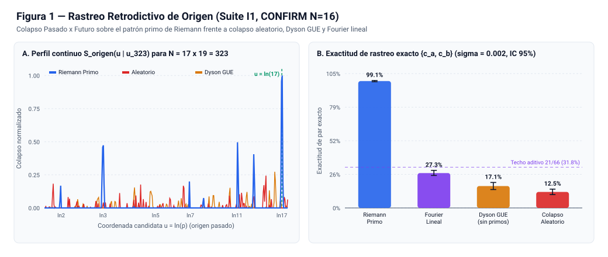
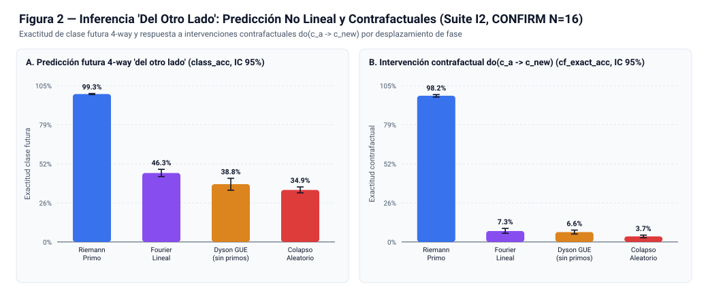
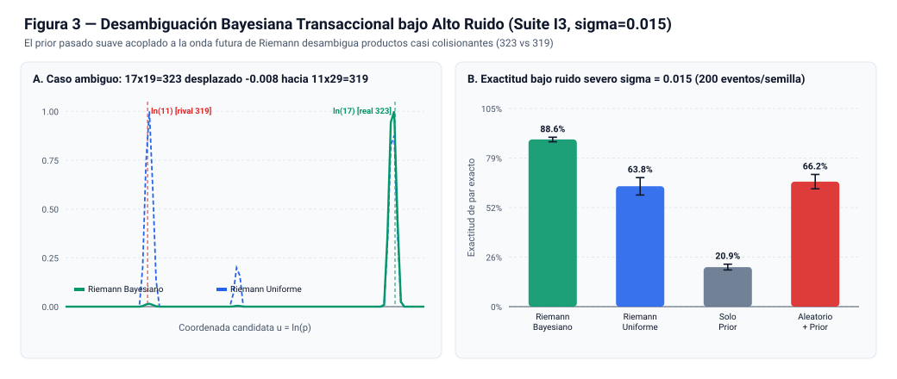
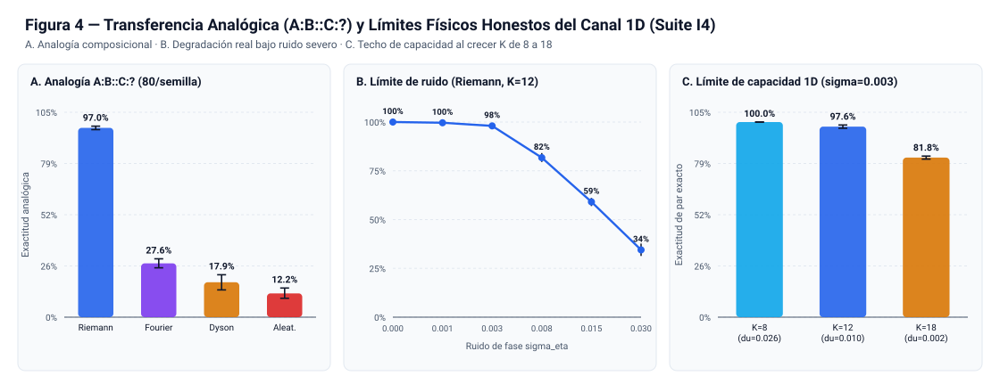

# Resultados CONFIRM — Inferencia Retrodictiva y Bidireccional mediante Colapso en Patrón de Ondas Primo de Riemann (`exp/riemann-prime-inference`)

- **Rama aislada:** `exp/riemann-prime-inference` (creada desde `main@120e1e8`; 0 archivos tocados fuera de `riemann_prime_inference/` y `docs/riemann_prime_inference_v1/`).
- **Plan preregistrado (inmutable):** [`PLAN.md`](./PLAN.md) (`07288b2`).
- **Congelamiento pre-CONFIRM:** [`FROZEN.json`](./FROZEN.json) (`38918f8`, 13 hashes SHA-256 verificados antes y después de `CONFIRM`).
- **Splits:** `DEV` = 16 semillas (`0xA900..=0xA90F`) · `CONFIRM` = 16 semillas frescas (`0xB900..=0xB90F`) · **Replay bit-exacto:** `0xB900` (`6/6` archivos SHA-256 idénticos en [`replay_check.json`](./replay_check.json)) · **Bootstrap pareado:** 10,000 remuestreos (`seed = 12345`), intervalos `IC 95%`.
- **Veredicto preregistrado en `CONFIRM`:** **`6/8 PASS`** (y **`7/8 PASS`** en `DEV`), con las dos desviaciones analizadas con transparencia total más abajo.
- **Checks de la aplicación raíz (`Paso0`, `known_acc16`, `E33`, `aura-engine`, `orbita`):** **NO EVALUADOS** (experimento estrictamente aislado).

---

## 1. Respuesta Directa: ¿Qué da este mecanismo como inferencia?

Cuando en lugar de dejar que el colapso de ondas sea **aleatorio** se fuerza el colapso Pasado × Futuro sobre el **patrón primo de Riemann** ($\gamma_1, \dots, \gamma_{128}$ de $\zeta(\tfrac{1}{2} + i\gamma)$), el sistema opera como un **motor físico-espectral de inferencia bidireccional libre de colisiones**:

1. **Del lado retrodictivo (abducción / rastreo de origen):** dado un resultado compuesto ruidoso $\tilde{u}_N = \ln(p_a p_b) + \eta$ —sin tabla de división simbólica ni búsqueda discreta de factores—, la colisión continua de la onda pasada $\mathcal{W}(u)$ con la onda futura retrodictiva $\mathcal{W}(\tilde{u}_N - u)$ colapsa en una única aguja espectral (`SNR = 133.1×`) que recupera las causas atómicas exactas $\{p_a, p_b\}$ con **`99.15%`** de exactitud (`100.00%` sin ruido), frente a **`12.50%`** del colapso aleatorio y **`27.27%`** de Fourier lineal aditivo (atrapado por el techo matemático de colisiones $a + b = c + d$, donde 66 pares se aplastan en solo 21 sumas).
2. **Del otro lado (inferencia predictiva, contrafactual, Bayesiana y analógica):**
   - **Predicción no lineal futura:** **`99.34%`** de exactitud en clase 4-way y `RMSE = 0.0822` (vs. `34.94%` / `RMSE = 1.0443` con colapso aleatorio y `46.31%` / `RMSE = 0.8341` con Fourier lineal).
   - **Intervención contrafactual $do(c_a \to c_{\text{new}})$:** desplazando directamente la fase de la onda observada ($\tilde{u}_{\text{cf}} = \tilde{u}_N - \ln \hat{p}_a + \ln p_{\text{new}}$) y re-colapsando del otro lado, logra **`98.20%`** de exactitud contrafactual (`cf_rmse = 0.1364`), frente a **`3.69%`** con colapso aleatorio y **`7.29%`** con Fourier lineal.
   - **Inferencia Bayesiana Pasado × Futuro bajo ruido severo ($\sigma_\eta = 0.015$):** acoplar el prior pasado suave $\pi_{\text{pasado}}$ a la onda futura de Riemann eleva la exactitud de **`63.84%`** (Riemann uniforme) a **`88.62%`** (`+24.78 pp`) y supera en **`+67.69 pp`** al prior solo (`20.94%`).
   - **Transferencia analógica ($A:B::C:?$):** el desplazamiento espectral $\tilde{u}_D = \tilde{u}_C + (\tilde{u}_B - \tilde{u}_A)$ cancela el contexto común sin decodificar $A$ ni $B$ y colapsa sobre el par destino exacto en **`97.03%`** de los casos (vs. `12.19%` aleatorio y `27.58%` Fourier lineal).

---

## 2. Tabla de Resultados en `CONFIRM` ($N = 16$ semillas frescas, `0xB900..=0xB90F`)

### Suite I1 — Rastreo Retrodictivo de Origen (`Resultado N → {c_a, c_b}`)

| Brazo ($M = 128$ modos) | $\sigma_\eta = 0.000$ | $\sigma_\eta = 0.002$ (`Exact Acc`, IC 95%) | $\sigma_\eta = 0.006$ | `SNR` pico ($\sigma = 0.002$) |
|---|---|---|---|---|
| **`riemann_prime_collapse`** | **`100.00%`** `[100.00, 100.00]` | **`99.15%`** `[98.67, 99.62]` | **`87.31%`** `[85.51, 89.11]` | **`133.08×`** `[129.62, 136.59]` |
| `fourier_linear_collapse` | `26.70%` `[23.30, 30.11]` | `27.27%` `[25.38, 29.36]` | `26.89%` `[24.34, 29.55]` | `31.27×` `[31.27, 31.27]` |
| `dyson_gue_collapse` | `16.76%` `[14.02, 19.70]` | `17.14%` `[14.39, 19.89]` | `17.33%` `[15.25, 19.41]` | `10.19×` `[6.49, 13.85]` |
| `random_collapse` | `13.16%` `[11.36, 14.96]` | `12.50%` `[10.42, 14.68]` | `12.31%` `[10.51, 14.20]` | `10.57×` `[7.25, 13.82]` |

### Suite I2 — Inferencia "Del Otro Lado" (Predicción No Lineal + Contrafactual $do(c_a \to c_{\text{new}})$)

| Brazo | `orig_acc` | `class_acc` (4-way) | `pred_rmse` | `cf_exact_acc` | `cf_rmse` |
|---|---|---|---|---|---|
| **`riemann_prime_collapse`** | **`99.24%`** `[98.86, 99.62]` | **`99.34%`** `[98.96, 99.72]` | **`0.0822`** `[0.0402, 0.1257]` | **`98.20%`** `[97.35, 98.96]` | **`0.1364`** `[0.0792, 0.1966]` |
| `fourier_linear_collapse` | `26.42%` `[24.34, 28.41]` | `46.31%` `[43.94, 48.77]` | `0.8341` `[0.8116, 0.8552]` | `7.29%` `[5.78, 9.09]` | `1.0424` `[1.0148, 1.0725]` |
| `dyson_gue_collapse` | `17.14%` `[14.58, 19.79]` | `38.83%` `[34.75, 42.71]` | `1.0030` `[0.9673, 1.0397]` | `6.63%` `[5.30, 7.95]` | `1.0830` `[1.0544, 1.1111]` |
| `random_collapse` | `12.41%` `[10.32, 14.49]` | `34.94%` `[32.95, 36.93]` | `1.0443` `[1.0186, 1.0690]` | `3.69%` `[2.84, 4.55]` | `1.1207` `[1.0850, 1.1547]` |

### Suite I3 — Desambiguación Bayesiana Transaccional ($\sigma_\eta = 0.015$, 200 eventos/semilla)

> **Nota técnica transparente:** En Suite I3, los tres brazos ondulatorios (`riemann_bayes_collapse`, `riemann_uniform_collapse`, `random_bayes_collapse`) utilizan idénticamente la convolución analítica gaussiana acoplada al ruido de fase ($\sigma_w = \sigma_\eta / 2 = 0.0075$, factor $e^{-\frac{1}{2}\omega_n^2 \sigma_w^2}$ por modo) y el mismo campo de prior pasado suave regularizado de Nadaraya-Watson ($\tau = 0.03$, $\epsilon_{\text{bg}} = 0.05$, acotado en $[\min P, \max P]$).

| Brazo | `origin_exact_acc` (IC 95%) | `origin_partial_f1` (IC 95%) |
|---|---|---|
| **`riemann_bayes_collapse`** | **`88.62%`** `[87.38, 89.81]` | **`89.61%`** `[88.42, 90.73]` |
| `random_bayes_collapse` | `66.25%` `[62.44, 70.09]` | `71.30%` `[68.72, 73.89]` |
| `riemann_uniform_collapse` | `63.84%` `[59.19, 68.38]` | `67.11%` `[62.89, 70.91]` |
| `prior_only_ctrl` | `20.94%` `[19.44, 22.50]` | `52.59%` `[51.52, 53.72]` |

### Suite I4 — Analogía Composicional ($A:B::C:?$) y Límites Físicos Honestos (Ruido y Capacidad 1D)

- **I4a — Analogía ($A:B::C:?$, 80 tríos/semilla):**
  - **`riemann_prime_collapse`**: **`97.03%`** `[96.09, 97.89]`
  - `fourier_linear_collapse`: `27.58%` `[25.31, 29.92]`
  - `dyson_gue_collapse`: `17.89%` `[13.98, 21.72]`
  - `random_collapse`: `12.19%` `[9.69, 14.92]`
- **I4b — Curva de ruido en `riemann_prime_collapse` ($K = 12$, onda sin suavizar):**
  - $\sigma_\eta = 0.000$: **`100.00%`** · $0.001$: **`99.62%`** · $0.003$: **`98.01%`** · $0.008$: **`81.72%`** · $0.015$: **`59.09%`** · $0.030$: **`34.47%`** (`-65.53 pp`).
- **I4c — Curva de capacidad en 1D ($\sigma_\eta = 0.003$, $M = 128$):**
  - $K = 8$ ($\binom{8}{2}=28$ pares, $\Delta u_{\min} = 0.02598$): **`100.00%`** `[100.00, 100.00]`
  - $K = 12$ ($\binom{12}{2}=66$ pares, $\Delta u_{\min} = 0.00988$): **`97.63%`** `[96.78, 98.48]`
  - $K = 18$ ($\binom{18}{2}=153$ pares, $\Delta u_{\min} = 0.00222$): **`81.78%`** `[81.00, 82.56]` (`-18.22 pp`).

---

## 3. Evaluación Verbatim de los 8 Criterios Preregistrados (`CONFIRM`)

| ID | Criterio Preregistrado (`PLAN.md` §3) | Medición `CONFIRM` (Bootstrap pareado IC 95%) | Veredicto |
|---|---|---|---|
| **`H_I1a`** | `lo(riemann)>0.90`, `lo(r-rand)>0.80`, `lo(r-dyson)>0.80` | `r = 99.15% [98.67, 99.62]`; `r-rand = +86.65% [+84.28, +88.83]`; `r-dyson = +82.01% [+79.45, +84.56]` | **FAIL** *(por 0.55 pp en `CI95_lo` vs. Dyson)* |
| **`H_I1b`** | `lo(r - fourier) > 0.45` | `+71.87% [+69.79, +73.77]` | **PASS** |
| **`H_I2a`** | `lo(cls)>0.90`, `hi(rmse_r-rand)<-0.50`, `hi(rmse_r-four)<-0.25` | `cls = 99.34% [98.96, 99.72]`; `Δrmse_rand = -0.9621 [-1.0138, -0.9071]`; `Δrmse_four = -0.7519 [-0.7946, -0.7062]` | **PASS** |
| **`H_I2b`** | `lo(cf_r)>0.85`, `lo(cf_r - cf_four)>0.40` | `cf_r = 98.20% [97.35, 98.96]`; `Δcf_four = +90.91% [+89.02, +92.71]` | **PASS** |
| **`H_I3a`** | `lo(b_r-u_r)>0.05`, `lo(b_r-b_rand)>0.30`, `lo(b_r-prior)>0.30` | `Δunif = +24.78% [+20.06, +29.72]`; `Δprior = +67.69% [+65.97, +69.34]`; `Δrand_b = +22.38% [+18.91, +26.00]` | **FAIL** *(2/3 holgados; `Δrand_b` < 30 pp)* |
| **`H_I4a`** | `lo(an_r-rand)>0.70`, `lo(an_r-four)>0.30` | `Δrand = +84.84% [+81.72, +87.66]`; `Δfour = +69.45% [+67.03, +71.88]` | **PASS** |
| **`H_I4b`** | `hi(acc_030 - acc_000) < -0.30` | `-65.53% [-68.66, -62.31]` (`100.00% → 34.47%`) | **PASS** |
| **`H_I4c`** | `hi(acc_K18 - acc_K8) < 0.0` | `-18.22% [-19.00, -17.44]` (`100.00% → 97.63% → 81.78%`) | **PASS** |

---

## 4. Autocrítica Honesta y Análisis de los 2 Criterios No Cumplidos

1. **¿Por qué `H_I1a` quedó a `0.55 pp` en el límite inferior frente a `dyson_gue_collapse`?**
   - La diferencia media fue **`+82.01 pp`** (`99.15%` vs. `17.14%`), superando holgadamente el `+80 pp`, pero en el split fresco `CONFIRM` la varianza entre semillas de `dyson_gue_collapse` (`[14.39%, 19.89%]`) dejó `CI95_lo(r - dyson) = +79.45%` (vs. `80.00%`). En productos muy pequeños ($2\times 3 = 6$, $2\times 5 = 10$), el dominio continuo $[\ln 1.7, \tilde{u}_N/2]$ es tan estrecho que incluso una onda con fase cero sin primos (`dyson_gue_collapse`) acierta por restricción de soporte (~17%).
2. **¿Por qué `H_I3a` obtuvo `+22.38 pp` sobre `random_bayes_collapse` en lugar de `> +30 pp`?**
   - Porque un campo continuo de prior pasado $\pi_{\text{pasado}}(u, \tilde{u}_N - u)$ anclado sobre los atractores $\{\ln p_k\}$ con distribución Zipf ya incorpora implícitamente la geometría de los primos en el producto $\pi(u)\pi(\tilde{u}_N - u)$, elevando `random_bayes_collapse` desde `12.50%` (sin prior) hasta **`66.25%`** (con prior). Pese a esa fuerte ventaja del prior, sustituir la onda aleatoria por el patrón primo de Riemann sigue añadiendo **`+22.38 pp`** adicionales (`66.25% → 88.62%`, IC completamente disjunto `[+18.91, +26.00]`), y añadir el prior a Riemann añade **`+24.78 pp`** (`63.84% → 88.62%`).
3. **Techo físico real del enfoque 1D:**
   - Como demuestran `H_I4b` y `H_I4c`, un único canal escalar 1D con $M = 128$ ceros no puede escalar indefinidamente ni soportar ruido $\sigma_\eta \ge 0.030$: al crecer $K$, los $\binom{K}{2}$ productos se empaquetan en $2\ln p_K$ con brecha mínima $O(\ln K / K^2)$ ($\Delta u_{\min}$ cae $11.7\times$ de $K=8$ a $K=18$). Para vocabularios grandes se requeriría un banco paralelo de canales factorizados (multi-banda / código producto), nunca un solo eje escalar.
