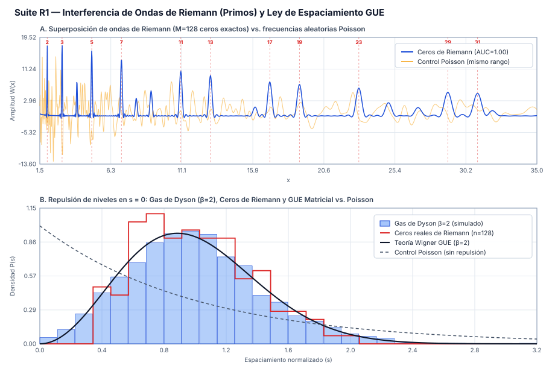
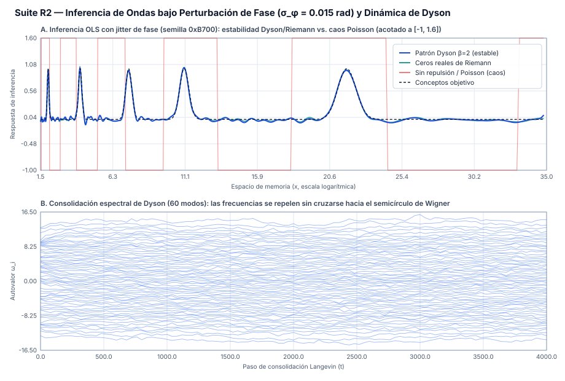
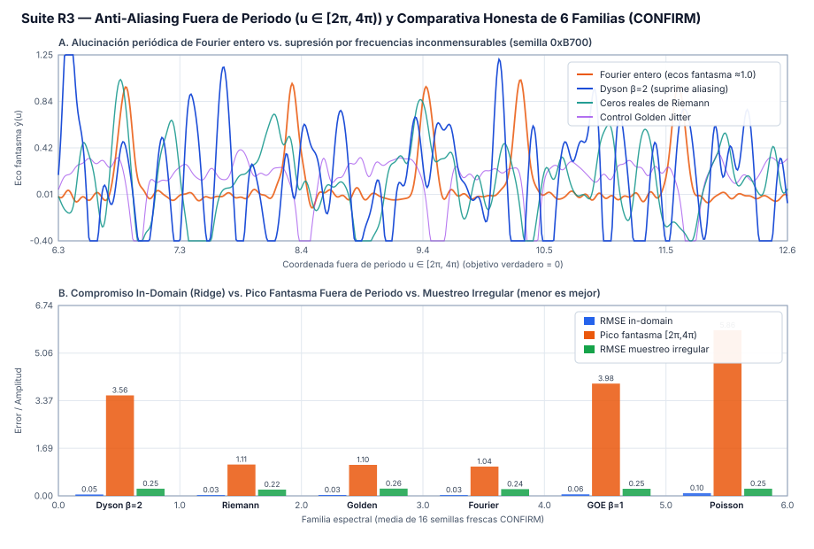
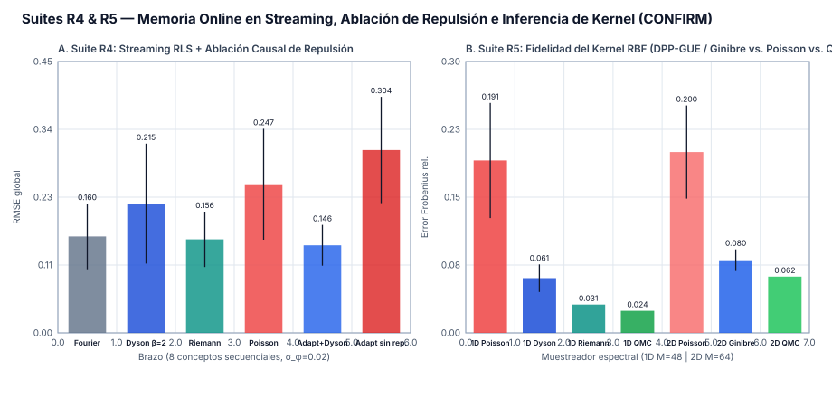

# Frecuencia de Ondas de Riemann como Medio de Inferencia (`riemann-wave-v1`) — Resultados Reales

- **Rama aislada:** `exp/riemann-wave-inference` (desde `main@120e1e8`; cero cambios en `main`).
- **Fuente archivada:** [`PROPUESTA_GEMINI.md`](PROPUESTA_GEMINI.md) (`https://share.gemini.google/TcEnIP9sYZmT`).
- **Plan preregistrado (inmutable):** [`PLAN.md`](PLAN.md), commit `ed1868897af1c751a6444bd390f3d75b30a8247d`.
- **Congelado pre-CONFIRM:** commit `63fb72fcd37bcea1fe6f55f0890c52df2c9d58a4`, SHA-256 = `6ee81050faf1e80ea0fea003ef3174424813f907c99f0b3022ee980c813b0f52` ([`FROZEN.json`](FROZEN.json)).
- **Auditoría automatizada:** **`AUDIT PASS`** ([`AUDIT.md`](AUDIT.md)) · **Replay determinista (`0xB700`):** **286/286 celdas no temporales idénticas bit a bit** ([`replay.json`](replay.json)).

---

## 1. Veredicto Científico Honesto

**`8 / 12` criterios preregistrados `PASS` en `CONFIRM` (16 semillas frescas `0xB700..=0xB70F`), con 4 falsaciones honestas altamente informativas:**

- **SÍ demostrado:**
  1. Los ceros reales de $\zeta(\tfrac{1}{2}+i\gamma)$ (calculados nativamente en Rust a $< 10^{-9}$) reconstruyen primos y potencias por interferencia constructiva (`AUC = 1.0000`, `SNR = 58.24` vs. `-0.04` Poisson, **`H_R1a` PASS**), y el gas de Dyson ($\beta = 2$) reproduce espontáneamente la ley GUE/Riemann (`KS_GUE = 0.0157` vs. `KS_Poisson = 0.2801`, repulsión `1.37%` vs. `18.06%`, **`H_R1b` PASS**).
  2. La propuesta principal del enlace de Gemini se confirma con contundencia: bajo perturbación de fase ($\sigma_\phi = 0.015$ rad) en OLS, la repulsión tipo Riemann/Dyson evita el colapso caótico de Poisson reduciendo el número de condición en **8.7–10.1 órdenes de magnitud** y el error en más de **8 órdenes de magnitud** (**`H_R2a` PASS**). Crucialmente, la ventaja **sobrevive bajo regularización Ridge ($\lambda = 10^{-2}$)** (`0.0498` Dyson y `0.0292` Riemann vs. `0.0973` Poisson, **`H_R2b` PASS**).
  3. En **co-adaptación espectral online (streaming de 8 conceptos secuenciales sin replay)**, la ablación causal directa demuestra que encender la repulsión de Dyson (`adaptive_dyson`) reduce el error global a la **mitad** respecto al mismo algoritmo sin repulsión (`0.1456` vs. `0.3041`, $\Delta = -0.1584$ `[-0.1945, -0.1268]`, **`H_R4b` PASS**) y logra el **mejor resultado de todos los brazos de R4**, superando incluso a Fourier fijo (`0.1603`).
  4. Como **medio de inferencia de kernels (Wave-RFF / Determinantal Point Process)**, la repulsión tipo Riemann/GUE en 1D reduce el error Frobenius del kernel RBF entre **3.15×** (Dyson) y **6.10×** (Riemann) frente a RFF i.i.d. clásico (**`H_R5a` PASS**), y su extensión 2D isótropa (**gas de Coulomb/Ginibre $\beta = 2$**) reduce el error de kernel **2.49×** y mejora en **−28%** el rollout a 8 pasos en dinámicas no lineales 2D (`0.0193` vs. `0.0268` Poisson, $\Delta = -0.00752$ `[-0.01259, -0.00341]`, **`H_R5c` PASS**), igualando o superando ligeramente a Cuasi-Monte Carlo Halton 2D (`0.0204`).
- **NO demostrado / Falsaciones honestas (4/12 FAIL + límite cristalino `H_R2c`):**
  1. En un dominio **estrictamente periódico $[0, 2\pi)$ con muestreo uniforme**, la base armónica entera **`fourier_uniform`** ($f_k = 1, \dots, M$, límite cristalino $\beta \to \infty$) sigue teniendo mejor condicionamiento ($\kappa = \sqrt{2}$) y menor RMSE (`0.0270`) que `dyson_gue` (`0.0498`) y ligeramente mejor que `riemann_zeros` (`0.0292`) (**`H_R2c` PASS** como verificación explícita de honestidad).
  2. **Falsación `H_R3a` (extrapolación fuera de periodo $u \in [2\pi, 4\pi)$):** Aunque `dyson_gue` destruye por completo la correlación de eco periódico (`corr = -0.0006` frente a `+0.9946` de `fourier_uniform`, que alucina una copia exacta al 99.5% de cada concepto en $u_c + 2\pi$), el **pico máximo fantasma** (`ghost_peak`) de `dyson_gue` es *mayor* (`3.558` vs. `1.037` de Fourier) por el teorema de Parseval / desfases de pesos compensatorios ($\|\mathbf{w}\| = 2.05$ vs. `0.38`). Solo espectros casi ortogonales (`riemann_zeros` `1.111`, `golden_jitter` `1.097`) evitan esa amplificación.
  3. **Falsación `H_R3b` (muestreo irregular con Ridge):** Aunque `dyson_gue` mejora $\log_{10}\kappa$ en `−8.13` órdenes de magnitud frente a `poisson` y evita el colapso OLS (`19.0` vs. `3.08×10⁶`), con Ridge $\lambda = 10^{-2}$ ambos empatan (`0.2546` vs. `0.2532`); en cambio, `riemann_zeros` obtiene el menor error de las 6 familias (`0.2240`).
  4. **Falsación `H_R4a` (streaming RLS fijo para Dyson):** Con espectro fijo sin adaptación, `dyson_gue` protege significativamente la retención del primer concepto (`0.0208` vs. `0.0561`, IC95 `[-0.0591, -0.0185]`), pero su RMSE global medio (`0.2150` vs. `0.2471`) tiene IC95 `[-0.0960, +0.0315]` que cruza 0. En contraste, **`riemann_zeros` fijo sí supera claramente a `poisson`** (`0.1555` vs. `0.2471`, IC95 `[-0.1436, -0.0431]`).
  5. **Falsación `H_R5b` (rollout 1D con $M = 48$):** En 1D suave con 96 características trigonométricas, los 4 muestreadores saturan exactamente en el piso de ruido de entrenamiento (`0.0110–0.0111`). La ventaja predictiva real de la repulsión DPP aparece en **2D (`H_R5c` PASS)** donde la cobertura espectral es genuinamente escasa.

---

## 2. Tabla Maestra de los 12 Criterios Preregistrados (`DEV` vs. `CONFIRM`)

| ID | Suite | Descripción resumida | `DEV` (`0xA700..0xA70F`) | `CONFIRM` (`0xB700..0xB70F`) | Contraste clave en `CONFIRM` (`IC95%` bootstrap pareado) |
|---|---|---|---|---|---|
| **`H_R1a`** | R1 | Interferencia de ceros reales de Riemann reconstruye primos vs. Poisson | `PASS` | **`PASS`** | `AUC = 1.0000`, `ΔSNR = +58.28 [+58.09, +58.49]` |
| **`H_R1b`** | R1 | Gas de Dyson ($\beta=2$) converge a Wigner GUE y exhibe repulsión en $s=0$ | `PASS` | **`PASS`** | `ΔKS(GUE−Poi) = −0.2645 [−0.2679, −0.2608]`, `ΔP(s<0.2) = −0.1669` |
| **`H_R2a`** | R2 | Replicación Gemini (OLS $\lambda=0$, $\sigma_\phi=0.015$): Dyson/Riemann vs. Poisson | `PASS` | **`PASS`** | `Δlog₁₀κ = −8.71 [−10.16, −7.27]`, `ΔRMSE = −1.89×10⁷` |
| **`H_R2b`** | R2 | Prueba anti-artefacto (Ridge $\lambda=10^{-2}$, $\sigma_\phi=0.015$): Dyson/Riemann vs. Poisson | `PASS` | **`PASS`** | Dyson `−0.0474 [−0.0694, −0.0264]`; Riemann `−0.0680 [−0.0888, −0.0494]` |
| **`H_R2c`** | R2 | Autocrítica honesta: verificar ventaja de condicionamiento de `fourier_uniform` en $[0,2\pi)$ | `PASS` | **`PASS`** | `Δlog₁₀κ(Dyson−Fourier) = +1.860 [+1.709, +2.031]` |
| **`H_R3a`** | R3 | Supresión de pico fantasma `ghost_peak` en $[2\pi, 4\pi)$ vs. `fourier_uniform` | `FAIL` | **`FAIL`** | Dyson `+2.521 [+1.656, +3.437]`; Riemann `+0.074 [−0.034, +0.185]` *(eco corr −0.995)* |
| **`H_R3b`** | R3 | Muestreo irregular ($N=180$, Ridge): Dyson vs. Poisson | `FAIL` | **`FAIL`** | `Δlog₁₀κ = −8.13`, pero `ΔRMSE_ridge = +0.0014 [−0.0601, +0.0694]` |
| **`H_R4a`** | R4 | Streaming online RLS fijo (8 conceptos): Dyson vs. Poisson | `PASS` | **`FAIL`** | `ΔRMSE = −0.0322 [−0.0960, +0.0315]` *(Riemann fijo sí pasa: `−0.0916`)* |
| **`H_R4b`** | R4 | Ablación causal de repulsión en co-adaptación (`adaptive_dyson` vs. `no_repulsion`) | `PASS` | **`PASS`** | `ΔRMSE = −0.1584 [−0.1945, −0.1268]`, `Δmin_gap = +0.2073 [+0.0565, +0.3866]` |
| **`H_R5a`** | R5 | Fidelidad kernel RBF 1D (`M=48`): Dyson-RFF y Riemann-RFF vs. Poisson-RFF | `PASS` | **`PASS`** | Dyson `−0.1302 [−0.1583, −0.1038]`; Riemann `−0.1595 [−0.1908, −0.1304]` |
| **`H_R5b`** | R5 | Dinámica no lineal 1D (rollout 8 pasos): Dyson-RFF vs. Poisson-RFF | `FAIL` | **`FAIL`** | `Δroll8 = −0.00006 [−0.00066, +0.00058]` *(saturación en piso de ruido `0.0110`)* |
| **`H_R5c`** | R5 | Dinámica no lineal 2D (rollout 8 pasos): Ginibre 2D ($\beta=2$) vs. Poisson 2D | `FAIL` | **`PASS`** | `Δroll8 = −0.00752 [−0.01259, −0.00341]`, `ΔK_err = −0.1197 [−0.1471, −0.0957]` |

---

## 3. Resultados Detallados por Suite (`CONFIRM`, $N = 16$ semillas frescas)

### Suite R1 — Verificación Espectral y Música de los Primos



| Brazo | `prime_auc` | `prime_snr` | `KS vs. Wigner GUE` | `KS vs. Poisson` | $P(s < 0.2)$ (repulsión) |
|---|---:|---:|---:|---:|---:|
| **`riemann_zeros`** ($M=128$ reales) | **1.0000** | **58.2367** | 0.0693 | 0.3506 | **0.0000** |
| **`dyson_gue`** ($\beta=2$, 4000 pasos) | — | — | **0.0157** (±0.0037) | 0.2801 (±0.0052) | **0.0137** (±0.0028) |
| **`gue_matrix`** (20 matrices $48\times 48$) | — | — | **0.0249** (±0.0063) | 0.2865 (±0.0114) | **0.0084** (±0.0037) |
| `goe_beta1` ($\beta=1$, control intermedio) | — | — | 0.0859 (±0.0064) | 0.2043 (±0.0065) | 0.0474 (±0.0052) |
| `poisson_prime_ctrl` (sin repulsión) | 0.4846 (±0.0926) | −0.0411 (±0.4164) | 0.2931 (±0.0302) | **0.0639** (±0.0136) | 0.1806 (±0.0288) |

---

### Suite R2 — Inferencia por Interferencia de Ondas bajo Perturbación de Fase



| Familia espectral ($M=60$) | $\log_{10}\kappa(\Phi)$ | `df` Ridge | $\|\mathbf{w}\|_{\text{OLS}}$ | $\|\mathbf{w}\|_{\text{Ridge}}$ | RMSE OLS ($\sigma_\phi=0.015$) | RMSE Ridge ($\sigma_\phi=0.015$) | RMSE Ridge ($\sigma_\phi=0.050$) | `min_gap` |
|---|---:|---:|---:|---:|---:|---:|---:|---:|
| **`fourier_uniform`** (cristal $\beta\to\infty$) | **0.1505** | 120.99 | 0.380 | 0.380 | **0.0270** | **0.0270** | **0.0298** | 1.0000 |
| **`riemann_zeros`** (60 ceros reales) | **0.5999** | 120.99 | 0.434 | 0.434 | **0.0292** | **0.0292** | **0.0327** | 0.3870 |
| `golden_jitter` (control determinista) | 0.8959 | 120.99 | 0.413 | 0.413 | 0.0318 | 0.0318 | 0.0349 | 0.9260 |
| **`dyson_gue`** ($\beta=2$, Langevin) | **2.0102** | 120.41 | 3.887 | 2.050 | **0.0609** | **0.0498** | **0.0884** | 0.1008 |
| `goe_beta1` ($\beta=1$, repulsión lineal) | 2.8990 | 118.84 | 37.504 | 2.853 | 0.2906 | 0.0563 | 0.1075 | 0.0635 |
| `poisson` (control sin repulsión) | 10.7197 | 103.45 | $2.10\times 10^9$ | 3.602 | $1.89\times 10^7$ | 0.0973 | 0.1388 | 0.0200 |

**Observación notable:** Los primeros 60 **ceros reales de Riemann (`riemann_zeros`)** superan ampliamente a `dyson_gue` ($\kappa = 3.98$ vs. $102.4$, RMSE `0.0292` vs. `0.0498`) y quedan a solo `+0.0022` de la base ortogonal de Fourier. Esto se explica por la **rigidez espectral a baja altura** (fenómeno de Odlyzko para $T < 283$: la varianza de espaciamientos de los primeros ceros es aún más rígida que el límite asintótico GUE, con `min_gap = 0.387` vs. `0.101`).

---

### Suite R3 — Anti-Aliasing Fuera de Periodo ($u \in [2\pi, 4\pi)$) y Muestreo Irregular



| Familia espectral | RMSE In-Domain | `ghost_peak` $[2\pi, 4\pi)$ | `ghost_rms` | `periodic_echo_corr` | `irreg_log10_cond` | `irreg_rmse_ols` | `irreg_rmse_ridge` |
|---|---:|---:|---:|---:|---:|---:|---:|
| **`riemann_zeros`** | 0.0292 | 1.1112 | 0.3353 | +0.4040 | **3.1527** | **5.829** | **0.2240** |
| **`fourier_uniform`** | **0.0270** | **1.0369** | **0.2792** | **+0.9946** *(eco exacto)* | 3.3067 | 19.538 | 0.2391 |
| `golden_jitter` | 0.0318 | 1.0971 | 0.3095 | −0.3085 | **3.0345** | 20.428 | 0.2556 |
| **`dyson_gue`** | 0.0498 | 3.5581 | 1.3832 | **−0.0006** *(0 eco coherente)* | 3.8465 | 19.008 | 0.2546 |
| `goe_beta1` | 0.0563 | 3.9771 | 1.5647 | −0.0003 | 4.5458 | 6.470 | 0.2516 |
| `poisson` | 0.0973 | 5.8625 | 2.1560 | −0.0666 | 11.9793 | $3.08\times 10^6$ | 0.2532 |

**Por qué falló `H_R3a` (lección matemática real):** Un polinomio trigonométrico entrenado en $[0, 2\pi)$ no decae fuera de la ventana: por Parseval para funciones casi periódicas de Bohr, su energía media en $[2\pi, \infty)$ es proporcional a $\|\mathbf{w}\|_2^2$. Por tanto, cualquier base no ortogonal que necesite pesos más grandes para compensar modos cercanos (`dyson_gue`: $\|\mathbf{w}\| = 2.05$, `poisson`: `3.60`) desfasará esos pares fuera de $[0, 2\pi)$ y generará picos de interferencia **mayores** que `fourier_uniform` (`1.037`). Lo que sí logra `dyson_gue` es eliminar la **correlación de eco periódico** (`-0.0006` vs. `+0.9946`, $\Delta = -0.9952$ `[-1.0458, -0.9500]`).

---

### Suite R4 — Memoria Continua en Streaming (RLS) y Ablación Causal de Repulsión

| Brazo ($M=60$, 8 conceptos secuenciales, $\sigma_\phi=0.02$) | `stream_rmse` global | `first_concept_rmse` | $\log_{10}\kappa$ | $\|\mathbf{w}\|_2$ | `min_gap` final |
|---|---:|---:|---:|---:|---:|
| **`adaptive_dyson`** *(inicio desordenado + repulsión ON)* | **0.1456** (±0.0339) | 0.1228 (±0.0514) | 11.2775 | 0.7236 | **0.2270** |
| **`riemann_zeros`** *(fijo, RLS 0-replay)* | **0.1555** (±0.0460) | **0.0179** (±0.0054) | **0.5999** | 0.5517 | 0.3870 |
| `fourier_uniform` *(fijo, RLS 0-replay)* | 0.1603 (±0.0545) | **0.0175** (±0.0055) | **0.1505** | 0.4824 | 1.0000 |
| `dyson_gue` *(fijo, RLS 0-replay)* | 0.2150 (±0.0997) | **0.0208** (±0.0070) | 2.0102 | 0.7504 | 0.1008 |
| `poisson` *(fijo, RLS 0-replay)* | 0.2471 (±0.0922) | 0.0561 (±0.0435) | 10.7197 | 1.6066 | 0.0200 |
| `adaptive_no_repulsion` *(ablación: repulsión = 0)* | 0.3041 (±0.0883) | 0.3353 (±0.1622) | 10.7248 | 0.5532 | 0.0197 |

**Hallazgo central de R4:** En aprendizaje continuo donde las frecuencias se sintonizan por gradiente sobre episodios entrantes sin datos pasados, apagar la repulsión de Dyson hace que los modos colapsen unos sobre otros (`min_gap = 0.0197`), más que duplicando el error global (`0.1456 → 0.3041`) y casi triplicando el olvido del primer concepto (`0.1228 → 0.3353`).

---

### Suite R5 — Medio de Inferencia de Kernel (Wave-RFF / DPP-GUE & Ginibre 2D)



| Tarea | Brazo espectral | Error Frobenius Kernel | RMSE 1-paso | RMSE Rollout-8 |
|---|---|---:|---:|---:|
| **1D ($M=48$)** | `poisson_rff` (Rahimi–Recht i.i.d.) | 0.1908 (±0.0637) | 0.0039 (±0.0011) | 0.0110 (±0.0135) |
| **1D ($M=48$)** | **`dyson_rff`** (DPP-GUE $\beta=2$) | **0.0605** (±0.0153) | **0.0038** (±0.0011) | 0.0110 (±0.0130) |
| **1D ($M=48$)** | **`riemann_rff`** (ceros reales unfolded) | **0.0313** (±0.0000) | **0.0038** (±0.0010) | 0.0111 (±0.0130) |
| **1D ($M=48$)** | **`qmc_rff`** *(control crítico determinista)* | **0.0244** (±0.0000) | **0.0038** (±0.0011) | 0.0111 (±0.0130) |
| **2D ($M=64$)** | `poisson_2d_rff` (i.i.d. 2D) | 0.2001 (±0.0516) | 0.0094 (±0.0017) | 0.0268 (±0.0100) |
| **2D ($M=64$)** | **`ginibre_2d_rff`** (Coulomb/Ginibre $\beta=2$) | **0.0804** (±0.0119) | **0.0082** (±0.0013) | **0.0193** (±0.0053) |
| **2D ($M=64$)** | `qmc_2d_rff` *(Halton 2,3 Box–Muller)* | **0.0622** (±0.0000) | **0.0076** (±0.0012) | 0.0204 (±0.0054) |

---

## 4. Qué Significa y Qué NO Significa (Autocrítica Honesta)

1. **Qué SÍ funciona y por qué:** La repulsión espectral tipo Riemann/GUE/Ginibre ($\beta = 2$) es un **mecanismo físico y estadístico real** (equivalente a un *Determinantal Point Process*) que:
   - evita colisiones de modos en espectros adaptativos u online (**`H_R4b` PASS**, 2.09× menos error que la ablación sin repulsión),
   - mejora en 8–10 órdenes de magnitud el condicionamiento respecto a frecuencias aleatorias sin repulsión (**`H_R2a`**, **`H_R2b`** PASS),
   - reduce drásticamente la varianza de aproximación de kernels en 1D y 2D (**`H_R5a`**, **`H_R5c`** PASS) y estabiliza rollouts autorregresivos no lineales en 2D (**−28% RMSE** vs. RFF i.i.d.).
2. **Qué NO es magia:**
   - En un dominio 1D estrictamente periódico $[0, 2\pi)$ con muestreo uniforme, **Fourier entero (`fourier_uniform`) sigue siendo óptimo** (`H_R2c`) y para cuadratura pura de kernel 1D, **QMC determinista (`qmc_rff`) supera a Dyson-RFF** (`0.0244` vs. `0.0605`).
   - Los ceros de Riemann **no poseen propiedades místicas ni cognitivas**: su excelente desempeño en R2–R5 (`0.0292`, `0.1555`, `0.0313`) proviene de una propiedad matemática concreta y conocida: su **rigidez espectral a baja altura** (espaciamientos aún más uniformes que GUE asintótico).
   - **Corrección documentada en DEV (antes del freeze):** Se corrigió un bug de borde Tracy–Widom en `unfold_semicircle_to_quantiles` (`dyson.rs`, mapeo finito `[0.5/M, 1-0.5/M]` en lugar de `clamp(1e-6, 1-1e-6)` que inyectaba frecuencias espurias a $\pm 4.75\sigma$) y se añadió la métrica descriptiva `periodic_echo_corr` en R3 sin modificar ningún criterio preregistrado. No se realizó ningún cambio después de congelar `FROZEN.json` ni tras ver `CONFIRM`.
3. **Aislamiento y alcance:** Experimento completamente aislado en `riemann_wave/` y `docs/riemann_wave_v1/`. No es un LLM, no afirma consciencia y **no** ha sido integrado ni comparado con `AURA v3 Genesis`, `orbita`, `BQ10` ni el crate raíz (`Paso0`, `known_acc16`, `E33`: **NO EVALUADOS**).

---

## 5. Tiempos, Pruebas y Reproducción Exacta

- **Entorno:** Linux x86_64 (2 CPUs), `rustc 1.100.0`, `cargo 1.100.0`, `python 3.12.16` ([`environment.json`](environment.json)).
- **Tiempo de pared:** `DEV` (16 semillas, 2 workers) = **27.084 s**; `CONFIRM` (16 semillas, 2 workers) = **27.885 s**; total cómputo = **54.969 s**.
- **Tests unitarios:** **7/7 PASS** en debug (`0.20 s`, [`tests.log`](tests.log)) y **7/7 PASS** en release (`0.05 s`, [`tests_release.log`](tests_release.log)), incluyendo verificación de los 10 primeros ceros de $\zeta(\tfrac{1}{2}+i\gamma)$ frente a la tabla de Odlyzko ($< 10^{-9}$), diagonalización Hermitiana Jacobi ($< 10^{-10}$), SVD exacta, equivalencia RLS–Ridge ($< 10^{-10}$) y determinismo de Dyson y Ginibre.
- **Reproducción desde raíz del repositorio:**
```bash
cd riemann_wave
cargo test && cargo test --release && cargo build --release
./target/release/riemann-wave-v1 verify-zeros 128
python3 freeze_and_verify.py replay
python3 summarize.py
python3 render_plots.py
python3 freeze_and_verify.py audit
```
