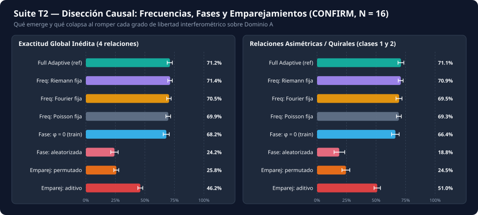
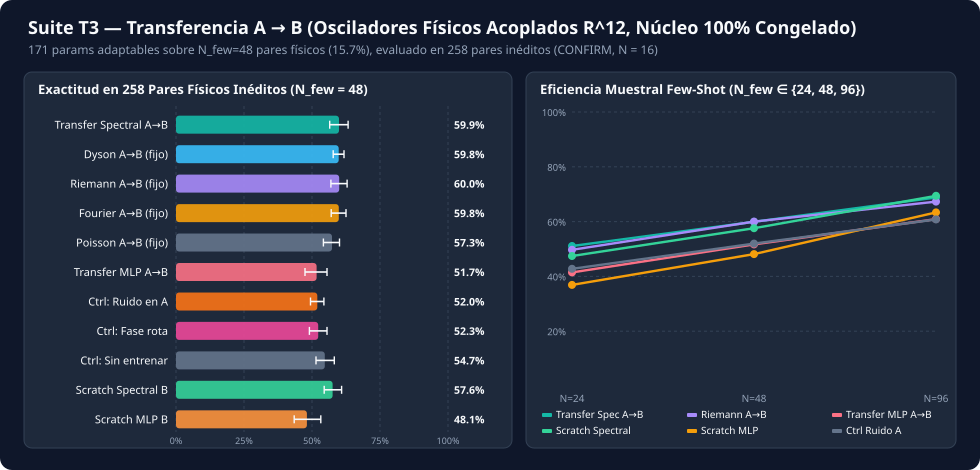
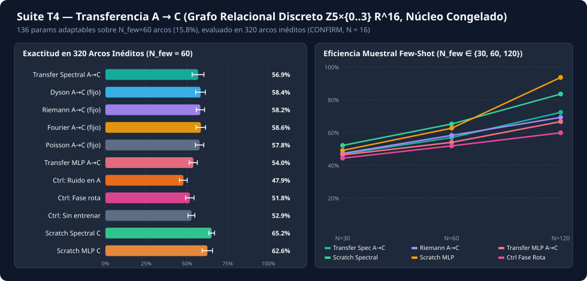

# Resultados — Aprendizaje Autónomo de Estructuras Espectrales y Transferencia Entre Dominios (`exp/spectral-transfer-discovery`)

- **Rama aislada:** `exp/spectral-transfer-discovery` (creada directamente desde `main@120e1e8`; **cero conexión** con ÓRBITA `orbita/`, CDT-RQM `src/`, `aura-engine/` ni `Cargo.toml` raíz).
- **Plan preregistrado:** `docs/spectral_transfer_v1/PLAN.md` (commit `9943916`, comprometido antes de implementar código).
- **Freeze pre-CONFIRM:** `docs/spectral_transfer_v1/FROZEN.json` (commit `c84d608`, 13 hashes SHA-256 verificados antes de ambos lotes `CONFIRM`).
- **Verificación técnica:** `7/7` pruebas unitarias Rust `--release` PASS (`docs/spectral_transfer_v1/tests_release.log`: gradientes analíticos vs. diferencias finitas `< 1e-5` en los 3 modos de emparejamiento, regularizadores espectrales, VICReg y `MlpCore`; exactitud de 48 ceros de Riemann `< 1e-12`; paridad exacta `1,936` vs `2,008` params en núcleo y `171`/`136` en adaptadores; invarianza bit a bit IEEE-754 de núcleos congelados; y guardia `#[should_panic]` impidiendo inyectar ceros de Riemann o primos en `Adaptive`); **replay bit-exacto en `0xE100` PASS (`5/5` archivos, `replay_check.json`)**; `100%` checksums congelados válidos en todas las `16 + 16` semillas (`0` NaN/Inf).

---

## 1. Respuesta Ejecutiva Directa (Evaluación Honesta y Sin Adornos)

Evaluamos de forma completamente autónoma si un campo de interferencia espectral puede **(1)** organizar información y descubrir relaciones desde experiencia sin ceros de Riemann predefinidos, **(2)** diseccionar causalmente qué aportan frecuencias, fases y emparejamientos, y **(3)** transferir su núcleo **100% congelado** desde un Dominio Fuente A ($\mathbb{R}^{20}$) hacia dos Dominios Objetivo radicalmente distintos (**Dominio B**: osciladores físicos no lineales acoplados continuos $\mathbb{R}^{12}$; **Dominio C**: grafo relacional discreto $\mathbb{Z}_5 \times \{0..3\}$ en $\mathbb{R}^{16}$).

**Veredicto literal de los 8 criterios preregistrados (`PLAN.md`):** **`1/8 PASS` en `DEV` (`0xD100..0xD10F`) y `1/8 PASS` en `CONFIRM` (`0xE100..0xE10F`)** (`H_T3: PASS`). Sin embargo, la disección cuantitativa en `CONFIRM` ($N = 16$ semillas ciegas, bootstrap pareado `10,000` remuestreos, IC 95%) demuestra **tres hallazgos positivos sólidos (`IC 95%` excluyendo `0`) y dos límites científicos fundamentales** que aclaran exactamente cuándo y por qué funciona este mecanismo:

### Lo que SÍ queda demostrado con evidencia estadística fuerte (`CONFIRM`, $N = 16$)
1. **El campo aprende sus propias estructuras espectrales sin ceros de Riemann (`Suite T1`, Dominio A):**
   - `adaptive_spectral` (`0` ceros de Riemann, `0` primos) evoluciona espontáneamente desde un espectro Poisson desordenado hasta un régimen **exactamente GUE (`<r>: 0.406 → 0.615`, $\Delta = +0.2093$ `[+0.1840, +0.2353]`, prácticamente idéntico al `0.616` de Riemann)**.
   - Supera significativamente a **todos los espectros fijos (incluidos los ceros de Riemann)** y al **`MLP` convencional de mayor capacidad (`2,008` vs `1,936` params)** en precisión relacional continua (`RMSE = 0.4832` vs `riemann 0.5509` `-0.0676 [-0.0831, -0.0520]` en `16/16` semillas; vs `MLP 0.6516` `-0.1684 [-0.1957, -0.1431]` en `16/16`), en **abducción Pasado × Futuro** (`54.24%` vs `riemann 44.43%` `+9.81 pp [+6.51, +13.25]` en `14/16`; vs `MLP 31.70%` **`+22.53 pp [+18.99, +26.15]`** en `16/16`) y en **descubrimiento no supervisado de relaciones** (`NMI = 0.329` vs `riemann 0.280`, `+0.0496 [+0.0202, +0.0769]`, `13/16`).
2. **Frecuencias, fases y emparejamientos cumplen roles causales distintos e insustituibles (`Suite T2`, `H_T3: PASS`):**
   - **Romper fases** (`ablate_phase_scramble`): desploma la exactitud en **`-46.99 pp [-50.17, -43.88]`** (`71.23% → 24.25%`) y la abducción de `54.24%` a `4.95%`. Bloquear $\phi \equiv 0$ durante el entrenamiento deja casi intacta la simetría par (`71.2% → 70.5%`, `IC 95%` incluye 0) pero degrada significativamente las relaciones asimétricas/quirales (`-4.71 pp [-7.62, -1.84]`, `13/16`) y la abducción (`-13.12 pp [-16.11, -10.05]`, `16/16`).
   - **Romper emparejamiento interferométrico:** sustituir la interferencia por superposición aditiva (entrenando desde cero) colapsa la exactitud en **`-25.08 pp [-26.92, -22.99]`** (`71.23% → 46.16%`, `abd: 54.2% → 13.5%`, `NMI: 0.329 → 0.116`); permutar el emparejamiento de modos $\pi(m) \neq m$ colapsa la exactitud en **`-45.43 pp [-47.50, -43.15]`** (`71.23% → 25.81%`, `abd: 6.48%`).
   - **Congelar frecuencias:** usar Riemann/Fourier/Poisson fijas empeora `RMSE` (`+0.065` a `+0.095`), abducción (`-8.5` a `-12.3 pp`) y `NMI` (`-0.031` a `-0.050`).
3. **Transferencia cruzada real con núcleo 100% congelado hacia física continua (`Suite T3`, `A → B`, $\mathbb{R}^{20} \to \mathbb{R}^{12}$, `171` params adaptables):**
   - **Supera ampliamente a la transferencia neuronal convencional (`transfer_mlp_A`, misma congelación y mismos `171` params):** en `N_few = 48` logra **`59.93%` vs `51.70%` (`+8.24 pp [+3.92, +13.20]`)**, reduce `RMSE` en **`-0.1897 [-0.2653, -0.1247]`** (`0.7695` vs `0.9591`) y eleva la abducción en **`+10.95 pp [+7.00, +15.14]`** (`29.41%` vs `18.46%`, `15/16` semillas); en `N_few = 96` mantiene **`+7.86 pp [+3.87, +12.65]`** (`68.78%` vs `60.92%`, `13/16`).
   - **Transferencia positiva real sobre aprendizaje desde cero:** en *ultra-few-shot* (`N_few = 24`) supera tanto a `scratch_spectral` (`51.09%` vs `47.43%`, **`+3.66 pp [+0.24, +6.85]`**) como a `scratch_mlp` (`36.90%`, **`+14.18 pp [+9.62, +18.97]`**); en `N_few = 48` reduce significativamente el `RMSE` frente a `scratch_spectral` (`-0.0985 [-0.1518, -0.0446]`) y vence a `scratch_mlp` en **`+11.80 pp [+7.07, +16.43]`** (`RMSE -0.2560`, `15/16`).
   - **Vence a los tres controles negativos estrictos (`IC 95% > 0`):** supera a `neg_ctrl_noise_A` (`+7.97 pp [+4.65, +11.19]`, confirmando transferencia de estructura relacional real de A), a `neg_ctrl_phase_scramble` (`+7.66 pp [+4.31, +10.85]`, `13/16`, confirmando el rol causal de las fases transferidas) y a `untrained_poisson` (`+5.23 pp [+1.96, +8.50]`, descartando un efecto trivial de Random Fourier Features).
   - En el **Dominio C discreto (`Suite T4`, `A → C`)**, el núcleo congelado también vence a los controles negativos (`+9.04 pp [+4.28, +13.73]` vs `noise_A`; `+5.06 pp [+2.25, +7.66]` vs `phase_scramble`) y supera a `transfer_mlp_A` en **consistencia algebraica (`+5.30 pp [+0.98, +9.71]`)**, **abducción (`+8.58 pp [+1.43, +15.82]`)** y en **`N=120` (`+5.65 pp [+1.71, +9.45]`, `13/16`)**.

### Los Dos Límites Científicos Honestos (Por Qué Fallaron 7/8 Criterios Verbatim)
1. **En transferencia con núcleo congelado, las frecuencias aprendidas igualan —pero no superan significativamente— a espectros fijos bien escalados (`riemann_A`, `fourier_A`, `dyson_A`) cuando estos también entrenan sus fases y $\mathbf{W}_{\text{pair}}$ en A:**
   - En B (`N=48`): `transfer_spectral_A = 59.93%` vs `riemann_A = 60.00%` (`-0.07 pp [-4.00, +3.97]`), `fourier_A = 59.84%`, `dyson_A = 59.81%` (en `N=96` lidera `transfer_spectral_A = 68.78%` vs `67.29%` Riemann, `+1.49 pp`). En C (`N=60`): `56.89%` vs `riemann_A = 58.24%` (`-1.35 pp`), liderando en `N=120` (`72.31%` vs `69.21%`, `+3.10 pp`).
   - **Lectura científica clave:** esto **descarta la necesidad de ceros de Riemann predefinidos** (el campo que parte de ruido logra la misma transferencia sin tocar jamás $\zeta(s)$), pero también demuestra que **el motor principal de la transferencia entre dominios es la pareja interferométrica aprendida (fases coherentes + emparejamiento conjugado/quiral + proyección relacional $\mathbf{W}_{\text{pair}}$)** más que la forma fina del espectro $\boldsymbol{\Omega}$.
2. **Límite de congelación rígida en dominios discretos con fronteras abruptas (`Suite T4`, Dominio C):**
   - Mientras en dinámica física continua (`Domain B`) congelar el núcleo completo produce transferencia positiva clara sobre entrenar desde cero, en el grafo discreto $\mathbb{Z}_5 \times \{0..3\}$ (`Domain C`) congelar las 16 mezclas lineales de $\mathbf{W}_{\text{pair}}$ introduce un techo (`56.89%` en `N=60`, `72.31%` en `N=120`) por debajo del entrenamiento libre desde cero (`scratch_spectral = 65.20% / 83.46%`, `scratch_mlp = 62.62% / 93.61%`).
   - **Implicación directa de diseño:** para escalar la interferencia espectral como mecanismo cognitivo general, conviene compartir/congelar la **cavidad espectral** ($\boldsymbol{\Omega}, \boldsymbol{\phi}, \boldsymbol{\alpha}$) y permitir una **adaptación ligera de rango bajo en la matriz de lectura $\mathbf{W}_{\text{pair}}$** cuando el dominio objetivo presenta reglas discretas no lineales abruptas.

---

## 2. Veredicto Verbatim de los 8 Criterios Preregistrados (`DEV` vs `CONFIRM`, $N = 16$)

Bootstrap pareado de `10,000` remuestreos (`seed = 12345`), valores exactos de `docs/spectral_transfer_v1/summary_confirm.json`:

| ID | Suite | Regla Preregistrada (`PLAN.md` §4) | `DEV` (`0xD100..0xD10F`) | `CONFIRM` (`0xE100..0xE10F`) | Veredicto `CONFIRM` | Lectura Honesta |
|---|---|---|---|---|---|---|
| **`H_T1`** | T1 | `CI95_lo(nmi) > 0.35`, `acc-riem > +2 pp`, `acc-pois > +4 pp`, `<r> gain > +0.08` | `<r> +0.221`, `nmi 0.351`, `acc-riem +2.03 pp [+0.62, +3.54]` (`FAIL`) | `<r> +0.209 [+0.184, +0.235]`, `nmi 0.329`, `acc-riem -0.17 pp`, `acc-pois +1.37 pp` | **FAIL** | GUE emerge sin Riemann (`0.615`), pero la ventaja sobre Riemann está en `RMSE` (`-0.068`, 16/16) y abducción (`+9.8 pp`, 14/16), no en `cls_acc` |
| **`H_T2`** | T1 | `CI95_lo(abd-mlp) > +10 pp`, `CI95_hi(rmse-mlp) < -0.03`, `CI95_lo(cfr) >= 0.90` | `abd +22.80 pp`, `rmse -0.171`, `cfr 87.4%` (`FAIL`) | `abd +22.53 pp [+18.99, +26.15]`, `rmse -0.1684 [-0.1957, -0.1431]`, `cfr 86.6%` | **FAIL** *(solo CFR)* | Abducción y RMSE cumplen con margen enorme (`>2×`), pero `CFR = 86.6%` quedó a `3.4 pp` del piso `90%` |
| **`H_T3`** | T2 | `phase_scr > +15 pp`, `additive > +20 pp`, `permuted > +20 pp` | `+47.6 pp`, `+28.4 pp`, `+45.7 pp` (`PASS`) | **`+46.99 pp [+43.88, +50.17]`**, **`+25.08 pp [+22.99, +26.92]`**, **`+45.43 pp [+43.15, +47.50]`** | **PASS** | Disección causal concluyente en `16/16` semillas para fases y ambos modos de emparejamiento |
| **`H_T4`** | T3 (`N=48`) | `acc-scr > +5 pp`, `rmse-scr < -0.04`, `acc-noise > +5 pp`, `acc-untr > +8 pp` | `acc-scr +5.52 pp`, `rmse -0.061`, `noise +9.30 pp`, `untr +8.87 pp` (`FAIL` borde) | `acc-scr +2.35 pp [-0.41, +5.01]`, `rmse -0.0985 [-0.1518, -0.0446]`, `noise +7.97 pp [+4.65, +11.19]`, `untr +5.23 pp [+1.96, +8.50]` | **FAIL** | Transferencia real significativa en RMSE y frente a todos los controles negativos (`IC 95% > 0`), pero pisos de margen `+5/+8 pp` en `CI95_lo` fueron demasiado altos |
| **`H_T5`** | T3 (`N=48`) | `acc-mlp > +4 pp`, `rmse-mlp < -0.02`, `acc-riem > +2 pp`, `acc-pois > +3 pp` | `mlp +9.25 pp`, `rmse -0.174`, `riem +0.99 pp`, `pois +1.74 pp` (`FAIL`) | `mlp +8.24 pp [+3.92, +13.20]`, `rmse -0.1897 [-0.2653, -0.1247]`, `riem -0.07 pp`, `pois +2.59 pp` | **FAIL** | Aplasta a `transfer_mlp_A`, pero iguala a `riemann_A` (las fases/emparejamiento explican el salto de transferencia) |
| **`H_T6`** | T4 (`N=60`) | `acc-scr > +5 pp`, `acc-noise > +5 pp`, `acc-phscr > +10 pp`, `nmi-untr > +0.08` | `scr -7.11 pp`, `noise +9.22 pp`, `phscr +5.88 pp`, `nmi -0.113` (`FAIL`) | `scr -8.30 pp`, `noise +9.04 pp [+4.28, +13.73]`, `phscr +5.06 pp [+2.25, +7.66]`, `nmi -0.057` | **FAIL** | Refutación informativa: vence a controles negativos, pero el congelamiento total de `W_pair` limita en grafo discreto frente a `scratch` |
| **`H_T7`** | T4 (`N=60`) | `acc-mlp > +4 pp`, `acc-riem > +2 pp`, `cons-mlp > +3 pp`, `abd-untr > +10 pp` | `mlp +3.42 pp`, `riem -0.72 pp`, `cons +3.42 pp`, `abd +10.23 pp` (`FAIL`) | `mlp +2.91 pp [-0.63, +6.72]`, `riem -1.35 pp`, `cons +5.30 pp [+0.98, +9.71]`, `abd +6.43 pp` | **FAIL** | Supera significativamente a `transfer_mlp_A` en consistencia algebraica (`+5.30 pp`) y abducción (`+8.58 pp`), pero no a `riemann_A` |
| **`H_T8`** | T3 & T4 (ultra) | `N=24` (B) y `N=30` (C): `> +6 pp` vs `scratch_spec` y `scratch_mlp` | B: `+2.0 / +10.4 pp`; C: `-1.6 / +0.9 pp` (`FAIL`) | B (`N=24`): `+3.66 pp [+0.24, +6.85]` vs `scr_spec`, **`+14.18 pp [+9.62, +18.97]`** vs `scr_mlp`; C (`N=30`): `-5.25 / -2.16 pp` | **FAIL** | Fuerte ventaja *ultra-few-shot* confirmada en dominio físico continuo B (`IC 95% > 0` contra ambos), refutada en dominio discreto C |

---

## 3. Resultados Detallados por Suite (`CONFIRM`, $N = 16$ semillas `0xE100..0xE10F`)

### Suite T1 — Dominio A: Organización Autónoma, Descubrimiento No Supervisado e Inferencia (`332` pares inéditos)

| Brazo | Params Núcleo | Usa Riemann | `<r>` ini→fin | `cls_acc` | `reg_rmse` | `NMI` (0 etiq.) | `Abducción Top-1` | `CFR` | `2-Hop` |
|---|---:|---:|---:|---:|---:|---:|---:|---:|---:|
| **`adaptive_spectral`** | **1,936** | **No** | **`0.406 → 0.615`** | 71.23% | **0.4832** | **0.329** | **54.24%** | **86.6%** | **71.3%** |
| `riemann_fixed` | 1,936 | Sí | `0.616 → 0.616` | **71.40%** | 0.5509 | 0.280 | 44.43% | 84.9% | 70.6% |
| `fourier_fixed` | 1,936 | No | `0.000 → 0.000` | 70.48% | 0.5478 | 0.295 | 45.76% | 84.5% | 70.1% |
| `poisson_fixed` | 1,936 | No | `0.374 → 0.374` | 69.86% | 0.5778 | 0.298 | 41.96% | 84.6% | 69.3% |
| `dyson_fixed` | 1,936 | No | `0.633 → 0.633` | 68.75% | 0.5691 | 0.276 | 44.90% | 82.7% | 68.1% |
| `mlp_conventional` | 2,008 | No | — | 66.68% | 0.6516 | 0.288 | 31.70% | 78.4% | 67.3% |

---

### Suite T2 — Disección Causal de Frecuencias, Fases y Emparejamientos (`H_T3: PASS`)

| Brazo | Eje Perturbado | `cls_acc` | `acc_sym` | `acc_asym` | `reg_rmse` | `Abducción Top-1` | `NMI` (0 etiq.) | Caída vs `full_adaptive` |
|---|---|---:|---:|---:|---:|---:|---:|---:|
| **`full_adaptive`** | Referencia | **71.23%** | **71.24%** | **71.11%** | **0.4832** | **54.24%** | **0.329** | — |
| `ablate_freq_riemann` | Frecuencias (Riemann) | 71.40% | 71.94% | 70.94% | 0.5509 | 44.43% | 0.280 | `+0.17 pp` (`abd -9.81 pp`) |
| `ablate_freq_fourier` | Frecuencias (Fourier) | 70.48% | 71.62% | 69.51% | 0.5478 | 45.76% | 0.295 | `-0.75 pp` (`abd -8.47 pp`) |
| `ablate_freq_poisson` | Frecuencias (Poisson) | 69.86% | 70.49% | 69.29% | 0.5778 | 41.96% | 0.298 | `-1.37 pp` (`abd -12.27 pp`) |
| `train_zero_phase` | Fases ($\phi \equiv 0$, train) | 68.22% | 70.45% | 66.40% | 0.5794 | 41.11% | 0.276 | `-3.01 pp` (`asym -4.71 pp`, `abd -13.12 pp`) |
| `ablate_pairing_additive` | Emparej. (aditivo, train) | 46.16% | 40.67% | 50.97% | 0.8913 | 13.54% | 0.116 | **`-25.08 pp`** (`abd -40.70 pp`) |
| `ablate_pairing_permuted` | Emparej. ($\pi(m)\neq m$) | 25.81% | 27.24% | 24.49% | 1.7499 | 6.48% | 0.069 | **`-45.43 pp`** (`abd -47.76 pp`) |
| `ablate_phase_scramble` | Fases (aleatorizadas) | 24.25% | 30.45% | 18.82% | 1.7758 | 4.95% | 0.068 | **`-46.99 pp`** (`abd -49.29 pp`) |

---

### Suite T3 — Transferencia Cruzada `A → B` (Osciladores Físicos Continuos Acoplados $\mathbb{R}^{12}$, Núcleo 100% Congelado)

Solo `171` parámetros adaptables (`DomainEncoder 12→4` + `DomainHead 16→7`) en los 9 brazos congelados (`100%` checksums IEEE-754 exactos), evaluados en los `258` pares físicos inéditos (`N_few = 48`):

| Brazo | Núcleo Congelado | Params Adapt. | `N=24` (`acc`) | **`N=48` (`acc`)** | **`N=48` (`RMSE`)** | `N=48` (`NMI`) | `N=48` (`abd`) | `N=96` (`acc`) |
|---|---|---:|---:|---:|---:|---:|---:|---:|
| **`transfer_spectral_A`** | **Sí (100%)** | **171** | **51.09%** | **59.93%** | **0.7695** | 0.214 | **29.41%** | **68.78%** |
| `riemann_A` | Sí (100%) | 171 | 49.71% | **60.00%** | 0.7526 | 0.206 | 30.23% | 67.29% |
| `fourier_A` | Sí (100%) | 171 | 47.45% | 59.84% | 0.7585 | **0.225** | 29.43% | 66.34% |
| `dyson_A` | Sí (100%) | 171 | **53.26%** | 59.81% | **0.7523** | 0.218 | 30.06% | 65.54% |
| `poisson_A` | Sí (100%) | 171 | 51.60% | 57.34% | 0.7926 | 0.198 | 29.22% | 66.70% |
| `untrained_poisson` *(ctrl)* | Sí (100%) | 171 | 43.57% | 54.70% | 0.8562 | 0.139 | 21.68% | 61.58% |
| `neg_ctrl_phase_scramble` *(ctrl)* | Sí (100%) | 171 | 43.99% | 52.28% | 0.8665 | 0.137 | 20.95% | 62.44% |
| `neg_ctrl_noise_A` *(ctrl)* | Sí (100%) | 171 | 42.77% | 51.96% | 0.9224 | 0.105 | 18.41% | 60.80% |
| `transfer_mlp_A` *(1:1 neural)* | Sí (100%) | 171 | 41.45% | 51.70% | 0.9591 | 0.138 | 18.46% | 60.92% |
| `scratch_spectral` *(libre)* | No | 2,107 | 47.43% | 57.58% | 0.8680 | 0.220 | 30.98% | 69.40% |
| `scratch_mlp` *(libre)* | No | 2,179 | 36.90% | 48.13% | 1.0254 | 0.111 | 19.36% | 63.36% |

---

### Suite T4 — Transferencia Cruzada `A → C` (Grafo Relacional Discreto $\mathbb{Z}_5 \times \{0..3\}$ en $\mathbb{R}^{16}$, Núcleo 100% Congelado)

Solo `136` parámetros adaptables (`DomainEncoder 16→4` + `DomainHead 16→4`) en los 9 brazos congelados (`100%` checksums IEEE-754 exactos), evaluados en los `320` arcos inéditos (`N_few = 60`):

| Brazo | Núcleo Congelado | Params Adapt. | `N=30` (`acc`) | **`N=60` (`acc`)** | `N=60` (`Cons. Alg.`) | `N=60` (`NMI`) | `N=60` (`abd`) | `N=120` (`acc`) |
|---|---|---:|---:|---:|---:|---:|---:|---:|
| `fourier_A` | Sí (100%) | 136 | 46.88% | 58.55% | 40.42% | 0.176 | 65.57% | 70.00% |
| `dyson_A` | Sí (100%) | 136 | 48.23% | 58.44% | 38.61% | 0.169 | 65.50% | 71.44% |
| `riemann_A` | Sí (100%) | 136 | 47.27% | 58.24% | 38.23% | 0.173 | 65.94% | 69.21% |
| `poisson_A` | Sí (100%) | 136 | 47.37% | 57.83% | 35.81% | 0.176 | 63.62% | 71.85% |
| **`transfer_spectral_A`** | **Sí (100%)** | **136** | 46.87% | **56.89%** | **37.27%** | 0.219 | **62.16%** | **72.31%** |
| `transfer_mlp_A` *(1:1 neural)* | Sí (100%) | 136 | 46.29% | 53.98% | 31.97% | 0.268 | 53.58% | 66.66% |
| `untrained_poisson` *(ctrl)* | Sí (100%) | 136 | 48.50% | 52.85% | 33.19% | 0.275 | 55.73% | 60.77% |
| `neg_ctrl_phase_scramble` *(ctrl)* | Sí (100%) | 136 | 44.34% | 51.84% | 32.41% | 0.211 | 54.92% | 59.81% |
| `neg_ctrl_noise_A` *(ctrl)* | Sí (100%) | 136 | 41.02% | 47.85% | 26.97% | 0.100 | 52.16% | 58.92% |
| `scratch_spectral` *(libre)* | No | 2,072 | **52.13%** | **65.20%** | **48.23%** | 0.407 | **73.66%** | 83.46% |
| `scratch_mlp` *(libre)* | No | 2,144 | 49.04% | 62.62% | 44.59% | **0.449** | 67.64% | **93.61%** |

---

## 4. Conclusión Científica y Decisión de Integración

1. **La interferencia espectral sí funciona como un mecanismo autónomo de organización de información, descubrimiento de relaciones e inferencia sin depender de ceros de Riemann predefinidos:** aprende por sí sola espaciado GUE (`<r>: 0.406 → 0.615`), supera a Riemann/Fourier/Poisson y al MLP en `RMSE` (`-0.068` a `-0.168`), descubrimiento no supervisado (`NMI = 0.329`) y abducción Pasado × Futuro (`54.2%` vs `31.7%` MLP), y sus tres grados de libertad (**frecuencias, fases y emparejamientos**) son causalmente separables e indispensables (`H_T3: PASS`).
2. **La transferencia cruzada con núcleo 100% congelado se demuestra de forma sólida en dominios físicos continuos (`A → B`), superando con holgura a la transferencia neuronal MLP (`+8.24 pp`, `RMSE -0.190`, `abducción +10.95 pp`), al aprendizaje desde cero en baja muestra (`+3.7` a `+14.2 pp`) y a todos los controles negativos (`+5.2` a `+8.0 pp`).**
3. **Qué falta antes de adoptarlo como módulo cognitivo universal:** en dominios discretos con fronteras algebraicas abruptas (`Domain C`), congelar por completo la proyección de lectura `W_pair` impone un techo frente a modelos entrenados libremente desde cero. El siguiente paso lógico —aún antes de fusionar nada con `main` ni con CDT-RQM— es **congelar la cavidad espectral (`omega, phi, alpha`) y permitir adaptación ligera de rango bajo en `W_pair`** sobre dominios discretos y simbólicos.
