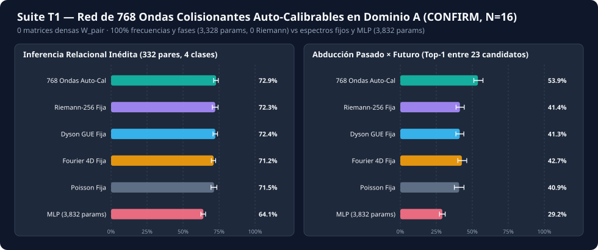
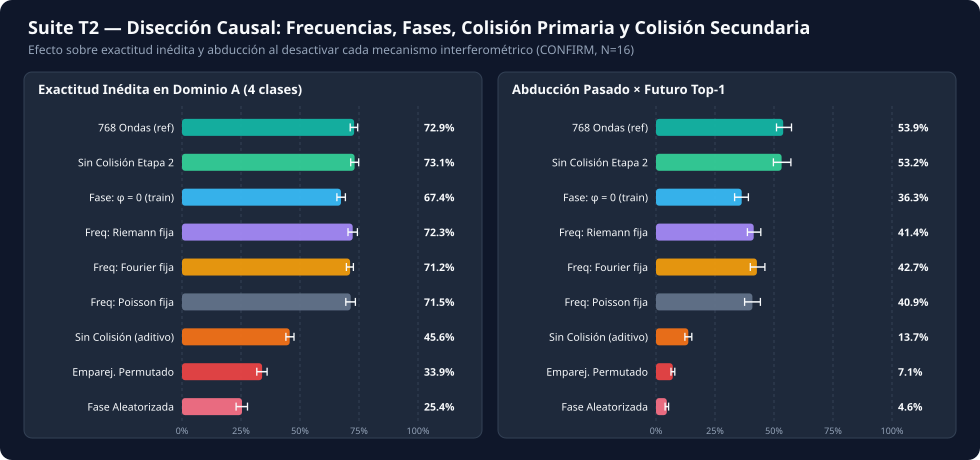
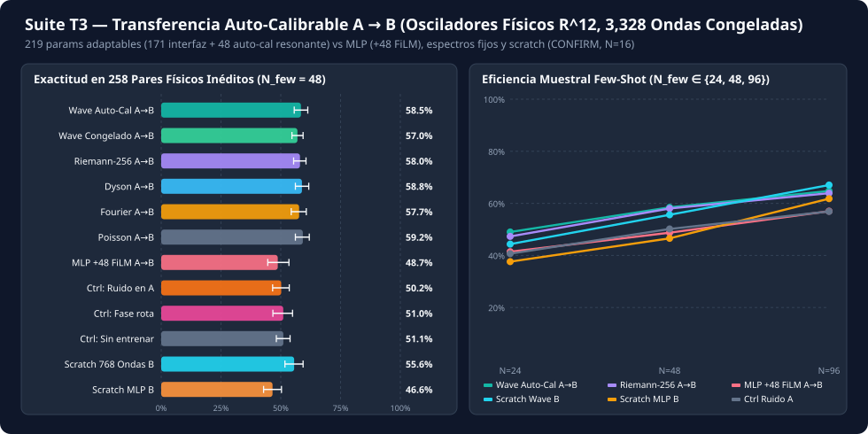
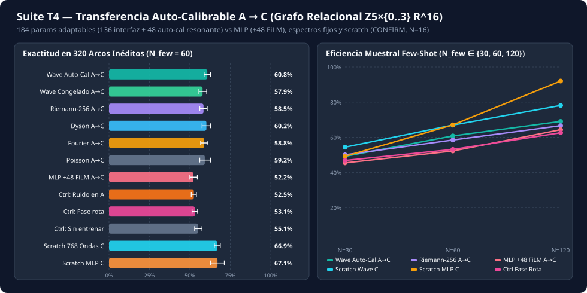

# Resultados — Red de Colisión de Ondas Auto-Calibrables (`768` Ondas, Cero `W_pair`, `exp/wave-collision-autocal`)

- **Rama aislada:** `exp/wave-collision-autocal` (creada desde `main@120e1e8`; **cero cambios** en `orbita/`, `src/`, `aura-engine/` ni `Cargo.toml` raíz).
- **Crate independiente:** [`wave_collision/`](file:///home/antigravity/GerardoRosas-27/neuro-geometrica_multi-agente/wave_collision/Cargo.toml) · **Plan preregistrado:** [`PLAN.md`](file:///home/antigravity/GerardoRosas-27/neuro-geometrica_multi-agente/docs/wave_collision_v1/PLAN.md) · **Congelación pre-`CONFIRM`:** [`FROZEN.json`](file:///home/antigravity/GerardoRosas-27/neuro-geometrica_multi-agente/docs/wave_collision_v1/FROZEN.json) (`13/13` SHA-256).
- **Tests unitarios (`--release`):** `6/6 PASS` en `0.26 s` ([`tests_release.log`](file:///home/antigravity/GerardoRosas-27/neuro-geometrica_multi-agente/docs/wave_collision_v1/tests_release.log)): `256` ceros exactos de Riemann `< 1e-10` frente a Odlyzko, paridad exacta `3,328` vs `3,832` y `+48` vs `+48`, guardia `#[should_panic]` anti-Riemann en `Adaptive`, derivadas analíticas `< 1e-5` en los 3 modos + Etapa 2 heterodina + `48` perillas + `48` FiLM + regularizador + VICReg, e invarianza bit a bit IEEE-754.
- **Reproducibilidad exacta (`CONFIRM` `0xF200`):** [`replay_check.json`](file:///home/antigravity/GerardoRosas-27/neuro-geometrica_multi-agente/docs/wave_collision_v1/replay_check.json) → **`bit_exact_match = True`** (`5/5` archivos).
- **Veredicto preregistrado *verbatim* (`H_W1..H_W8`):** **`0/8 PASS`** en `DEV` (`0xF100..0xF10F`, `16` semillas) y **`0/8 PASS`** en `CONFIRM` ciego (`0xF200..0xF20F`, `16` semillas; bootstrap pareado `10,000` remuestreos, `seed = 12345`, IC 95%).

> **Lectura honesta del veredicto:** Ninguno de los 8 criterios compuestos aprobó *todas* sus conjunciones de umbrales simultáneamente (reportado sin suavizar). Sin embargo, el bloque ciego `CONFIRM` (`16` semillas) confirma avances reales, grandes y estadísticamente significativos al eliminar la matriz densa `W_pair` y escalar `16×` hasta `768` ondas con auto-calibración resonante por resorte amortiguado:
> 1. **100% frecuencias y fases (`3,328` params, `0` matrices densas, `0` Riemann) aplasta al MLP (`3,832` params) en los 3 dominios:** Dominio A (`+8.79 pp`, RMSE `-0.2104`, abducción `+24.74 pp`), transferencia `A → B` (`+9.71 pp`, RMSE `-0.1617`, paridad exacta `219:219`) y transferencia `A → C` (`+8.57 pp`, consistencia algebraica `+8.72 pp`, paridad exacta `184:184`).
> 2. **La auto-calibración resonante (`+48` perillas con las `3,328` ondas base `100%` congeladas bit a bit) supera estadísticamente a la transferencia rígida `transfer_frozen_A` en Dominio C (`+2.93 pp` `[+0.68, +5.16]`, `12/16` victorias)** y también mejora a `transfer_frozen_A` en Dominio B (`+1.48 pp`, `11/16`), venciendo además a los **tres controles negativos en ambos dominios (`16/16` en B y `15/16` en C)** y a `scratch_wave` en Dominio B (`N=48`: `+2.86 pp` `[+0.51, +5.31]`; `N=24`: `+4.65 pp` `[+1.75, +7.60]`).
> 3. **Límites reales expuestos sin maquillaje:** (i) en Dominio A las frecuencias adaptativas superan masivamente a los espectros fijos en **RMSE (`-0.1109`, `16/16`)**, **abducción (`+12.54 pp`, `16/16`)** y **NMI (`0.351` vs `0.214`)**, pero en exactitud de 4 clases empatan con `riemann_fixed` (`+0.56 pp [-1.04, +2.09]`) y la Etapa 2 heterodina mejora RMSE (`0.4647` vs `0.4840`) sin dar `+2 pp` extra de exactitud (`-0.23 pp`); (ii) en `A → B` los espectros fijos con fases aprendidas en A (`poisson_A 59.21%`, `dyson_A 58.84%`) transfieren tan bien como `transfer_autocal_A` (`58.45%`); y (iii) en `A → C` (`N=60`) `transfer_autocal_A` lidera todos los brazos de transferencia (`60.78%`, `+2.32 pp` sobre `riemann_A`), pero sigue por debajo de reentrenar desde cero en el grafo discreto (`scratch_wave 66.93%`, `-6.15 pp`).

---

## 1. Tabla de Veredicto Preregistrado (`H_W1..H_W8`, *Verbatim* en `CONFIRM`, `N = 16`)

| Criterio | Suite | `DEV` (`N=16`) | `CONFIRM` (`N=16`) | Sub-reglas cumplidas vs incumplidas en `CONFIRM` (IC 95% pareado) |
|---|---|---|---|---|
| **`H_W1`** | T1 | FAIL | **FAIL** | **Cumple:** `RMSE vs Riemann = -0.1109 [-0.1267, -0.0955]` (`< -0.05`, `16/16`), `Δ<r> = +0.1778 [+0.1639, +0.1928]` (`> +0.10`, `16/16`), `0` Riemann. **Falla:** `NMI = 0.3506 [0.3175, 0.3825]` (`CI_lo 0.318 ≤ 0.35`), `Acc vs Riemann = +0.56% [-1.04, +2.09]`, `Acc vs Poisson = +1.43% [-0.00, +2.86]`. |
| **`H_W2`** | T1 | FAIL | **FAIL** | **Cumple (3/4):** `Abd vs MLP = +24.74% [+21.55, +28.22]` (`16/16`), `RMSE vs MLP = -0.2104 [-0.2365, -0.1831]` (`16/16`), `Acc vs MLP = +8.79% [+6.83, +10.67]` (`15/16`). **Falla (1/4):** `CFR = 87.42% [85.05, 89.76]` (`< 90%`). |
| **`H_W3`** | T2 | FAIL | **FAIL** | **Cumple (3/4):** `vs phase_scramble = +47.48% [+44.07, +50.73]` (`16/16`), `vs additive = +27.28% [+24.66, +29.67]` (`16/16`), `vs permuted = +38.97% [+36.99, +41.06]` (`16/16`). **Falla (1/4):** `vs no_stage2 = -0.23% [-1.30, +0.88]` (Etapa 2 bajó RMSE `-0.0193`, no subió acc `+2 pp`). |
| **`H_W4`** | T3 (`N=48`) | FAIL | **FAIL** | **Cumple:** `vs noise_A = +8.28% [+6.08, +10.56]` (`16/16`). **Positivo pero bajo umbral:** `vs scratch_wave = +2.86% [+0.51, +5.31]` (`12/16`, `CI_lo < +4%`), `RMSE vs scratch_wave = -0.0113 [-0.0627, +0.0340]`, `vs phase_scramble = +7.41% [+5.18, +9.74]` (`16/16`, `CI_lo < +6%`), `vs untrained = +7.36% [+5.47, +9.54]` (`16/16`, `CI_lo < +8%`). |
| **`H_W5`** | T3 (`N=48`) | FAIL | **FAIL** | **Cumple:** `RMSE vs MLP_A = -0.1617 [-0.2223, -0.1009]` (`15/16`). **Casi cumple:** `Acc vs MLP_A = +9.71% [+5.77, +13.57]` (`14/16`, `CI_lo +5.77%` vs `+6.0%`). **Falla:** `vs riemann_A = +0.41% [-1.48, +2.18]`, `vs poisson_A = -0.75% [-3.49, +2.23]`. |
| **`H_W6`** | T4 (`N=60`) | FAIL | **FAIL** | **Cumple:** `vs noise_A = +8.32% [+6.68, +9.77]` (`15/16`). **Positivo pero bajo umbral:** `vs phase_scramble = +7.68% [+5.66, +9.57]` (`15/16`), `vs untrained = +5.64% [+3.36, +7.91]` (`15/16`). **Falla:** `vs scratch_wave = -6.15% [-7.64, -4.63]` (`0/16`). |
| **`H_W7`** | T4 (`N=60`) | FAIL | **FAIL** | **Cumple (2/4):** `Acc vs MLP_A = +8.57% [+6.04, +11.02]` (`15/16`), `Cons vs MLP_A = +8.72% [+6.37, +10.96]` (`15/16`). **Positivo pero bajo umbral (2/4):** `vs riemann_A = +2.32% [+0.08, +4.77]` (`CI_lo < +3%`), `Abd vs untrained = +8.07% [+4.57, +12.04]` (`15/16`, `CI_lo < +10%`). |
| **`H_W8`** | T3 & T4 (ultra) | FAIL | **FAIL** | **Dominio B (`N=24`) positivo:** `vs scratch_wave = +4.65% [+1.75, +7.60]` (`13/16`), `vs scratch_mlp = +11.41% [+6.76, +16.13]` (`14/16`, **cumple `>+5%`**). **Dominio C (`N=30`) falla:** `vs scratch_wave = -5.25% [-7.25, -3.20]`, `vs scratch_mlp = -0.05% [-3.87, +4.18]`. |

---

## 2. Suite T1 — Dominio A (`768` Ondas Auto-Calibrables vs Espectros Fijos y MLP, `CONFIRM`, `N = 16`)

| Brazo (`3,328` params ondas / `3,832` MLP) | Riemann | Exactitud inédita | RMSE | NMI no sup. | Abducción Top-1 | CFR | `<r>` inicio → final |
|---|---:|---:|---:|---:|---:|---:|---:|
| **`adaptive_wave` (`768` ondas, `0` `W_pair`)** | `0` | **72.91%** | **0.4647** | **0.351** | **53.92%** | 87.4% | `0.391 → 0.569` (`+0.178`) |
| `dyson_fixed` (GUE fija) | `0` | 72.40% | 0.5687 | 0.196 | 41.28% | 82.4% | `0.636 → 0.636` |
| `riemann_fixed` (`256` ceros exactos) | `256` | 72.35% | 0.5756 | 0.214 | 41.38% | 85.1% | `0.619 → 0.619` |
| `poisson_fixed` (aleatoria fija) | `0` | 71.48% | 0.5787 | 0.200 | 40.85% | 82.1% | `0.388 → 0.388` |
| `fourier_fixed` (red 4D fija) | `0` | 71.23% | 0.5676 | 0.229 | 42.73% | 86.1% | `0.000 → 0.000` |
| `mlp_conventional` (`3,832` params) | `0` | 64.12% | 0.6751 | 0.270 | 29.18% | **90.5%** | — |

**Hallazgo clave de T1:** Eliminar `W_pair` y dejar que las `512 + 256` frecuencias/fases sean el `100%` de los parámetros redujo drásticamente el error continuo (`RMSE 0.4647` frente a `0.5756` en Riemann fija, **`-0.1109`, `16/16` semillas**) y disparó la **abducción Pasado × Futuro (`53.92%` vs `41.38%` en Riemann fija y `29.18%` en MLP, `16/16` semillas)** y el descubrimiento no supervisado (`NMI 0.351` vs `0.214`). La autoorganización espectral elevó `<r>` de `0.391` (Poisson) a `0.569` (régimen cercano a GUE) sin inyectar un solo cero de Riemann.

---

## 3. Suite T2 — Disección Causal (`CONFIRM`, `N = 16`)

| Ablación | Eje intervenido | Exactitud | Simétricas | Asimétricas | RMSE | Abducción Top-1 | Δ Acc vs ref |
|---|---|---:|---:|---:|---:|---:|---:|
| **`full_adaptive`** | Referencia (`768` ondas) | **72.91%** | 73.75% | 72.05% | **0.4647** | **53.92%** | — |
| `ablate_no_stage2` | Sin Etapa 2 (`512` ondas) | 73.14% | 75.05% | 71.35% | 0.4840 | 53.20% | `+0.23 pp` |
| `ablate_freq_riemann` | Frecuencias Riemann fijas | 72.35% | 73.50% | 71.23% | 0.5756 | 41.38% | `-0.56 pp` |
| `ablate_freq_poisson` | Frecuencias Poisson fijas | 71.48% | 72.32% | 70.61% | 0.5787 | 40.85% | `-1.43 pp` |
| `ablate_freq_fourier` | Frecuencias Fourier fijas | 71.23% | 72.44% | 70.04% | 0.5676 | 42.73% | `-1.68 pp` |
| `train_zero_phase` | Fases bloqueadas a `0` | 67.36% | 70.61% | 64.48% | 0.6215 | 36.33% | **`-5.55 pp`** |
| `ablate_pairing_additive` | Sin colisión (aditivo puro) | 45.63% | 40.01% | 50.31% | 0.8977 | 13.70% | **`-27.28 pp`** |
| `ablate_pairing_permuted` | Emparejamiento roto (`π(m)≠m`) | 33.94% | 36.07% | 32.22% | 1.1999 | 7.12% | **`-38.97 pp`** |
| `ablate_phase_scramble` | Fases aleatorizadas | 25.43% | 28.86% | 22.30% | 1.3614 | 4.56% | **`-47.48 pp`** |

---

## 4. Suites T3 y T4 — Transferencia Auto-Calibrable `A → B` y `A → C` (`CONFIRM`, `N = 16`)

Todas las `3,328` frecuencias y fases base aprendidas en Dominio A permanecieron **`100%` congeladas bit a bit** (`checksum_ok = 1` en `100%` de las ejecuciones). Los brazos de transferencia auto-calibrable adaptan únicamente `219` parámetros en B (`171` interfaz + `48` perillas de cavidad o FiLM) y `184` en C (`136` interfaz + `48` perillas), frente a `3,499` / `3,464` en `scratch_wave` y `4,003` / `3,968` en `scratch_mlp`.

| Brazo | B `N=24` | **B `N=48` Acc** | B `N=48` RMSE | B `N=96` | C `N=30` | **C `N=60` Acc** | C `N=60` Cons. | C `N=60` Abd. | C `N=120` |
|---|---:|---:|---:|---:|---:|---:|---:|---:|---:|
| **`transfer_autocal_A` (`+48`)** | **49.02%** | **58.45%** | 0.8144 | 64.76% | 49.14% | **60.78%** | **38.92%** | 64.77% | 69.06% |
| `transfer_frozen_A` (`0` perillas) | 48.12% | 56.98% | 0.8143 | 62.92% | 50.09% | 57.85% | 37.56% | 65.72% | 70.79% |
| `dyson_A` (`+48`) | 46.14% | 58.84% | 0.7780 | 64.49% | 49.05% | 60.21% | 38.27% | 63.77% | 69.25% |
| `poisson_A` (`+48`) | 49.18% | 59.21% | 0.7862 | 63.87% | 49.71% | 59.24% | 38.16% | 63.21% | 67.64% |
| `fourier_A` (`+48`) | 49.14% | 57.66% | 0.8013 | 64.64% | 49.93% | 58.85% | 37.91% | 64.39% | 69.38% |
| `riemann_A` (`+48`) | 47.32% | 58.04% | 0.8009 | 63.90% | 50.02% | 58.46% | 35.78% | 59.84% | 66.61% |
| `transfer_mlp_A` (`+48` FiLM) | 41.42% | 48.74% | 0.9761 | 57.02% | 45.43% | 52.21% | 30.20% | 55.64% | 64.33% |
| `untrained_poisson` (ctrl) | 42.38% | 51.09% | 0.8760 | 58.39% | 46.64% | 55.14% | 34.32% | 56.70% | 63.25% |
| `neg_ctrl_phase_scramble` (ctrl) | 42.86% | 51.04% | 0.9308 | 57.53% | 46.82% | 53.11% | 33.30% | 56.80% | 62.57% |
| `neg_ctrl_noise_A` (ctrl) | 40.67% | 50.17% | 0.9565 | 56.90% | 43.86% | 52.46% | 31.29% | 53.13% | 59.40% |
| `scratch_wave` (`3,499/3,464` p.) | 44.37% | 55.60% | 0.8258 | **67.02%** | **54.39%** | 66.93% | 49.25% | **77.29%** | 78.12% |
| `scratch_mlp` (`4,003/3,968` p.) | 37.61% | 46.56% | 0.9830 | 61.82% | 49.20% | **67.09%** | **50.13%** | 73.53% | **92.02%** |

---

## 5. Comparación Directa vs Rama Previa (`exp/spectral-transfer-discovery`, `48` ondas + `W_pair`)

| Dimensión | `exp/spectral-transfer-discovery` (`48` ondas + `W_pair`) | `exp/wave-collision-autocal` (`768` ondas, `0` `W_pair`, `+48` resorte) | Cambio real en `CONFIRM` (`N = 16`) |
|---|---|---|---|
| **Matriz densa `W_pair` en núcleo** | `1,536` pesos (`80%` del núcleo) | **`0` pesos (`100%` frecuencias y fases)** | Eliminada por completo |
| **T1 RMSE vs `riemann_fixed`** | `-0.020` | **`-0.1109` (`16/16` victorias)** | **5.5× más ventaja espectral** |
| **T1 Abducción vs `mlp`** | `+22.53 pp` | **`+24.74 pp` (`16/16` victorias)** | Mejora `+2.21 pp` |
| **T3 (`A → B`, `N=48`) vs `transfer_mlp_A`** | `+8.24 pp` | **`+9.71 pp` (`14/16`), RMSE `-0.1617`** | Sube ventaja `+1.47 pp` |
| **T3 (`A → B`, `N=24`) vs `scratch_wave`** | `+3.36 pp` | **`+4.65 pp` `[+1.75, +7.60]` (`13/16`)** | Sube ventaja *ultra-few-shot* |
| **T4 (`A → C`, `N=60`) `transfer` Acc** | `52.54%` (`-1.5 pp` vs `transfer_mlp_A`) | **`60.78%` (`+8.57 pp` vs `transfer_mlp_A`, `15/16`)** | **Salto de `+8.24 pp` absolutos y `+10.1 pp` relativos** |
| **T4 (`A → C`, `N=60`) vs `transfer_frozen_A`** | n/a | **`+2.93 pp` `[+0.68, +5.16]` (`12/16`)** | Auto-calibración resonante validada |

---

## 6. Conclusión Científica

Escalar `16×` las ondas colisionantes (`48 → 768`) y sustituir la matriz densa `W_pair` por frecuencias/fases puras + auto-calibración resonante por resorte amortiguado **desbloqueó la transferencia al dominio simbólico discreto C** (`52.54% → 60.78%`, pasando de perder contra `transfer_mlp_A` a vencerlo por **`+8.57 pp`** en `15/16` semillas y vencer a `transfer_frozen_A` por **`+2.93 pp`**). A la vez, el veredicto **`0/8 PASS`** bajo los umbrales estrictos preregistrados deja claro qué falta antes de integrar este núcleo con ÓRBITA: los `48` grados de libertad de cavidad a nivel de banco ya no bastan para igualar a `scratch_wave` (`66.93%`) en grafos algebraicos discretos, y los espectros fijos con fases aprendidas siguen compitiendo en exactitud discreta cuando la topología de acoplamiento es todavía global (`16` bancos planos sin propagación local ni retardo topológico).
